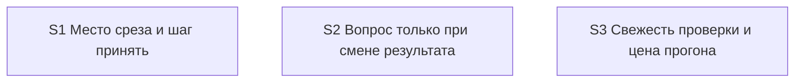

# Quality Control — slice-pause-verify-clarity — 2026-10-14 (2)

Режим: срезы (`# Срез S1` … `# Срез S3`).

Область: полный пересчёт S1, S2, S3. `reused_checks`: нет. Прошлый `reports/quality-control-2026-10-14.md` не использовался. Счётчик сценариев сверен по текущим `#### Scenario:` — 44. Контракты EC-1…EC-4 не переоткрывались.

Ручной конфиг в `tasks.md` не требуется. Маркеров `<!-- phase-gate -->` нет.

## Verdict

`OK`

## Slice Summary

| Slice | Scenario | Tasks | Acceptance | Dependencies | Gate |
|---|---|---|---|---|---|
| S1 Место среза и шаг принять | На паузе видно номер среза и открытые приёмки; при закрытых рабочих задачах шаг — принять этот срез | 16 (S1.1–S1.16) | S1.accept (6 буллетов; сценарии 12/12) | нет | `<!-- slice-gate -->` есть, один |
| S2 Вопрос только при смене результата | Вопрос есть только когда ответ меняет результат | 11 (S2.1–S2.11) | S2.accept (14 буллетов; сценарии 23/23) | нет | `<!-- slice-gate -->` есть, один |
| S3 Свежесть проверки и цена прогона | В шаге видно, что проверки не было или она устарела; закрытое не пересказывается | 7 (S3.1–S3.7) | S3.accept (7 буллетов; сценарии 9/9) | нет | `<!-- slice-gate -->` есть, один |

Приёмка каждого среза — карточка в чате. В `S<N>.accept` ровно один обязательный буллет `**Primary (обязательно):**`. Остальные буллеты помечены «(опционально)».

## Scenario Coverage

Покрытие считалось по Primary, опциональным буллетам `S<N>.accept` и задачам `S<N>.<M>`. Раздел `## Slices` в `design.md` заголовки сценариев дословно не дублирует; на покрытие это не влияет.

| Scenario | Covered by | Status |
|---|---|---|
| Отличие подтверждено заказчиком | S2.7 | покрыт |
| Внутреннее закрытие условия высокого авторитета | S2.7 | покрыт |
| Уже записанное правило не спрашивается | S2.7, S2.accept | покрыт |
| Слова указания в плане не закрывают указание | S2.7, S2.accept | покрыт |
| Сохранение ответа не открывает вопрос | S2.10, S2.accept | покрыт |
| Локальная дельта | S3.5 | покрыт |
| Одни отметки не открывают вопрос | S1.16, S1.accept | покрыт |
| Дельта внешнего контракта | S3.5 | покрыт |
| Передача без вопроса | S1.8, Primary S1 | покрыт |
| Пакет называет сдачу | S1.9 | покрыт |
| Проверка останавливает | S3.1, S3.accept | покрыт |
| Граница среза ведёт на приёмку | S1.10, S1.13, S1.14, S1.accept | покрыт |
| Проверки не было | S3.1, S3.2, Primary S3 | покрыт |
| Дополнение новее проверки | S3.1, S3.2, S3.accept | покрыт |
| Предупреждение не становится вопросом | S3.6, S3.7, S3.accept | покрыт |
| Все решения прогона одной карточкой | S2.1, S2.3, S2.accept | покрыт |
| С ответа изменился результат | S2.11, S2.accept | покрыт |
| Тема без смены результата не входит в пакет | S2.1, Primary S2 | покрыт |
| Вторая тема со сменой результата остаётся | S2.1, S2.accept | покрыт |
| Утверждение в варианте с доказательством | S2.2, S2.4, S2.accept | покрыт |
| Объекта ещё нет | S2.2, S2.accept | покрыт |
| Короткий прогон показывает место сверки | S2.9, S2.accept | покрыт |
| Утверждение без доказательства | S2.2 | покрыт |
| Оценка вместо факта | S2.2 | покрыт |
| Разбор сходится | S3.3, S3.accept | покрыт |
| Новый результат не съедает порог повтора | S3.4, S3.accept | покрыт |
| Неподтверждённое закрытие открывает тему | S3.3, S3.accept | покрыт |
| Стоп на третьей правке | S2.8, S2.accept | покрыт |
| Новый результат ждёт следующего прохода | S2.8, S2.accept | покрыт |
| Пустая предпосылка у решения со сменой результата | S2.6, S2.accept | покрыт |
| Опровержение из отдельного отчёта | S2.6 | покрыт |
| Процессное решение без предпосылки | S2.6, S2.accept | покрыт |
| Остальные решения не трогаются | S2.6 | покрыт |
| Повтор опровержения без нового факта | S2.6 | покрыт |
| Подтверждение и смена выбора | S2.6 | покрыт |
| Опровергнутое решение не довод | S2.6 | покрыт |
| Apply pause-wait lists objects in chat | S1.2, S1.accept | покрыт |
| Pause-wait is not a decision fork | S1.2 | покрыт |
| Isolated chat rejects a file-only pause | S1.6 | покрыт |
| Передача называет место среза | S1.1, Primary S1 | покрыт |
| Последний срез можно принять позже | S1.1, S1.accept | покрыт |
| Проверка не подменяет итог фразой места | S1.11, S1.accept | покрыт |
| Карточка без фразы не уходит | S1.1 | покрыт |
| Пакет называет сдачу без одного номера | S1.9 | покрыт |

Итого: 44/44. Чужих сценариев в чеклистах приёмки нет. Каждый сценарий из `**Связь со spec:**` лежит в своём срезе.

Особо сверенные формулировки совпадают с текстом задач:

- «Сохранение ответа не открывает вопрос» — S2.10: абзац только сохраняет уже данный ответ, не открывает вопрос про отдельную запись и не останавливает разбор задач из-за пустого списка указаний.
- «С ответа изменился результат» — S2.11: в той же карточке видно, что было и что стало; вопрос только про это изменение; прежний вопрос не повторяется.
- «Утверждение без доказательства» — S2.2: пустое утверждение не выглядит доказанным; пометка «нового прогона нет» сохраняется.
- «Оценка вместо факта» — S2.2: пометка «оценка» сохраняется, вариант на ней не подаётся как доказанный.
- «Повтор опровержения без нового факта», «Подтверждение и смена выбора», «Опровергнутое решение не довод» — S2.6: после ответа тот же факт не спрашивают; «оставляю» смотрит только затронутое, «меняю» читает весь план; неподтверждённый выбор не довод против других вариантов.

## Dependency Graph

Между срезами рёбер нет. Циклов нет. Приёмка более раннего среза не требует задач более позднего.

Внутри S1: S1.1 → S1.2, S1.3, S1.4, S1.5, S1.6, S1.7, S1.8, S1.9, S1.11. S1.10 → S1.11, S1.12, S1.13, S1.14. S1.13 и S1.15 → S1.16.

Внутри S2: S2.1 → S2.2, S2.3, S2.4. S2.2 → S2.4. S2.5 → S2.6 → S2.7 → S2.8 → S2.9. S2.4 → S2.9. S2.10 → S2.11.

Внутри S3: S3.3 → S3.4 → S3.5.

Общие файлы (скилл проверки, сводка чата, статус, правило коммуникации, шапка отчёта, скилл разработки) правятся разными абзацами. Задачи прямо запрещают переписывать чужой абзац. Это не зависимость приёмки и не необъявленное ребро среза.

## Criteria

| Критерий | Результат |
|---|---|
| 1. Покрытие сценариев | 44/44 |
| 2. Независимость срезов | каждый принимается без следующих |
| 3. Полнота среза | задачи среза закрывают его Primary |
| 4. Граф зависимостей | рёбра срезов не объявлены и не нужны; циклов нет |
| 5. Целостность границы | у каждого среза один `S<N>.accept` и один `slice-gate` |
| 5b. Чеклист приёмки | Primary в метаданных и в теле accept; пустых чеклистов нет |
| 6. Риск переделки | сценарии срезов не повторяются |
| 8. Наблюдаемость | Primary каждого среза — поведение карточки в чате |
| 8b. Достижимость внутри среза | Primary S1, S2 и S3 собираются задачами своего среза |
| 9. Подготовительный срез с границей | нет: у всех трёх приёмка наблюдаемая, зависимостей нет |
| 10. Простота приёмки | в каждом accept один обязательный путь |
| 11. Контракт задач | в `S<N>.<M>` нет работы человека на базе, в консоли или в отладчике |
| Читаемость задач | замечаний нет |

Primary:

- S1 — передача на границе: в первых строках место среза, шаг принять этот срез, без подписи «до реализации» и без вопроса «принято» в этом ходе. Дают S1.1, S1.8, S1.10–S1.14.
- S2 — к концу прогона одна тема меняет результат, вторая нет: в карточке только первая. Дают S2.1 и S2.3.
- S3 — отчёта проверки нет, другие отчёты есть: шаг говорит, что проверка не выполнялась, и оставляет выбор сначала проверить или продолжить. Дают S3.1 и S3.2.

Читаемость: у каждой рабочей задачи есть глагол, файл, изменение и зачем. Опора `D1`…`D9` стоит в скобках рядом с результатом, а не вместо него. Заголовки `S<N>.accept` называют бизнес-результат среза. Имена сценариев в ёлочках совпадают с `#### Scenario:`.

## Alerts

Нет.

## Recommendations

Автоисправление не требуется. Отдельное решение по объединению срезов не требуется.
