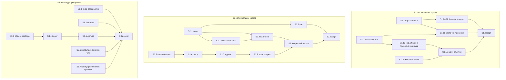

# Quality Control — Slice Coherence

- change: `slice-pause-verify-clarity`
- date: 2026-10-14
- mode: slice (`tasks.md` содержит `# Срез S1`, `# Срез S2`, `# Срез S3`)
- delta: полный пересчёт — `changed_slices: all` (cache miss); `linked_scenarios`: все `#### Scenario:` из `specs/`; `deterministic_results: none`; `affected_contract_ids: none`; `reused_checks: none`
- criteria evaluated: 1, 2, 3, 4, 5, 5b, 6, 7, 8, 8b, 9, 10, 11
- new findings: полный прогон текущего текста. Кэша нет, повторно использованных проверок нет
- out of scope: исполнимость приёмки прямо сейчас на информационной базе; тестовые данные. Поручение пользователю на прогон посередине среза — в охвате

Источники: `tasks.md`, `design.md` § Slices, `proposal.md`, четыре дельты `specs/**/spec.md` (37 `#### Scenario:`). Ручной чеклист конфигуратора: нет. Механические замечания: нет (три среза, у каждого одна приёмка и один обязательный путь). Предпроверка поручений пользователю: нет, перепроверена чтением рабочих задач `S*.*`. Репозиторий: правка существующих текстов kit, новых объектов нет.

`no-slices` не выпускается. `deprecated-phase-gate` не выпускается: маркера фаз нет. `legacy-acceptance-format` не выпускается: приёмка у каждого среза одна, старых пунктов `S<N>.T*` нет.

Объём — 32 рабочие задачи и 3 приёмки. Это полный размер. Три среза держатся, потому что у каждого свой видимый итог в чате, и каждый можно принять, не начиная остальные. Так записано в `design.md` § Slices: зависимостей между срезами нет, общие файлы правятся разными абзацами.

## Verdict

`OK`

Три среза принимаются по отдельности. Обязательный ход у каждого один и достижим задачами того же среза. Остальные сценарии дельт закрыты необязательным пунктом приёмки или текстом рабочей задачи. Объединять срезы нечего. Покрытие, ворота, зависимости и поручения пользователю посередине среза в порядке.

## Slice Summary

| Slice | Scenario | Tasks | Acceptance | Dependencies | Gate |
|---|---|---|---|---|---|
| S1: Место среза и шаг принять | На паузе в первых строках видно номер среза и открытые приёмки; при закрытых рабочих задачах шаг — принять этот срез | S1.1–S1.16 | `S1.accept` (1 обязательный + 5 необязательных; связь 12/12) | нет | есть |
| S2: Вопрос только при смене результата | Вопрос есть только когда ответы меняют результат | S2.1–S2.9 | `S2.accept` (1 обязательный + 11 необязательных; связь 16/16) | нет | есть |
| S3: Свежесть проверки и цена прогона | В шаге видно, что проверки не было или она устарела; закрытое не пересказывается | S3.1–S3.7 | `S3.accept` (1 обязательный + 6 необязательных; связь 9/9) | нет | есть |

Дробь связи — сценарии из `**Связь со spec:**`. Все 37 заголовков `#### Scenario:` распределены по полям связи без пересечения: S1 — 12, S2 — 16, S3 — 9.

`**Primary acceptance:**`, подпункт `**Primary (обязательно):**` и колонка Primary в `design.md` § Slices совпадают дословно у всех трёх срезов.

- S1. Обязательный ход — одна передача: рабочие задачи закрыты, приёмка открыта, поздние срезы не начаты, пакета нет. В первых строках номер и открытые приёмки, либо что срез последний; шаг — принять этот срез, без подписи «до реализации» и без вопроса «принято» в этом ходе. Пять необязательных пунктов называют сценарии буквально. Ещё семь сценариев связи закрыты задачами S1.1, S1.2, S1.6, S1.8, S1.9 (имена в тексте задач).
- S2. Обязательный ход совпадает со сценарием «Тема без смены результата не входит в пакет». Одиннадцать необязательных пунктов называют остальные видимые ветки пакета, доказательства, стопа и предпосылки. Четыре сценария связи в чеклист не вынесены и закрыты S2.6 и S2.7: «Отличие подтверждено заказчиком», «Внутреннее закрытие условия высокого авторитета», «Опровержение из отдельного отчёта», «Остальные решения не трогаются».
- S3. Обязательный ход совпадает со сценарием «Проверки не было». Шесть необязательных пунктов называют остановку, дополнение, предупреждение и цену разбора. «Локальная дельта» и «Дельта внешнего контракта» закрыты S3.5.

## Scenario Coverage

Все 37 сценариев закрыты. Дыр нет.

| Scenario | Covered by | Status |
|---|---|---|
| Apply pause-wait lists objects in chat | S1.2; необязательный пункт | OK |
| Pause-wait is not a decision fork | S1.2 | OK |
| Isolated chat rejects a file-only pause | S1.6 | OK |
| Передача называет место среза | S1.1; обязательный ход | OK |
| Последний срез можно принять позже | S1.1; необязательный пункт; ветка «либо» обязательного хода | OK |
| Проверка не подменяет итог фразой места | S1.11; необязательный пункт | OK |
| Карточка без фразы не уходит | S1.1 | OK |
| Пакет называет сдачу без одного номера | S1.9 | OK |
| Передача без вопроса | S1.8; обязательный ход | OK |
| Пакет называет сдачу | S1.9 | OK |
| Граница среза ведёт на приёмку | S1.10; необязательный пункт; обязательный ход | OK |
| Одни отметки не открывают вопрос | S1.15, S1.16; необязательный пункт | OK |
| Отличие подтверждено заказчиком | S2.7 | OK |
| Внутреннее закрытие условия высокого авторитета | S2.7 | OK |
| Уже записанное правило не спрашивается | S2.7; необязательный пункт | OK |
| Слова указания в плане не закрывают указание | S2.7 (прямое указание без парной записи остаётся вопросом); необязательный пункт | OK |
| Все решения прогона одной карточкой | S2.1, S2.3; необязательный пункт | OK |
| Тема без смены результата не входит в пакет | S2.1; обязательный ход | OK |
| Вторая тема со сменой результата остаётся | S2.1; необязательный пункт | OK |
| Утверждение в варианте с доказательством | S2.2, S2.4; необязательный пункт | OK |
| Объекта ещё нет | S2.2; необязательный пункт | OK |
| Короткий прогон показывает место сверки | S2.9; необязательный пункт | OK |
| Стоп на третьей правке | S2.8; необязательный пункт | OK |
| Новый результат ждёт следующего прохода | S2.8; необязательный пункт | OK |
| Пустая предпосылка у решения со сменой результата | S2.5, S2.6; необязательный пункт | OK |
| Опровержение из отдельного отчёта | S2.6 | OK |
| Процессное решение без предпосылки | S2.6; необязательный пункт | OK |
| Остальные решения не трогаются | S2.6 | OK |
| Проверка останавливает | S3.1; необязательный пункт | OK |
| Проверки не было | S3.1, S3.2; обязательный ход | OK |
| Дополнение новее проверки | S3.1, S3.2; необязательный пункт | OK |
| Предупреждение не становится вопросом | S3.6, S3.7; необязательный пункт | OK |
| Локальная дельта | S3.5 | OK |
| Дельта внешнего контракта | S3.5 | OK |
| Разбор сходится | S3.3; необязательный пункт | OK |
| Новый результат не съедает порог повтора | S3.4; необязательный пункт | OK |
| Неподтверждённое закрытие открывает тему | S3.3; необязательный пункт | OK |

Имена в необязательных пунктах и в строках `Scenario «…»` задач совпадают с заголовками `#### Scenario:` буквально. Чужого сценария в чеклисте нет: пункт приёмки ссылается только на сценарий из `**Связь со spec:**` своего среза.

Обязательный ход S1 содержит ветку «либо что срез последний». Это та же передача: если поздних срезов нет, фраза говорит, что срез последний. Отдельный заголовок этой ветки стоит необязательным пунктом. Это не второй обязательный проход.

## Dependency Graph

- Рёбер между срезами нет. Циклов нет. Приёмка `S<N>` не требует задач `S<N+1>`.
- В метаданных всех трёх срезов: **Зависимости:** нет. Объявленные цели отсутствуют, потому что рёбер нет — несоответствия нет.
- Внутри среза рёбра только назад, и все цели существуют.
  - S1: S1.2–S1.9 от S1.1; S1.11 от S1.1 и S1.10; S1.12–S1.14 от S1.10; S1.16 от S1.13 и S1.15. S1.10 и S1.15 входящих не имеют.
  - S2: S2.2 и S2.3 от S2.1; S2.4 от S2.1 и S2.2; S2.6 от S2.5; S2.7 от S2.6; S2.8 от S2.7; S2.9 от S2.4 и S2.8.
  - S3: S3.4 от S3.3; S3.5 от S3.4. S3.1, S3.2, S3.6, S3.7 входящих не имеют.
- Приёмка своих зависимостей не объявляет и стоит последней задачей среза. Для обязательного хода хватает задач того же среза; остальные задачи закрывают необязательные пункты и соседние файлы.
- Общие файлы не заведены как зависимость среза. Задачи заранее расходятся по абзацам и пишут, какой абзац не переписывать: `openspec-verify-change/SKILL.md` (S1.13, S1.16, S2.6–S2.9, S3.3–S3.5), `templates/chat-summary.md` (S1.12, S2.3, S3.6), `templates/report-header.md` (S1.15, S2.5), `openspec-apply-change/SKILL.md` (S1.8, S3.1), `openspec-status/SKILL.md` (S1.14, S3.2), `verify-user-communication.mdc` (S1.10, S3.7). Приёмка одного среза от текста другого не зависит.

## Checklist Results

| # | Criterion | Result |
|---|---|---|
| 1 | Scenario Coverage | Pass — 37/37. Каждый `#### Scenario:` закрыт обязательным ходом, необязательным пунктом или рабочей задачей своего среза. Отдельный срез на сценарий заведён только там, где итог в чате принимается сам |
| 2 | Slice Independence | Pass — у трёх срезов зависимости «нет». Принять S1 можно без S2 и S3, S2 без S1 и S3, S3 без S1 и S2. Вперёд приёмка не смотрит |
| 3 | Slice Completeness | Pass — слои 1С не требуются: продукт этого изменения — карточка в чате. S1: хозяин фразы S1.1, передача S1.8, шаг «принять этот срез» S1.10 и S1.12–S1.14. S2: состав пакета S2.1, чат без своей копии S2.3. S3: вход разработки S3.1 и снимок S3.2. Пропущенного слоя для обязательного хода нет |
| 4 | Slice Dependency Graph | Pass — межсрезовых рёбер нет, внутренние рёбра существуют и не зациклены, целей «вперёд» нет |
| 5 | Slice Gate Integrity | Pass — у S1, S2 и S3 ровно один `S<N>.accept` и ровно один `<!-- slice-gate -->` |
| 5b | Acceptance Checklist Coverage | Pass — колонка Primary и обязательный подпункт есть у всех трёх, пустого чеклиста нет, сценарий дельты нигде не потерян, чужого сценария в чеклисте нет |
| 6 | Rework Risk | Pass — срез не опирается на непринятый предыдущий, один и тот же сценарий двум срезам не отдан. Соседние темы «новый результат ждёт следующего прохода» (S2) и «новый результат не съедает порог повтора» (S3) — разные наблюдаемые исходы. Общие файлы разведены абзацами |
| 7 | Task Readability | Pass — у S1.1–S1.16, S2.1–S2.9, S3.1–S3.7 в формулировке глагол, путь файла и результат для человека; ссылка D1–D9 не заменяет текст. Короче восьми слов задач нет. Заголовок каждой приёмки называет результат среза. Имена сценариев в пунктах не перефразированы |
| 8 | Slice Verticality | Pass — обязательный ход каждого среза читается в чате: передача с номером среза и шагом принять; одна карточка только с темой, которая меняет результат; шаг говорит, что проверки не было, и оставляет выбор проверить или продолжить. Это не вызов функции и не сверка diff. Сверка текста — работа агента в `S<N>.<M>` |
| 8b | Self-Achievable Acceptance | Pass — обязательный ход S1 дают S1.1, S1.8 и S1.10 вместе с S1.12–S1.14; ход S2 дают S2.1 и S2.3; ход S3 дают S3.1 и S3.2. Совпадающего хода у соседа нет. Объединять нечего |
| 9 | Foundation slice with gate | Pass — у каждого среза обязательный ход виден в чате. Пары «подготовка без видимого итога → потребитель с воротами» нет |
| 10 | Acceptance Simplicity | Pass — в теле каждой приёмки один подпункт без пометки «опционально». Остальные пункты помечены «опционально»: S1 — 5, S2 — 11, S3 — 6. Ветка «либо последний срез» внутри хода S1 — та же передача, не второй обязательный проход |
| 11 | User Task Contract | Pass — в строках `S1.1`–`S1.16`, `S2.1`–`S2.9`, `S3.1`–`S3.7` нет поручения на тестовую базу, стенд, консоль, отладчик, вызов интерфейса, спайк и нет цепочки «после проверки» / «после стенда». Приёмка — карточка в чате, на границе среза |

## Alerts

Нет.

## Recommendations

**Автоправка**

Не требуется.

**Решение о структуре срезов**

Не требуется. Три обязательных хода достижимы задачами своих срезов. Запрещённый обход «не подписывать приёмку, пока не готов следующий срез» не предлагается. Сводить S1–S3 в один срез не требуется: место среза, состав вопроса и свежесть проверки принимаются по разным карточкам.

**Поле связи**

Сценарии, закрытые только рабочей задачей, в чеклист приёмки не продублированы. Правило покрытия это разрешает. Дописывать их необязательными пунктами не обязательно.

**Общие файлы**

Шесть файлов правятся из двух или трёх срезов, разными абзацами. В задаче сказано, какой абзац не переписывать. Параллельно один и тот же файл из задач разных срезов лучше не отдавать в один проход правки. На независимость приёмки это не влияет: обязательный ход читает свой абзац.

**Не выпущено**

`primary-acceptance-missing`, `accept-checklist-empty`, `accept-bullets-missing-scenario`, `accept-bullet-foreign-scenario`, `slice-not-vertical`, `slice-accept-not-self-achievable`, `slice-foundation-with-gate`, `acceptance-simplicity-overload`, `user-task-contract-violation`, `legacy-acceptance-format`, `task-opaque-title`, `task-too-short`, `task-opaque-acceptance`, `no-slices`, `deprecated-phase-gate`.

Блок авторемонта не приложен: замечаний, которые чинятся правкой текста, нет.

## Reused vs new

- reused: none
- new: полный прогон срезов S1–S3 и всех 37 сценариев по текущему тексту `tasks.md`, `design.md`, `proposal.md` и `specs/chat-surface-clarity/spec.md`, `specs/kit-protocol-coherence/spec.md`, `specs/value-efficient-verify/spec.md`, `specs/verify-stop-repeat/spec.md`
