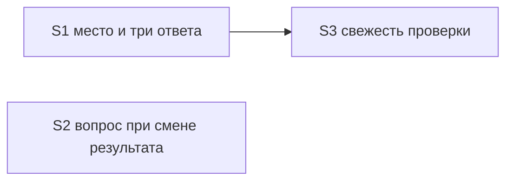

# Quality control — slice-pause-verify-clarity — 2026-10-15-2

## Scope

- Mode: slice (`# Срез S1`, `# Срез S2`, `# Срез S3`).
- Пересчёт: S1, S2, S3 целиком. `reused_checks`: нет. `deterministic_results`: нет. Файл `reports/quality-control-2026-10-15.md` входом не был.
- Связанные сценарии: все `#### Scenario:` четырёх дельт (45) и имена из `design.md` ## Slices. Заголовки в ## Slices совпадают с `#### Scenario:` буквально.
- Контракт в охвате: EC-5 (три ответа на сдаче среза). EC-1…EC-4 подтверждены и не переоткрывались.
- Исполнимость приёмки на информационной базе не оценивалась. Ручного конфигурирования нет. Рабочие задачи правят тексты kit в `.cursor/`.

## Verdict

OK

## Slice Summary

| Slice | Scenario | Tasks | Acceptance | Dependencies | Gate |
|---|---|---|---|---|---|
| S1 Место среза и шаг принять | На паузе видно, последний это срез или промежуточный; если сдача предполагается — три ответа | S1.1–S1.16 (16) | S1.accept (1 mandatory + 6 optional; сценарии 13/13) | нет | `<!-- slice-gate -->` есть, один |
| S2 Вопрос только при смене результата | Вопрос только когда ответы меняют результат | S2.1–S2.11 (11) | S2.accept (1 mandatory + 13 optional; сценарии 23/23) | нет | `<!-- slice-gate -->` есть, один |
| S3 Свежесть проверки и цена прогона | В шаге видно, что проверки не было или она устарела | S3.1–S3.7 (7) | S3.accept (1 mandatory + 6 optional; сценарии 9/9) | S1 | `<!-- slice-gate -->` есть, один |

## Criteria

| # | Criterion | Result |
|---|---|---|
| 1 | Scenario coverage | PASS — 45/45. У каждого сценария видимый чат. Отдельного implementation-only сценария нет, путь «верифицировать по коду» не требуется. |
| 2 | Slice independence | PASS. Приёмка S1 не требует S2 или S3. Приёмка S2 не требует S3. Приёмка S3 опирается только назад, на S1. Циклов нет. |
| 3 | Slice completeness | PASS для blocking Primary. Хозяин фразы места — S1.1; три ответа и условие изолированного блока — S1.8 и S1.9; пакет тем — S2.1; признак «проверки не было» — S3.1 и S3.2. |
| 4 | Dependency graph | PASS. Единственное межсрезовое ребро объявлено: S3 → S1. Объявленный срез существует. Необъявленного ребра и цикла нет. |
| 5 | Slice gate integrity | PASS. Ровно один `S<N>.accept` и один `<!-- slice-gate -->` на срез. `S<N>.T<M>` и `<!-- phase-gate -->` нет. |
| 5b | Acceptance checklist | PASS. У каждого среза есть `**Primary acceptance:**` и один sub-bullet `**Primary (обязательно):**`. Текст Primary в метаданных и в accept совпадает. Пустых чеклистов нет. Чужих Scenario в accept нет. |
| 6 | Rework risk | PASS. S3 опирается на карточку трёх ответов при явной зависимости S1. Повтор сценария между срезами нет. Общие файлы разведены абзацами. |
| 7 | Task readability | PASS. Нет `task-opaque-title`, `task-too-short`, `task-opaque-acceptance`. S2.6 вписывает «только затронутое» и «весь план» в уже существующий абзац журнала — это текст правила для Scenario «Подтверждение и смена выбора», не голый идентификатор. |
| 8 | Slice verticality | PASS. Все три mandatory Primary — чёрный ящик чата. |
| 8b | Self-achievable acceptance | PASS. Primary S1 достижим S1.1–S1.16. Primary S2 достижим S2.1. Primary S3 достижим S3.1 при уже принятом S1. Дубля journey с более поздним срезом нет. |
| 9 | Foundation slice with gate | PASS. S3 зависит от S1, и accept S1 — видимая карточка, не приёмка кода. |
| 10 | Acceptance simplicity | PASS. В каждом `S<N>.accept` один mandatory journey. Остальные буллеты помечены «(опционально)». |
| 11 | User task contract | PASS. DENY-маркеров в строках `S<N>.<M>` нет. Исполнитель рабочих задач — правка файлов kit. «Проверка на ИБ» в S1.7 — запрещённый заголовок примера, не обязанность человека. Отметку «приёмка в конце» в S1.9 ставит постановка заявки, не прогон базы. |

## EC-5

Три ответа «Принять срез», «Дать замечание по реализации», «Отложить до финального теста» — единственный mandatory journey S1. Он совпадает со Scenario «Передача предлагает три ответа». Условие входа то же в Primary, в WHEN сценария и в S1.9: срез — изолированный функциональный блок, отметки «приёмка в конце» нет, срез не отмечен принятым, пакета нет. Primary S3 ставит предложение «проверка не выполнялась» после этих трёх ответов и запрещает отдельный выбор. Четвёртого обязательного ответа нет. EC-1…EC-4 не переоткрывались.

## Scenario Coverage

| Scenario | Covered by | Status |
|---|---|---|
| Apply pause-wait lists objects in chat | S1.2, S1.accept optional | OK |
| Pause-wait is not a decision fork | S1.2 | OK |
| Isolated chat rejects a file-only pause | S1.6 | OK |
| Передача называет место среза | S1.1 | OK |
| Последний срез можно принять позже | S1.accept optional | OK |
| Проверка не подменяет итог фразой места | S1.11, S1.accept optional | OK |
| Карточка без фразы не уходит | S1.1 | OK |
| Пакет называет сдачу без одного номера | S1.9 | OK |
| Передача предлагает три ответа | S1 Primary, S1.8, S1.9 | OK |
| Отметка приёмка в конце снимает вопрос | S1.9, S1.accept optional | OK |
| Пакет называет сдачу | S1.8, S1.9 | OK |
| Граница среза ведёт на приёмку | S1.10, S1.13, S1.accept optional | OK |
| Одни отметки не открывают вопрос | S1.15, S1.16, S1.accept optional | OK |
| Отличие подтверждено заказчиком | S2.7 | OK |
| Внутреннее закрытие условия высокого авторитета | S2.7 | OK |
| Уже записанное правило не спрашивается | S2.7, S2.accept optional | OK |
| Слова указания в плане не закрывают указание | S2.7, S2.accept optional | OK |
| Сохранение ответа не открывает вопрос | S2.10, S2.accept optional | OK |
| Все решения прогона одной карточкой | S2.accept optional | OK |
| С ответа изменился результат | S2.11, S2.accept optional | OK |
| Тема без смены результата не входит в пакет | S2 Primary, S2.1 | OK |
| Вторая тема со сменой результата остаётся | S2.1, S2.accept optional | OK |
| Утверждение в варианте с доказательством | S2.2, S2.accept optional | OK |
| Объекта ещё нет | S2.2, S2.accept optional | OK |
| Короткий прогон показывает место сверки | S2.9, S2.accept optional | OK |
| Утверждение без доказательства | S2.2 | OK |
| Оценка вместо факта | S2.2 | OK |
| Стоп на третьей правке | S2.8, S2.accept optional | OK |
| Новый результат ждёт следующего прохода | S2.8, S2.accept optional | OK |
| Пустая предпосылка у решения со сменой результата | S2.6, S2.accept optional | OK |
| Опровержение из отдельного отчёта | S2.6 | OK |
| Процессное решение без предпосылки | S2.6, S2.accept optional | OK |
| Остальные решения не трогаются | S2.6 | OK |
| Повтор опровержения без нового факта | S2.6 | OK |
| Подтверждение и смена выбора | S2.6 | OK |
| Опровергнутое решение не довод | S2.6 | OK |
| Проверка останавливает | S3.1, S3.accept optional | OK |
| Проверки не было | S3 Primary, S3.1, S3.2 | OK |
| Дополнение новее проверки | S3.1, S3.2, S3.accept optional | OK |
| Предупреждение не становится вопросом | S3.6, S3.7, S3.accept optional | OK |
| Локальная дельта | S3.5 | OK |
| Дельта внешнего контракта | S3.5 | OK |
| Разбор сходится | S3.3, S3.accept optional | OK |
| Новый результат не съедает порог повтора | S3.4, S3.accept optional | OK |
| Неподтверждённое закрытие открывает тему | S3.3, S3.accept optional | OK |

Покрытие только задачей `S<N>.<M>` засчитано. Пропусков нет.

## Dependency Graph

Объявленные рёбра: S3 зависит от S1. S1 и S2 независимы. Циклов нет. Приёмка более раннего среза не ждёт более поздний.

Внутри срезов циклов нет.

- S1: S1.2–S1.9 → S1.1; S1.11 → S1.1, S1.10; S1.12–S1.14 → S1.10; S1.16 → S1.13, S1.15.
- S2: S2.2–S2.3 → S2.1; S2.4 → S2.1, S2.2; S2.6 → S2.5; S2.7 → S2.6; S2.8 → S2.7; S2.9 → S2.4, S2.8; S2.11 → S2.10. S2.10 отдельного входа не ждёт.
- S3: S3.4 → S3.3; S3.5 → S3.4. S3.1 и S3.2 ждут срез S1 целиком, не отдельную задачу S3.

Общие файлы, абзацы разведены:

- `openspec-apply-change/SKILL.md`: S1.8 хозяин трёх ответов и не делает признак «проверки не было» четвёртым ответом. S3.1 пишет само предложение свежести и три ответа не переписывает. Порядок задаёт зависимость S3 → S1.
- `openspec-status/SKILL.md`: S1.14 не переписывает признак «проверки не было». S3.2 пишет этот признак в ветках «отчёта нет» и «дополнение новее».
- `openspec-verify-change/SKILL.md`: S1.13 и S1.16 — граница сдачи и маска отметок. S2.6–S2.10 — предпосылка, журнал, один вопрос прохода. S3.3–S3.5 — объём разбора и дельта. S2.8 не заменяет предложение про порог; S3.4 не заменяет единственный вопрос прохода.
- `verify-user-communication.mdc`: S1.10 не добавляет абзац предупреждения. S3.7 добавляет одно предложение после шага.
- `chat-summary.md`: S1.12 не трогает место предупреждения. S2.3 не трогает таблицу шага. S3.6 ставит предупреждение после шага.
- `report-header.md`: S1.15 — маска отметок. S2.5 — комментарий предпосылки.

## Verticality, self-achievable, simplicity

S1 Primary — одна передача. Предусловие: рабочие задачи закрыты, срез — изолированный функциональный блок, отметки «приёмка в конце» нет, срез не принят, пакета нет. Наблюдаемое: в первых строках последний это срез или промежуточный, на карточке три ответа, без подписи «до реализации». Это тот же THEN, что Scenario «Передача предлагает три ответа». Условие изолированного блока записано в S1.9 и не заимствуется у S2 или S3. Фраза места и три ответа — один заход на одну карточку.

S2 Primary — одна карточка прогона, в ней только тема, которая меняет результат. Соседние Primary этот путь не повторяют. Две фразы в S2.6 не становятся отдельной приёмкой.

S3 Primary — один заход Scenario «Проверки не было»: в шаге сказано, что проверка не выполнялась; на карточке сдачи это предложение после трёх ответов и не выбор; вне карточки остаётся выбор сначала проверить или продолжить. Карточку трёх ответов даёт принятый S1. Средняя клауза — ребро назад, не заём journey у более позднего среза. Сливать S1 и S3 не требуется.

8b не срабатывает. Критерий 9 не срабатывает. Критерий 10 не срабатывает: предложение свежести не второй mandatory journey и не четвёртый ответ.

## Alerts

### SUGGESTION — last-slice clause only in accept

- Criteria: 1 и 3, необязательный сценарий
- Slice: S1, задача S1.1, optional Scenario «Последний срез можно принять позже»
- Evidence: буллет accept требует, чтобы на последнем срезе в первых строках было «принять можно сейчас или позже» и сразу после этого выбор архива. То же требует `design.md` D1 и требование «Карточка приёмки показывает место среза». S1.1 — единственный хозяин фразы в `.cursor/docs/opsx-output-style.md` §5.2 — доводит фразу до «либо что срез последний» и этот хвост не называет. Другие задачи копию фразы держать не должны. Primary S1 хвост не требует, сценарий покрыт буллетом accept, поэтому пропуск не блокирует срез.
- Recommendation: дописать хвост в S1.1, чтобы необязательная приёмка опиралась на абзац §5.2.

## Recommendations

### Automatic fix

В S1.1, в определение фразы места, добавить: на последнем срезе в ту же фразу входит, что принять можно сейчас или позже, и что следом выбор архива. Условие изолированного блока и три ответа не переносить из S1.9. Зависимость S3 от S1 не снимать.

### Decision required

Нет. Срезы не сливать. Primary S1 (место и три ответа у изолированного блока), Primary S2 (в пакете только тема со сменой результата) и Primary S3 (свежесть проверки) — три разных наблюдаемых результата.

### Remediation (auto-repair)

- alert: last-slice clause only in accept
- target: `openspec/changes/slice-pause-verify-clarity/tasks.md`, срез S1, задача S1.1
- action: в предложение про состав фразы §5.2 дописать хвост последнего среза — «принять можно сейчас или позже, следом выбор архива». Ссылку Scenario «Последний срез можно принять позже» можно поставить на S1.1 рядом с уже названными сценариями. Primary и число ответов не менять.
