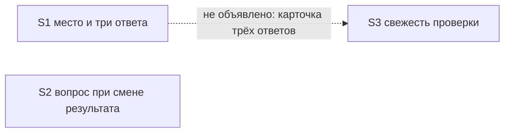

# Quality control — slice-pause-verify-clarity — 2026-10-15

## Scope

- Mode: slice (`# Срез S1`, `# Срез S2`, `# Срез S3`).
- Recalculation: S1, S2, S3 целиком. Контроль 2026-10-14 не переиспользован.
- `reused_checks`: нет. `deterministic_results`: нет.
- Контракт в охвате: EC-5 (три ответа на сдаче среза). EC-1…EC-4 не переоткрывались.
- Исполнимость приёмки на информационной базе не оценивалась. Ручного конфигурирования нет.

## Verdict

WARNING

## Slice Summary

| Slice | Scenario | Tasks | Acceptance | Dependencies | Gate |
|---|---|---|---|---|---|
| S1 Место среза и шаг принять | На паузе видно, последний это срез или промежуточный; если сдача предполагается — три ответа | S1.1–S1.16 (16) | S1.accept (1 primary + 6 optional; сценарии 13/13) | нет | `<!-- slice-gate -->` есть, один |
| S2 Вопрос только при смене результата | Вопрос только когда ответы меняют результат | S2.1–S2.11 (11) | S2.accept (1 primary + 13 optional; сценарии 23/23) | нет | `<!-- slice-gate -->` есть, один |
| S3 Свежесть проверки и цена прогона | В шаге видно, что проверки не было или она устарела | S3.1–S3.7 (7) | S3.accept (1 primary + 6 optional; сценарии 9/9) | объявлено «нет»; фактически карточка трёх ответов из S1 | `<!-- slice-gate -->` есть, один |

## Criteria

| # | Criterion | Result |
|---|---|---|
| 1 | Scenario coverage | PASS — 45/45. Отдельных implementation-only сценариев нет: у каждого WHEN/THEN видимый чат. Путь «верифицировать по коду» не требуется. |
| 2 | Slice independence | PASS по направлению вперёд. Приёмка S1 не требует S2/S3. Приёмка S2 не требует S3. Циклов нет. |
| 3 | Slice completeness | PASS. Для primary каждого среза есть задачи на те файлы карточки, которые срез сам пишет. |
| 4 | Dependency graph | WARNING — необъявленное ребро S3 → S1. |
| 5 | Slice gate integrity | PASS. Ровно один `S<N>.accept` и один маркер на срез. `S<N>.T<M>` и `<!-- phase-gate -->` нет. |
| 5b | Acceptance checklist | PASS. У каждого среза есть `**Primary acceptance:**` и один sub-bullet `**Primary (обязательно):**`. Пустых чеклистов нет. Чужих Scenario в accept нет. |
| 6 | Rework risk | WARNING — S1.8 и S3.1 правят одно предложение свежести на карточке сдачи; S1.14 и S3.2 — тот же признак в снимке. |
| 7 | Task readability | PASS. Нет `task-opaque-title`, `task-too-short`, `task-opaque-acceptance`. |
| 8 | Slice verticality | PASS. Все три mandatory Primary — чёрный ящик чата, не код-ревью и не вызов процедуры. |
| 8b | Self-achievable acceptance | PASS. Дубля journey с соседним более поздним срезом нет. Слой primary S1 не лежит в S2. Слой primary S2 не лежит в S3. |
| 9 | Foundation slice with gate | PASS. Ни один accept не является programmatic-only при пользовательском accept следующего среза. |
| 10 | Acceptance simplicity | PASS. В каждом `S<N>.accept` один mandatory journey. Предложение свежести на карточке S3 — не второй выбор и не четвёртый ответ. |
| 11 | User task contract | PASS. DENY-маркеров в `S<N>.<M>` нет. Рабочие задачи — правки текстов kit. Приёмка чата только в `S<N>.accept`. |

## EC-5

Контракт «три ответа: Принять срез / Дать замечание по реализации / Отложить до финального теста» совпадает с единственным mandatory Primary S1 и со Scenario «Передача предлагает три ответа». На карточке сдачи это один journey. Primary S3 ставит предложение «проверка не выполнялась» после этих трёх ответов и прямо запрещает делать его отдельным выбором. Четвёртого обязательного ответа нет.

## Scenario Coverage

| Scenario | Covered by | Status |
|---|---|---|
| Apply pause-wait lists objects in chat | S1.2, S1.accept optional | OK |
| Pause-wait is not a decision fork | S1.2 | OK |
| Isolated chat rejects a file-only pause | S1.6 | OK |
| Передача называет место среза | S1.1 | OK |
| Последний срез можно принять позже | S1.accept optional | OK |
| Проверка не подменяет итог фразой места | S1.11, S1.accept optional | OK |
| Карточка без фразы не уходит | S1.1 | OK |
| Пакет называет сдачу без одного номера | S1.9 | OK |
| Передача предлагает три ответа | S1 Primary, S1.8 | OK |
| Отметка приёмка в конце снимает вопрос | S1.9, S1.accept optional | OK |
| Пакет называет сдачу | S1.8, S1.9 | OK |
| Граница среза ведёт на приёмку | S1.10, S1.13, S1.accept optional | OK |
| Одни отметки не открывают вопрос | S1.16, S1.accept optional | OK |
| Отличие подтверждено заказчиком | S2.7 | OK |
| Внутреннее закрытие условия высокого авторитета | S2.7 | OK |
| Уже записанное правило не спрашивается | S2.7, S2.accept optional | OK |
| Слова указания в плане не закрывают указание | S2.7, S2.accept optional | OK |
| Сохранение ответа не открывает вопрос | S2.10, S2.accept optional | OK |
| Все решения прогона одной карточкой | S2.accept optional | OK |
| С ответа изменился результат | S2.11, S2.accept optional | OK |
| Тема без смены результата не входит в пакет | S2 Primary, S2.1 | OK |
| Вторая тема со сменой результата остаётся | S2.1, S2.accept optional | OK |
| Утверждение в варианте с доказательством | S2.2, S2.accept optional | OK |
| Объекта ещё нет | S2.2, S2.accept optional | OK |
| Короткий прогон показывает место сверки | S2.9, S2.accept optional | OK |
| Утверждение без доказательства | S2.2 | OK |
| Оценка вместо факта | S2.2 | OK |
| Стоп на третьей правке | S2.8, S2.accept optional | OK |
| Новый результат ждёт следующего прохода | S2.8, S2.accept optional | OK |
| Пустая предпосылка у решения со сменой результата | S2.6, S2.accept optional | OK |
| Опровержение из отдельного отчёта | S2.6 | OK |
| Процессное решение без предпосылки | S2.6, S2.accept optional | OK |
| Остальные решения не трогаются | S2.6 | OK |
| Повтор опровержения без нового факта | S2.6 | OK |
| Подтверждение и смена выбора | S2.6 | OK |
| Опровергнутое решение не довод | S2.6 | OK |
| Проверка останавливает | S3.1, S3.accept optional | OK |
| Проверки не было | S3 Primary, S3.1, S3.2 | OK |
| Дополнение новее проверки | S3.1, S3.2, S3.accept optional | OK |
| Предупреждение не становится вопросом | S3.6, S3.7, S3.accept optional | OK |
| Локальная дельта | S3.5 | OK |
| Дельта внешнего контракта | S3.5 | OK |
| Разбор сходится | S3.3, S3.accept optional | OK |
| Новый результат не съедает порог повтора | S3.4, S3.accept optional | OK |
| Неподтверждённое закрытие открывает тему | S3.3, S3.accept optional | OK |

Покрытие только задачей `S<N>.<M>` засчитано. Пропусков нет.

## Dependency Graph

Объявленные рёбра между срезами: нет. Циклов нет. Вперёд (приёмка более раннего среза ждёт более поздний) нет.

Необъявленное ребро: S3 → S1. Средняя клауза Primary S3 («на карточке сдачи среза это предложение после трёх ответов и не становится отдельным выбором») наблюдаема только на карточке, которую пишут S1.1 и S1.8. S3.1 и S3.2 прямо говорят три ответа не переписывать.

Внутри срезов циклов нет.

- S1: S1.2–S1.9 → S1.1; S1.11 → S1.1, S1.10; S1.12–S1.14 → S1.10; S1.16 → S1.13, S1.15.
- S2: S2.2–S2.3 → S2.1; S2.4 → S2.1, S2.2; S2.6 → S2.5; S2.7 → S2.6; S2.8 → S2.7; S2.9 → S2.4, S2.8; S2.11 → S2.10.
- S3: S3.4 → S3.3; S3.5 → S3.4.

Общие файлы с явной границей абзацев, без ребра приёмки:

- `openspec-verify-change/SKILL.md`: S2.8 пишет единственный вопрос прохода в шаге 4b и не заменяет предложение про порог; S3.4 пишет порог и не заменяет это предложение. S3.3 шаг 4b не переписывает.
- `verify-user-communication.mdc`: S1.10 не добавляет абзац предупреждения; S3.7 добавляет одно предложение после шага.
- `chat-summary.md`: S1.12 не трогает место предупреждения; S2.3 не трогает таблицу шага и место предупреждения; S3.6 ставит предупреждение после шага.

## Verticality, self-achievable, simplicity

S1 Primary — одна передача: в первых строках последний или промежуточный срез, на карточке ровно три ответа, без подписи «до реализации». Это тот же THEN, что Scenario «Передача предлагает три ответа». Фраза места и три ответа — один заход на одну карточку, не два mandatory journey.

S2 Primary — одна карточка прогона, в ней только тема, которая меняет результат. Соседние Primary S1 и S3 этот путь не повторяют.

S3 Primary — один заход Scenario «Проверки не было»: в шаге сказано, что проверка не выполнялась; на карточке сдачи это предложение стоит после трёх ответов и не является выбором; вне этой карточки выбор сначала проверить или продолжить остаётся. Предложение свежести не второй обязательный journey и не четвёртый ответ рядом с EC-5.

8b не срабатывает. Primary S1 достижим задачами S1.1–S1.16 без S2 и S3. Primary S2 достижим S2.1 без S3. Недостижимость средней клаузы S3 — это опора на уже описанную карточку S1, то есть ребро назад, а не заём journey у более позднего среза. Сливать S1 и S3 не требуется: у срезов разные наблюдаемые результаты.

Критерий 9 не срабатывает: accept S1 — видимая карточка чата, не приёмка «ревью контракта».

## Alerts

### WARNING — undeclared-dependency

- Criteria: 4 и 6
- Slice: S3, задачи S3.1, S3.2; опора на S1.1, S1.8, S1.14
- Evidence: в метаданных S3 и в `design.md` ## Slices зависимости «нет». Primary S3 и Scenario «Проверки не было» требуют, чтобы на карточке сдачи предложение «проверка не выполнялась» стояло после трёх ответов и не было отдельным выбором. Эти три ответа создают S1.1 и S1.8. S3.1: «Три ответа сдачи не переписывать». S1.8 в том же `openspec-apply-change/SKILL.md` как раз правит «предложение после трёх ответов: признак проверки не было не становится четвёртым ответом». S1.14 в `openspec-status/SKILL.md` запрещает переписывать признак «проверки не было», а S3.2 этот признак пишет. Пока S1 не принят, средняя клауза Primary S3 на карточке не из чего собрать. Это опора на непринятый предыдущий срез без поля `**Зависимости:**`.
- Recommendation: объявить у S3 зависимость S1. Абзацы не сливать: S1 остаётся хозяином трёх ответов, S3 — хозяином предложения свежести после них.

### SUGGESTION — last-slice clause only in accept

- Slice: S1, задача S1.1, optional Scenario «Последний срез можно принять позже»
- Evidence: optional accept требует, чтобы на последнем срезе было видно «принять сейчас или позже», и сразу после этого — выбор архива. S1.1 доводит фразу до «либо что срез последний» и не называет этот хвост. Primary S1 хвост не требует, сценарий покрыт буллетом accept.
- Recommendation: дописать хвост в S1.1, чтобы необязательная приёмка не осталась без абзаца в §5.2.

## Recommendations

### Automatic fix

Объявить зависимость S3 от S1 в `tasks.md` и в строке S3 таблицы `design.md` ## Slices. Порядок сдачи: сначала карточка трёх ответов, затем предложение свежести на ней. Тексты S1.8 и S3.1 оставить разными абзацами.

### Decision required

Нет. Срезы не сливать: Primary S1 (три ответа и место среза) и Primary S3 (свежесть проверки) — разные результаты. Переписывать Primary S3 так, чтобы убрать «после трёх ответов», значило бы оторвать blocking-приёмку от THEN Scenario «Проверки не было».

### Remediation (auto-repair)

- alert: undeclared-dependency
- target: `openspec/changes/slice-pause-verify-clarity/tasks.md` срез S3; `design.md` ## Slices, строка S3
- action: заменить `**Зависимости:** нет` у S3 на `**Зависимости:** S1`. В таблице срезов design поставить S1. Не переносить три ответа в задачи S3 и не делать предложение «проверка не выполнялась» четвёртым выбором на карточке.
