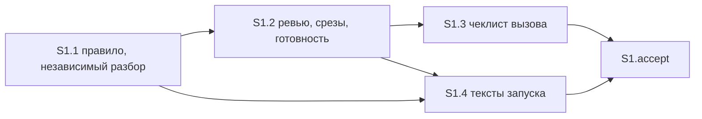

# Quality Control — Slice Coherence

- change: `verify-model-bands`
- date: 2026-10-14
- mode: slice (`tasks.md` содержит `# Срез S1`)
- delta: полный пересчёт — `changed_slices: all` (cache miss); `linked_scenarios`: все `#### Scenario:` из `specs/subagent-model-mapping/spec.md`; `deterministic_results: none`; `affected_contract_ids: none`; `reused_checks: none`
- criteria evaluated: 1, 2, 3, 4, 5, 5b, 6, 7, 8, 8b, 9, 10, 11
- new findings: полный прогон текущего текста. Кэша нет, повторно использованных проверок нет
- out of scope: исполнимость приёмки прямо сейчас на информационной базе; тестовые данные. Поручение пользователю на прогон посередине среза — в охвате

Источники: `tasks.md`, `design.md` § Slices, `proposal.md`, `specs/subagent-model-mapping/spec.md` (3 требования, 18 `#### Scenario:`). Ручной чеклист конфигуратора: нет. Механические замечания шагов 7A–7E: нет. Предпроверка поручений пользователю: нет, перепроверена чтением рабочих задач. Репозиторий: правка только существующих файлов кита, перечисленных в задачах; `.bsl` и `src/` нет.

`no-slices` не выпускается. `deprecated-phase-gate` не выпускается: маркера фаз нет. `legacy-acceptance-format` не выпускается: приёмка одна, старых пунктов `S1.T*` нет.

Объём — четыре рабочие задачи и одна приёмка. Это лёгкий размер, один срез допустим. Делить ревью, сверку срезов и готовность задач нельзя: это одна таблица назначения, её читают вместе. Так и записано в `design.md` § Slices.

## Verdict

`OK`

Один срез принимается сам по себе. Обязательный ход один: открыть правило назначения и увидеть обе ветки независимого разбора в одной строке. Остальные сценарии этой строки стоят необязательными пунктами или закрыты критерием рабочей задачи. Объединять нечего. Покрытие, ворота, зависимости и поручения пользователю посередине среза в порядке.

## Slice Summary

| Slice | Scenario | Tasks | Acceptance | Dependencies | Gate |
|---|---|---|---|---|---|
| S1: Назначение модели по цене ошибки | На первой проверке без тяжёлого признака независимый разбор идёт на тяжёлой модели, при тяжёлом признаке — на самой сильной | S1.1–S1.4 | `S1.accept` (10/10): 1 обязательный + 10 необязательных | нет | есть |

Дробь — сценарии из `**Связь со spec:**`, у каждого есть необязательный пункт с тем же именем. Обязательный ход — чтение той же строки правила и покрывает два из этих десяти (разбор без тяжёлого признака и разбор с ним); отдельные заголовки этих двух стоят ещё и необязательными пунктами.

Ещё восемь сценариев дельты в поле связи не перечислены. Они закрыты критерием «по тексту закрыты» в S1.1 и S1.2. Для покрытия этого достаточно.

`**Primary acceptance:**` и подпункт `**Primary (обязательно):**` совпадают дословно. В `design.md` § Slices та же формулировка.

## Scenario Coverage

Все 18 сценариев закрыты. Дыр нет.

| Scenario | Covered by | Status |
|---|---|---|
| Вызов архитектора без ошибки enum | S1.2, критерий по тексту | OK |
| Команда на Grok 4 без смены чата | S1.2, критерий по тексту | OK |
| Рантайм свободен от мёртвых слагов | S1.2, критерий по тексту | OK |
| Ревью кода на модели Gemini из списка | S1.2; необязательный пункт | OK |
| В списке нет семейства Gemini | S1.2; необязательный пункт | OK |
| Сверка одного среза на модели чата | S1.2; необязательный пункт | OK |
| Сверка нескольких срезов на профиле GPT-5.6 | S1.2; необязательный пункт | OK |
| В списке нет профиля GPT-5.6 | S1.2; необязательный пункт | OK |
| Готовность задач на модели чата | S1.2; необязательный пункт | OK |
| Готовность при неизвестном перехвате или вызове платформы | S1.2; необязательный пункт | OK |
| Сбой единственного вызова готовности задач | S1.2, критерий по тексту | OK |
| Слаг таблицы отсутствует в enum сборки | S1.2, критерий по тексту | OK |
| Декомпозиция срезов не идёт на Fable | S1.1, критерий по тексту | OK |
| Независимый разбор без тяжёлого признака идёт на тяжёлую модель | S1.1; обязательный ход; необязательный пункт | OK |
| Независимый разбор с тяжёлым признаком идёт на Fable | S1.1; обязательный ход; необязательный пункт | OK |
| Нет слага сильной модели — строка про Opus 5 | S1.1, критерий по тексту | OK |
| Сбой Opus не включает Fable | S1.1; необязательный пункт | OK |
| Сверка с прошлым договором идёт по лестнице независимого разбора с тяжёлым признаком | S1.1, критерий по тексту | OK |

Имена в необязательных пунктах и в критериях задач совпадают с заголовками `#### Scenario:` буквально. Чужого сценария в чеклисте нет: второй срез отсутствует.

Обязательный ход — одна читка правила. В ней две ветки одной строки: без тяжёлого признака строка называет тяжёлую модель и «Разбор постановки (Opus 5)», с признаком — самую сильную и «Разбор постановки (Fable)», если она есть в списке вызова. Это две стороны одного условия, не второй обязательный сценарий. Те же два заголовка продублированы необязательными пунктами, чтобы имя сценария стояло буквально.

## Dependency Graph

- Рёбер между срезами нет: срез один. Циклов нет.
- В метаданных: **Зависимости:** нет.
- Внутри среза рёбра только назад и все цели существуют: S1.2 от S1.1; S1.3 от S1.2; S1.4 от S1.1 и S1.2. Приёмка стоит последней и своих зависимостей не объявляет; для неё хватает текста правила из S1.1, остальные задачи того же среза закрывают необязательные пункты и соседние файлы.
- Приёмка не ссылается на задачи более позднего среза. Более позднего среза нет.
- S1.1 и S1.2 правят один файл по очереди. Это порядок правок внутри среза, не зависимость приёмки от другого среза.

## Checklist Results

| # | Criterion | Result |
|---|---|---|
| 1 | Scenario Coverage | Pass — 18/18. Десять сценариев из связи закрыты обязательным ходом или необязательным пунктом. Восемь остальных закрыты критерием «по тексту закрыты» в S1.1 или S1.2. Для правил кита это статическая сверка текста, не прогон на базе |
| 2 | Slice Independence | Pass — зависимостей от другого среза нет, приёмка не смотрит вперёд |
| 3 | Slice Completeness | Pass — метаданные, формы и код 1С не требуются. Обязательный ход читает правило назначения: его правит S1.1. Необязательные пункты про ревью, сверку срезов и готовность читают ту же таблицу: её правит S1.2. Второй перечень в чеклисте убирает S1.3. Тексты запуска, которые сами назначают модель, сводит S1.4. Пропущенного слоя для приёмки нет |
| 4 | Slice Dependency Graph | Pass — межсрезовых рёбер нет, внутренние рёбра существуют и не зациклены |
| 5 | Slice Gate Integrity | Pass — ровно один `S1.accept` и ровно один `<!-- slice-gate -->` |
| 5b | Acceptance Checklist Coverage | Pass — колонка Primary и обязательный подпункт есть, пустого чеклиста нет, сценарий требования нигде не потерян, чужого сценария в чеклисте нет |
| 6 | Rework Risk | Pass — предыдущего среза нет, один и тот же сценарий двум срезам не отдан. Две правки одного файла идут по объявленной очереди S1.1 → S1.2 |
| 7 | Task Readability | Pass — у S1.1–S1.4 в первой фразе глагол, путь файла и результат, ссылка на решение в скобках не заменяет текст. Короче восьми слов задач нет. Заголовок приёмки называет результат среза. Имена сценариев в пунктах не перефразированы |
| 8 | Slice Verticality | Pass — обязательный ход: открыть правило назначения и увидеть, какая модель и какая строка чата записаны для разбора без тяжёлого признака и с ним. Для кита поверхность продукта — текст правила. Это не вызов функции в отладчике и не проверка типа. Сверка чеклиста и текстов запуска живёт в S1.3 и S1.4, не в обязательном пункте |
| 8b | Self-Achievable Acceptance | Pass — обязательный ход даёт S1.1 того же среза. Соседнего среза с тем же ходом нет. Объединять нечего |
| 9 | Foundation slice with gate | Pass — второго среза нет, пары «подготовка без видимого итога → потребитель» нет |
| 10 | Acceptance Simplicity | Pass — в теле приёмки один обязательный ход. Десять остальных пунктов помечены «опционально». Две ветки внутри обязательного хода — одно условие одной строки, его же формулирует сценарий среза |
| 11 | User Task Contract | Pass — в S1.1–S1.4 нет поручения пользователю на базу, стенд, консоль, отладчик, вызов интерфейса или цепочку «после проверки». Чтение правила стоит на границе приёмки. Критерий «по тексту закрыты» выполняет агент в той же задаче |

## Alerts

Нет.

## Recommendations

**Автоправка**

Не требуется.

**Решение о структуре срезов**

Не требуется. Срез один, обязательный ход достижим его же первой задачей. Запрещённый обход «не подписывать приёмку, пока не готов следующий срез» не предлагается. Делить срез по ревью, сверке срезов или готовности задач не требуется: отдельного видимого итога у них нет, они читаются в той же таблице и уже стоят необязательными пунктами.

**Поле связи**

Восемь сценариев закрыты критерием рабочих задач и в `**Связь со spec:**` не повторены. Правило покрытия это разрешает. Дописывать их в поле связи или в необязательные пункты не обязательно.

**Общий файл**

S1.1 и S1.2 правят правило назначения по очереди. Параллельно один файл из этих двух задач не править. На приёмку это не влияет: обе задачи внутри одного среза.

**Не выпущено**

`primary-acceptance-missing`, `accept-checklist-empty`, `accept-bullets-missing-scenario`, `accept-bullet-foreign-scenario`, `slice-not-vertical`, `slice-accept-not-self-achievable`, `slice-foundation-with-gate`, `acceptance-simplicity-overload`, `user-task-contract-violation`, `legacy-acceptance-format`, `task-opaque-title`, `task-too-short`, `task-opaque-acceptance`, `no-slices`, `deprecated-phase-gate`.

Блок авторемонта не приложен: замечаний, которые чинятся правкой текста, нет.

## Reused vs new

- reused: none
- new: полный прогон среза S1 и всех 18 сценариев по текущему тексту `tasks.md`, `design.md` и `specs/subagent-model-mapping/spec.md`
