# Quality Control — slice-handoff-final-tests

Прогон полный, только срез S1. `reused_checks: none`. Кэш `reports/quality-control-2026-10-27.md` не читался: набор сценариев и текст Primary сменились. Покрытие сценариев пересчитано по текущим `specs/**/spec.md` и `tasks.md`.

Режим: срезы (`# Срез S1`). Устаревших заголовков фазы и маркера `<!-- phase-gate -->` нет. Ручной конфиг и Form.xml / Template.xml не требуются (`form_mode: n/a`). Контрактов `EC-*` в охвате нет.

## Verdict

`OK`

## Slice Summary

| Slice | Scenario | Tasks | Acceptance | Dependencies | Gate |
|---|---|---|---|---|---|
| S1 Текст сдачи в чате | Разработчик по сообщению сдачи видит место среза, идёт ли финальный тест, что вошло и какие основные тесты пройти | S1.1–S1.14 (14) | S1.accept (1 обязательный + 14 необязательных; сценарии spec 32/32) | нет | есть, один |

Один срез на 15 задач (14 работ + приёмка) — верх полосы Standard. Второй срез не нужен: самостоятельный исход один — текст сдачи в чате.

## Checklist

| Критерий | Результат |
|---|---|
| 1. Scenario Coverage | PASS. 32 `#### Scenario` в двух delta-spec. Каждый закрыт Primary, необязательным буллетом `S1.accept` или задачей `S1.<M>` |
| 2. Slice Independence | PASS. Срез один, приёмка не смотрит на более поздний срез |
| 3. Slice Completeness | PASS. Для карточки единственного среза в срезе есть хозяин фразы, состав сообщения, набор ответов, исключение лимита, ссылки вместо копий, шаблон файла сдачи, статическая сверка и пять образцов |
| 4. Slice Dependency Graph | PASS. `**Зависимости:** нет`. Циклов и необъявленных рёбер между срезами нет |
| 5. Slice Gate Integrity | PASS. Ровно один `S1.accept`, ровно один `<!-- slice-gate -->`. Задач `S1.T*` нет |
| 5b. Acceptance Checklist Coverage | PASS. `**Primary acceptance:**` есть, обязательный подпункт есть, текст совпадает с шапкой. Пустого чеклиста нет. Чужого сценария нет. Заголовки в ёлочках совпадают со spec буквально |
| 6. Rework Risk | PASS. Предыдущего среза нет, повтор сценария между срезами невозможен |
| 8. Slice Verticality | PASS. Единственный обязательный пункт — чтение сообщения сдачи, не осмотр процедуры |
| 8b. Self-Achievable Acceptance | PASS. Исход Primary дают задачи этого же среза; соседнего среза нет |
| 9. Foundation slice with gate | PASS. Потребителя `S2` нет. Приёмка S1 — текст карточки, не пустой программный шлюз |
| 10. Acceptance Simplicity | PASS. Обязательный путь один |
| 11. User Task Contract | PASS. В `S1.1`–`S1.14` нет работы пользователя на ИБ, в консоли, в отладчике и нет цепочки «после проверки / стенда» |
| Читаемость задач | PASS. Алертов `task-opaque-title`, `task-too-short`, `task-opaque-acceptance` нет |

## Scenario Coverage

Источники: `specs/chat-surface-clarity/spec.md` (16), `specs/kit-protocol-coherence/spec.md` (16).

| Scenario | Covered by | Status |
|---|---|---|
| Apply pause-wait lists objects in chat | S1.1 (на ожидании объектов нет «готов» и «это финальный тест»); S1.13 (список «что создать» в чате остаётся) | Покрыт |
| Pause-wait is not a decision fork | S1.13 (инвариант «без развилки» в статической сверке) | Покрыт |
| Isolated chat rejects a file-only pause | S1.13 (заголовок назван) | Покрыт |
| Передача называет место среза | S1.1 (передача первого из двух называет второй срез, финал впереди, дроби нет) | Покрыт |
| Единственный срез — финальный тест | Primary; необязательный буллет S1.accept; S1.1; образец S1.14 | Покрыт |
| Последний срез — финальный тест | S1.1 (финал — сдача без открытых рабочих задач; оборот «принять сейчас или позже, следом архив» убран) | Покрыт |
| Фраза места при открытых доработках раннего | S1.1; образец S1.14 «последний из трёх, у первого открыты доработки» | Покрыт |
| Финальная сдача после доработок называет финал | S1.1 (финальной называется сдача раннего среза; фраза называет срезы с открытой приёмкой); пятый образец S1.14 | Покрыт |
| Проверка не подменяет итог фразой места | S1.10 (первая строка — итог проверки, следом фраза места) | Покрыт |
| Карточка без фразы не уходит | S1.6 (карточка без фразы места не отправляется и собирается заново) | Покрыт |
| Пакет называет сдачу без одного номера | Необязательный буллет S1.accept; S1.1; S1.5 | Покрыт |
| Пауза в работе не называет финальный тест | Необязательный буллет S1.accept; S1.1; S1.11 | Покрыт |
| В чате есть основной тест | Primary («есть основной тест»); S1.2 (что вошло, шаги основного теста, одна ссылка, пустой блок не пишется) | Покрыт |
| Финал собирает тесты ещё не принятых срезов | Необязательный буллет S1.accept; S1.2; S1.14 | Покрыт |
| Пустой список отложенных не пишется | Необязательный буллет S1.accept; S1.2 | Покрыт |
| Полный перечень лежит в файле сдачи | Необязательный буллет S1.accept; S1.7 | Покрыт |
| Передача предлагает три ответа | Необязательный буллет S1.accept; S1.3; образец S1.14 «второй из трёх» | Покрыт |
| На финале нет ответа отложить | Primary (нет ответа «отложить до финального теста»); S1.3 (на финале третьего ответа нет) | Покрыт |
| Последний срез при открытых доработках раннего | Необязательный буллет S1.accept; S1.3; S1.14 | Покрыт |
| Доработка раннего закрыла последние работы | Необязательный буллет S1.accept; S1.2; S1.3; S1.14 | Покрыт |
| Принять на финале закрывает показанные срезы | Необязательный буллет S1.accept; S1.3; S1.8 | Покрыт |
| Неполная карточка финала не уходит | Необязательный буллет S1.accept; S1.3; S1.6 | Покрыт |
| Принять на финале пишет записи приёмки каждого показанного среза | Необязательный буллет S1.accept; S1.8 | Покрыт |
| Своя фраза «отложить» на финале не откладывает | Необязательный буллет S1.accept; S1.8 | Покрыт |
| Отметка приёмка в конце снимает вопрос | S1.13 (заголовок назван, суть не меняется) | Покрыт |
| Пакет называет сдачу | S1.5 (карточка пакета называет финальный тест только без открытых работ; один ответ принимает показанные срезы); S1.13 | Покрыт |
| Проверка останавливает | S1.13 (заголовок назван) | Покрыт |
| Граница среза ведёт на приёмку | S1.13 (заголовок назван; случай второго из трёх, финал ещё впереди) | Покрыт |
| Финальная карточка не спрашивает, какой срез | S1.3; S1.5; S1.8; S1.11 | Покрыт |
| Проверки не было | Необязательный буллет S1.accept; S1.3; S1.10 (предупреждение «после ответов») | Покрыт |
| Дополнение новее проверки | S1.13 (заголовок назван) | Покрыт |
| Предупреждение не становится вопросом | S1.13 (заголовок назван) | Покрыт |

Непокрытых сценариев нет. `accept-bullets-missing-scenario` не ставится. Покрытие только задачей `S1.<M>`, без строки в приёмке, для правила 6 допустимо. Это касается сценариев, чей заголовок не повторён в `S1.accept`: пауза-навигатор и развилка, передача первого из двух, последний срез при уже принятом первом, фраза места и финальная сдача после доработок раннего, карточка проверки, карточка без фразы, отсутствие вопроса «какой срез», а также семь регрессионных заголовков из S1.13.

Обязательный путь один и совпадает с design: карточка заявки из одного среза. В него входят три факта одного сообщения (это финальный тест, есть основной тест, нет ответа отложить). Остальные ситуации помечены «опционально» и приёмку не блокируют.

## Dependency Graph

Между срезами рёбер нет.

```mermaid
flowchart LR
  S1_1[S1.1 фраза места] --> S1_2[S1.2 состав]
  S1_2 --> S1_3[S1.3 ответы]
  S1_3 --> S1_4[S1.4 лимит]
  S1_4 --> S1_5[S1.5 правило срезов]
  S1_5 --> S1_6[S1.6 скилл apply]
  S1_6 --> S1_7[S1.7 файл сдачи]
  S1_7 --> S1_8[S1.8 разбор ответа]
  S1_8 --> S1_9[S1.9 граница проверки]
  S1_9 --> S1_10[S1.10 слот проверки]
  S1_10 --> S1_11[S1.11 снимок]
  S1_11 --> S1_12[S1.12 изолированный чат]
  S1_12 --> S1_13[S1.13 сверка по коду]
  S1_13 --> S1_14[S1.14 образцы]
  S1_14 --> accept[S1.accept]
```

Порядок внутри среза линейный: сначала абзац-хозяин, затем файлы, которые на него ссылаются, затем сверка и образцы, затем приёмка. Цикла нет. Повторы одного файла (S1.1–S1.3 — `opsx-output-style.md` §5.2; S1.6–S1.8 — скилл apply) идут друг за другом, а не по кругу.

Приёмка S1 не требует задач вне S1. Образец единственного среза готовит S1.14. Фразу «это финальный тест», блок основного теста и отсутствие третьего ответа задают S1.1–S1.3.

## Verticality and acceptance

Обязательный пункт: на заявке из одного среза в чате сказано, что это финальный тест, есть основной тест и нет ответа «отложить до финального теста».

Это чёрный ящик поверхности чата. Читатель видит текст сообщения. Пункт не требует вызова процедуры, просмотра типа или сверки diff. Поле «Приёмка» («ручная сверка карточек с правилами чата») задаёт способ сличить образец с правилом; само ожидаемое поведение остаётся текстом сообщения. S1.14 кладёт пять образцов в раздел «Что проверить сейчас» файла сдачи этого среза, чтобы путь был достижим без другой заявки.

Критерий 8b: видимый результат и момент приёмки совпадают и лежат в S1. Соседнего среза с тем же путём нет. Карточка «объединить срезы или переписать приёмку» не нужна.

Критерий 9: условий foundation-среза нет. Нет `S2` с зависимостью от S1 и нет пары «программная приёмка, затем пользовательская».

Критерий 10: в теле `S1.accept` один подпункт без пометки «опционально». Четырнадцать остальных помечены «опционально». `acceptance-simplicity-overload` не ставится.

Маркер ворот повторяет тот же единственный исход: на сдаче единственного среза сказано, что это финальный тест, есть основной тест и нет ответа «отложить до финального теста».

## User Task Contract

Строки `S1.1`–`S1.14` просмотрены целиком, не только по списку запрещённых слов.

Запрещённых маркеров нет: тестовая ИБ, стенд, runtime-verify, спайк, консоль, отладчик, эмуляция вызова, вызов API, «после verify», «после стенда».

S1.13 — сверка агента по тексту kit (`Read/Grep` `.cursor/`). Это разрешённый статический путь, не работа пользователя.

S1.14 готовит образцы сообщений в файле сдачи. Приёмку по этим образцам делает граница среза `S1.accept`, а не промежуточная задача.

Ручного конфигурирования в задачах нет.

## Task Readability

Шаблон «глагол + файл + что меняется + зачем + (D…)» выполнен у S1.1–S1.14. Голого «реализовать D*» нет. Короче 8 слов задач нет.

| Задача | Файл | Опора |
|---|---|---|
| S1.1 Переписать | `.cursor/docs/opsx-output-style.md` §5.2 | D1 |
| S1.2 Дописать | тот же §5.2, состав сообщения | D2 |
| S1.3 Закрепить | тот же §5.2, набор ответов | D3 |
| S1.4 Добавить | `.cursor/rules/chat-output-budget-full.mdc` §1 | D2, D4 |
| S1.5 Привести | `.cursor/rules/vertical-slices.mdc` | D3, D4 |
| S1.6 Обновить | `.cursor/skills/openspec-apply-change/SKILL.md` | D1, D3, D4 |
| S1.7 Изменить | шаблон файла сдачи того же скилла | D2 |
| S1.8 Дописать | разбор ответа и расчёт финала того же скилла | D3, D4 |
| S1.9 Заменить | `.cursor/rules/verify-user-communication.mdc` | D4 |
| S1.10 Обновить | скилл verify и `templates/chat-summary.md` | D1, D4 |
| S1.11 Обновить | `.cursor/skills/openspec-status/SKILL.md` | D1, D3, D4 |
| S1.12 Изменить | `.cursor/docs/ux-acceptance-isolated-chat.md` | D2 |
| S1.13 Сверить по коду | `.cursor/` Read/Grep | D4 |
| S1.14 Подготовить | раздел «Что проверить сейчас» файла сдачи этого среза | D1–D3 |

`S1.accept`: в заголовке есть результат среза — по сообщению видно место, финал, состав и основные тесты. Тело не пустое. Имена сценариев в буллетах не перефразированы.

Список файлов среза совпадает с design «Затронутые тексты» плюс `ux-acceptance-isolated-chat.md` (S1.12): без этой правки проверка изолированного чата сочла бы полный список тестов ошибкой.

## Alerts

Нет.

`primary-acceptance-missing`, `accept-checklist-empty`, `accept-bullets-missing-scenario`, `accept-bullet-foreign-scenario`, `slice-not-vertical`, `slice-accept-not-self-achievable`, `slice-foundation-with-gate`, `acceptance-simplicity-overload`, `user-task-contract-violation` не ставятся.

`legacy-acceptance-format`, `deprecated-phase-gate`, `no-slices` не ставятся.

### Remediation (auto-repair)

Не требуется.

Развилка «объединить срезы или переписать приёмку» не требуется: срез один, видимый результат Primary достижим его задачами.

## Recommendations

Автоматический ремонт не нужен. Решения заказчика по структуре среза не нужно.

Поле «Приёмка» говорит «ручная сверка трёх карточек», S1.14 готовит пять образцов, а блокирует приёмку только карточка одного среза. На число обязательных путей это не влияет: обязательный подпункт один, ворота повторяют его. Текст поля можно позже выровнять с этой одной карточкой, отдельная правка среза для вердикта не нужна.
