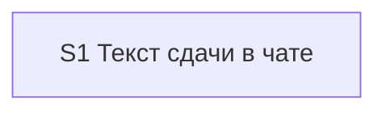

# Quality Control — slice-handoff-final-tests

- Дата: 2026-10-27
- Прогон: 3
- Режим: slice (`# Срез S1` есть)
- Охват: только S1, полный текущий план
- Повторное использование: нет. Кэш покрытия не читался. `reports/quality-control-2026-10-27-2.md` не использовался.
- Дельта: changed_slices = S1; linked_scenarios = все текущие `#### Scenario` обоих delta spec; affected_contract_ids = нет
- Критерии: 1–6, 5b, 8, 8b, 9–11 и читаемость задач
- Вне оценки: исполнимость приёмки на ИБ прямо сейчас

## Verdict

`OK`

## Slice Summary

| Slice | Scenario | Tasks | Acceptance | Dependencies | Gate |
|---|---|---|---|---|---|
| S1 Текст сдачи в чате | Разработчик по сообщению сдачи видит место среза, идёт ли финальный тест, что вошло и какие основные тесты пройти | S1.1–S1.14 (14) | S1.accept (1 Primary + 14 optional; spec 37/37) | нет | есть |

Один пользовательский исход: текст сдачи в чате. Второй срез не требуется. Задачи 14 плюс одна приёмка — верх стандартного размера при одном исходе.

## Scenario Coverage

Пересчитано по текущим `specs/chat-surface-clarity/spec.md` (21) и `specs/kit-protocol-coherence/spec.md` (16). Всего 37. Непокрытых нет.

| Scenario | Covered by | Status |
|---|---|---|
| Apply pause-wait lists objects in chat | S1.1 (ожидание объектов: место словами, без «готов» и без «это финальный тест»), S1.13 (список «что создать» в чате сохраняется) | покрыт |
| Pause-wait is not a decision fork | S1.13 («без развилки») | покрыт |
| Isolated chat rejects a file-only pause | S1.13 (сценарий назван, список «что создать» в чате) | покрыт |
| Передача называет место среза | S1.1 (первый из двух: назван второй, финальный тест впереди, без дроби) | покрыт |
| Единственный срез — финальный тест | Primary, S1.accept, S1.1, S1.13 (нет «1 из 1»), S1.14 | покрыт |
| Последний срез — финальный тест | S1.1 (финал = не осталось открытых рабочих задач; оборот «принять сейчас или позже, следом архив» убран), S1.13 | покрыт |
| Фраза места при открытых доработках раннего | S1.1 (финал после доработок, без слов «это финальный тест»), S1.14 | покрыт |
| Финальная сдача после доработок называет финал | S1.1 (финальной называется сдача раннего среза; фраза называет срезы с открытой приёмкой), S1.14 | покрыт |
| Проверка не подменяет итог фразой места | S1.10 (первая строка — итог проверки, следом фраза места) | покрыт |
| Карточка без фразы не уходит | S1.6 (карточка без фразы места не отправляется и собирается заново) | покрыт |
| Пакет называет сдачу без одного номера | S1.accept, S1.1, S1.5 | покрыт |
| Пауза в работе не называет финальный тест | S1.accept, S1.1 | покрыт |
| Принято без проверки видно на финальном тесте | S1.1, S1.13 (строка на карточке финального теста, не на последнем по порядку при открытых доработках) | покрыт |
| Перед архивом видны срезы без проверки | S1.13 (сценарий назван как сохранённый) | покрыт |
| Обычное принято пометки не ставит | S1.13 | покрыт |
| Принять последний по порядку при открытых доработках развилку не открывает | S1.8, S1.13 | покрыт |
| Принять на финале раннего среза открывает развилку в том же ходе | S1.8 (вопрос в том же ходе, слова прежние), S1.13 | покрыт |
| В чате есть основной тест | Primary, S1.2 (состав, шаги основного теста, одна ссылка), S1.4 (тесты не сжимаются лимитом 4–8) | покрыт |
| Финал собирает тесты ещё не принятых срезов | S1.accept, S1.2, S1.7, S1.14 | покрыт |
| Пустой список отложенных не пишется | S1.accept, S1.2 | покрыт |
| Полный перечень лежит в файле сдачи | S1.accept, S1.7 (отсылка к tasks.md убирается), S1.2 | покрыт |
| Передача предлагает три ответа | S1.accept, S1.3, S1.14 | покрыт |
| На финале нет ответа отложить | Primary, S1.3 | покрыт |
| Последний срез при открытых доработках раннего | S1.accept, S1.1, S1.3 (третий ответ, пока финал впереди), S1.8 (архив в этом ходе не открывается), S1.14 | покрыт |
| Доработка раннего закрыла последние работы | S1.accept, S1.1, S1.2, S1.3, S1.14 | покрыт |
| Принять на финале закрывает показанные срезы | S1.accept, S1.3, S1.5, S1.8 | покрыт |
| Неполная карточка финала не уходит | S1.accept, S1.3, S1.6 | покрыт |
| Принять на финале пишет записи приёмки каждого показанного среза | S1.accept, S1.8 (отметка, запись решения, файл сдачи среза) | покрыт |
| Своя фраза «отложить» на финале не откладывает | S1.accept, S1.8 | покрыт |
| Отметка приёмка в конце снимает вопрос | S1.5 (условие сдачи остаётся в правиле срезов), S1.13 | покрыт |
| Пакет называет сдачу | S1.1, S1.5 (финальный тест только если работ не осталось; один ответ принимает срезы с показанными тестами), S1.13 | покрыт |
| Проверка останавливает | S1.13 | покрыт |
| Граница среза ведёт на приёмку | S1.3, S1.9, S1.10, S1.13 | покрыт |
| Финальная карточка не спрашивает, какой срез | S1.3, S1.5, S1.8, S1.11; буллет «Принять на финале закрывает показанные срезы» | покрыт |
| Проверки не было | S1.accept, S1.3, S1.10, S1.13 (нет формулы «после трёх ответов») | покрыт |
| Дополнение новее проверки | S1.13 | покрыт |
| Предупреждение не становится вопросом | S1.13 | покрыт |

Имена Scenario в буллетах `S1.accept` совпадают с заголовками `#### Scenario:` буквально. Чужих срезов нет: срез один.

Сценарии, закрытые только задачами, без отдельного буллета приёмки: пауза-навигатор (два сценария), передача первого из двух, последний срез при уже принятом первом, фраза места и финал после доработок раннего, карточка проверки, карточка без фразы, приёмка без прогона (три сценария), обе развилки архива, «На финале нет ответа отложить», «В чате есть основной тест», отметка «приёмка в конце», пакетная сдача по протоколу, проверка останавливает, граница среза, «какой срез», дополнение новее проверки, предупреждение. Для правила покрытия этого достаточно.

## Dependency Graph

Между срезами рёбер нет: в метаданных `**Зависимости:** нет`, другого среза нет. Циклов нет. Опережающей зависимости приёмки нет.

Внутри S1 порядок линейный и без цикла: хозяин §5.2 (S1.1–S1.3) → лимит чата (S1.4) → правило срезов (S1.5) → скилл разработки (S1.6–S1.8) → проверка, снимок, изолированный чат (S1.9–S1.12) → сверка по коду (S1.13) → образцы (S1.14) → `S1.accept`. Необъявленных зависимостей от другого среза нет.

## Criteria

| Критерий | Результат | Опора |
|---|---|---|
| 1. Scenario Coverage | PASS | 37/37, таблица выше |
| 2. Slice Independence | PASS | Приёмка S1 не требует более позднего среза |
| 3. Slice Completeness | PASS | Слои 1С не нужны (`form_mode: n/a`). Тексты из design «Затронутые тексты» есть в задачах: §5.2, `vertical-slices.mdc`, скилл разработки, коммуникация проверки, скилл проверки и `chat-summary.md`, снимок, лимит чата. `ux-acceptance-isolated-chat.md` добавлен задачей S1.12. Статическая сверка — S1.13 |
| 4. Slice Dependency Graph | PASS | Граф выше |
| 5. Slice Gate Integrity | PASS | Ровно один `S1.accept`, ровно один `<!-- slice-gate -->`. Legacy `S1.T*` нет |
| 5b. Acceptance Checklist | PASS | `**Primary acceptance:**` есть. Первый буллет — `**Primary (обязательно):**`, текст совпадает с метаданными. Пустого чеклиста нет. `accept-bullet-foreign-scenario` нет |
| 6. Rework Risk | PASS | Предыдущего непринятого среза нет. Повтора сценария другого среза нет |
| Читаемость задач | PASS | S1.1–S1.14: глагол, файл, что меняется, зачем, ссылка D1–D4. Короче 8 слов задач нет. `S1.accept` называет результат среза. `task-opaque-title`, `task-too-short`, `task-opaque-acceptance` нет |
| 8. Slice Verticality | PASS | Единственный обязательный пункт — содержимое сообщения сдачи: сказано, что это финальный тест, есть основной тест, нет ответа «отложить до финального теста». Это наблюдение текста сдачи, не вызов процедуры и не просмотр diff. `slice-not-vertical` не срабатывает |
| 8b. Self-Achievable Acceptance | PASS | Обязательный путь — карточка единственного среза. Её дают правки S1.1–S1.4 и S1.6–S1.8 плюс образец «единственный срез» в S1.14. Более позднего среза нет, дубля Primary нет. `slice-accept-not-self-achievable` не срабатывает |
| 9. Foundation slice with gate | PASS | Второго среза с зависимостью от S1 нет. Условия ложной границы foundation/consumer не выполнены |
| 10. Acceptance Simplicity | PASS | Обязательный black-box путь один: карточка единственного среза. Остальные 14 буллетов помечены «опционально». Тот же расклад в design: обязательна карточка одного среза, остальные приёмку не блокируют. `acceptance-simplicity-overload` не срабатывает |
| 11. User Task Contract | PASS | По строкам `S1.1`–`S1.14` нет «тестовой ИБ», «на стенде», `runtime-verify`, «спайк», «в консоли», «отладчик», «вызвать API», «после verify», «после стенда». S1.13 — сверка Read/Grep по `.cursor/`. S1.14 готовит образцы в файле сдачи. Приёмка на границе среза — только `S1.accept` |

## Alerts

Алертов нет.

## Recommendations

### Автоисправление

Не требуется.

### Нужно решение

Нет. Объединять срезы не с чем: срез один, обязательный путь достижим его же задачами.

### Не блокирует

Поле `**Приёмка:**` говорит «ручная сверка трёх карточек», а S1.14 готовит пять образцов. Блокирует закрытие среза только Primary; четыре остальных образца в приёмке помечены как необязательные. Расхождение числа в поле метода приёмки на вердикт не влияет.

В `**Связь со spec:**` не названы требования «Приёмка без прогона остаётся видимой» и «Last-slice acceptance offers prerelease or archive». Их сценарии закрыты S1.1, S1.8 и S1.13, так что пропуск в строке связи дырой покрытия не является.

S1.13 ставит сценарий «Пакет называет сдачу» в перечень того, что «не изменились по сути». S1.1 и S1.5 при этом добавляют на конечную карточку пакета признак финального теста, если после пакета открытых рабочих задач не остаётся. При сверке эту фразу не считать нарушением «сути»: без паузы на каждом срезе, одна карточка и один общий ответ остаются; новым является только признак финала.
