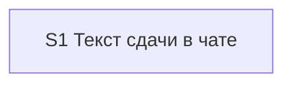

# Quality control — slice-handoff-final-tests

Дата: 2026-10-27. Режим: срезы (`# Срез S1` есть). Кэш: промах, `reused_checks: none`, `deterministic_results: none`. Охват: весь текущий план. Переиспользованных проверок нет. Предыдущий текст этого файла входом не был.

Источники: `tasks.md`, `design.md`, `proposal.md`, `specs/chat-surface-clarity/spec.md`, `specs/kit-protocol-coherence/spec.md`, `.cursor/rules/vertical-slices.mdc`, `.cursor/rules/task-readability.mdc`.

## Verdict

OK

Один срез. Обязательная приёмка — одна карточка единственного среза. Все 26 сценариев двух дельт покрыты приёмкой или задачами этого среза. Циклов, чужой приёмки и пользовательского прогона базы в рабочих задачах нет.

## Slice Summary

| Slice | Scenario | Tasks | Acceptance | Dependencies | Gate |
|---|---|---|---|---|---|
| S1 Текст сдачи в чате | Разработчик по сообщению сдачи видит место среза, идёт ли финальный тест, что вошло и какие основные тесты пройти. Связь — пять требований, без перечня заголовков сценариев. | S1.1–S1.14 (14) | S1.accept (1 обязательный + 10 необязательных; 10 заголовков сценариев из 26) | нет | `<!-- slice-gate: ... -->` есть, один |

Задач с чекбоксом 15, включая приёмку: полоса одного среза. Второй пользовательский исход в `design.md` не заявлен. `form_mode: n/a`. Маркеров ручной настройки объектов в Конфигураторе нет.

Файлы задач существуют и не пусты: `opsx-output-style.md` (110660), `chat-output-budget-full.mdc` (41783), `vertical-slices.mdc` (73917), `openspec-apply-change/SKILL.md` (91866), `verify-user-communication.mdc` (10622), `openspec-verify-change/SKILL.md` (122780), `openspec-status/SKILL.md` (11521), `ux-acceptance-isolated-chat.md` (9510). Якоря §5.2 и §1 в правиле лимита на месте.

## Scenario Coverage

Покрытие собрано по текущим спецификациям и `tasks.md`. Заголовок в приёмке совпадает с `#### Scenario:` буквально. Сценарий без строки приёмки закрыт задачей среза.

| Scenario | Covered by | Status |
|---|---|---|
| Apply pause-wait lists objects in chat | S1.1 (ожидание объектов без «готов» и без финального теста), S1.13 (список «что создать» в чате) | Покрыт |
| Pause-wait is not a decision fork | S1.13 (пауза с объектами без развилки) | Покрыт |
| Isolated chat rejects a file-only pause | S1.13 (список «что создать» остаётся в чате, файл паузы его не заменяет) | Покрыт |
| Передача называет место среза | S1.1 (место словами, без дроби, признак финала), S1.14 (образец «второй из трёх») | Покрыт |
| Единственный срез — финальный тест | Primary, S1.accept необязательный буллет, S1.14 (образец одного среза) | Покрыт |
| Последний срез — финальный тест | S1.1 (на передаче сказано, финальный ли тест; оборот «принять сейчас или позже, следом архив» убран) | Покрыт |
| Проверка не подменяет итог фразой места | S1.10 (первая строка — итог проверки, фраза места следом) | Покрыт |
| Карточка без фразы не уходит | S1.6 (без фразы места карточка не отправляется) | Покрыт |
| Пакет называет сдачу без одного номера | S1.accept необязательный буллет, S1.5 | Покрыт |
| Пауза в работе не называет финальный тест | S1.accept необязательный буллет, S1.1 | Покрыт |
| В чате есть основной тест | Primary («есть основной тест»), S1.2 | Покрыт |
| Финал собирает тесты ещё не принятых срезов | S1.accept необязательный буллет, S1.2, S1.14 | Покрыт |
| Пустой список отложенных не пишется | S1.accept необязательный буллет, S1.2 | Покрыт |
| Полный перечень лежит в файле сдачи | S1.accept необязательный буллет, S1.7 | Покрыт |
| Передача предлагает три ответа | S1.accept необязательный буллет, S1.3, S1.14 | Покрыт |
| На финале нет ответа отложить | Primary (нет ответа «отложить до финального теста»), S1.3 | Покрыт |
| Принять на финале закрывает показанные ранние срезы | S1.accept необязательный буллет, S1.8, S1.5 | Покрыт |
| Своя фраза «отложить» на финале не откладывает | S1.accept необязательный буллет, S1.8 | Покрыт |
| Отметка приёмка в конце снимает вопрос | S1.5 (условие сдачи остаётся в правиле срезов), S1.13 (отметка не меняется) | Покрыт |
| Пакет называет сдачу | S1.5 (пакет до последнего среза называет финальный тест; один ответ принимает и ранние с показанными тестами) | Покрыт |
| Проверка останавливает | S1.13 (следующий шаг из итога последней проверки не меняется) | Покрыт |
| Граница среза ведёт на приёмку | S1.3, S1.10, S1.11 (при открытой приёмке шаг и ответы по §5.2) | Покрыт |
| Финальная карточка не спрашивает, какой срез | S1.3, S1.8, S1.11 | Покрыт |
| Проверки не было | S1.accept необязательный буллет, S1.3, S1.10 (предупреждение после ответов) | Покрыт |
| Дополнение новее проверки | S1.13 | Покрыт |
| Предупреждение не становится вопросом | S1.13 (неблокирующее предупреждение не меняется) | Покрыт |

## Dependency Graph

Рёбер нет. Объявленные зависимости: нет. Более позднего среза нет. Циклов, зависимости вперёд и необъявленной опоры на другой срез нет.

Внутри среза хозяин текста §5.2 (S1.1–S1.3) стоит раньше задач, которые на него ссылаются (S1.4–S1.12). Образцы для приёмки — S1.14, до `S1.accept`.

## Criteria

1. Покрытие сценариев — все 26 закрыты Primary, необязательным буллетом или задачей `S1.*`. Отдельного пользовательского прогона базы для сценария нет.
2. Независимость — принимать нечего, кроме S1. Следующего среза нет.
3. Полнота — для приёмки нужны правка хозяина текста, ссылки вместо копий, исключение лимита, образцы трёх карточек и сверка по коду. Эти слои есть в S1.1–S1.14. Метаданных, формы и BSL у заявки нет.
4. Граф зависимостей — поле «нет» совпадает с планом. Несуществующих срезов в зависимостях нет.
5. Конец среза — ровно один `S1.accept` и ровно один маркер `slice-gate`. Legacy `S1.T*` нет. `<!-- phase-gate` нет.
5b. В шапке есть `**Primary acceptance:**`. В приёмке есть `**Primary (обязательно):**`, текст совпадает с шапкой. Пустого чеклиста нет. Чужого сценария в буллетах нет. Десять необязательных заголовков совпадают со спецификациями буквально.
6. Риск переделки — срез не опирается на непринятый предыдущий. Повтор сценария другого среза невозможен: срез один.
7. Читаемость — у S1.1–S1.14 есть глагол, файл, изменение и зачем. Короче восьми слов задач нет. Заголовок приёмки называет результат: по сообщению сдачи видно место, финал, состав и основные тесты. `task-opaque-title`, `task-too-short`, `task-opaque-acceptance` нет.
8. Наблюдаемость — обязательный пункт описывает сообщение в чате: сказано, что это финальный тест, есть основной тест, нет ответа «отложить до финального теста». Это чтение карточки сдачи, не просмотр кода и не вызов процедуры. `slice-not-vertical` нет.
8b. Достижимость — заявка сама из одного среза. S1.1–S1.12 меняют текст, по которому собирается её сдача. S1.14 кладёт образец одного среза в раздел «Что проверить сейчас» до приёмки. Более позднего среза с тем же путём нет. `slice-accept-not-self-achievable` нет.
9. Подготовительный срез с отдельной приёмкой — условия не выполнены: среза S2 с зависимостью от S1 нет. `slice-foundation-with-gate` нет.
10. Простота приёмки — обязательный путь один: карточка единственного среза. Десять остальных буллетов помечены «опционально». Середина из трёх и последний с непринятым ранним в `design.md` приёмку не блокируют. `acceptance-simplicity-overload` нет.
11. Доля человека в рабочих задачах — в S1.1–S1.14 нет тестовой базы, стенда, консоли, отладчика, вызова внешнего интерфейса и фраз «после verify» / «после стенда». S1.13 — сверка Read/Grep по `.cursor/`. S1.14 готовит образцы. Ручная сверка карточек стоит на `S1.accept`. `user-task-contract-violation` нет.

Исполнимость приёмки на информационной базе и наличие тестовых данных не оценивались.

## Alerts

Нет.

## Recommendations

Автоисправление не требуется. Решений по структуре срезов нет.
