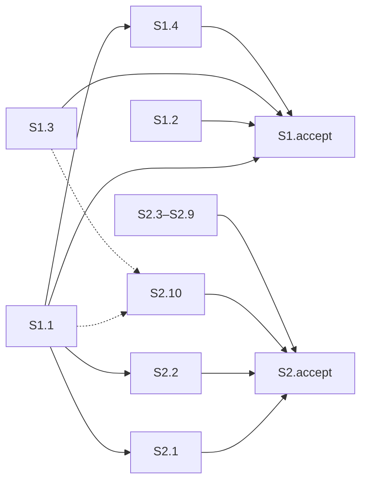

Предупреждение: срезы S1 и S2 — две разные приёмки текста правил, критического разрыва приёмки нет; 18 сценариев семи дельт нигде не закрыты, а шапка S2 одновременно пишет «зависимостей нет» и «после S1.1».

### Verdict

WARNING

Полный текущий контроль. Снимка проверки нет, повторно использованных проверок нет. Оценены оба среза и все 43 заголовка `#### Scenario:` семи дельт. Старый отчёт `reports/quality-control-2026-11-10.md` не использовался.

### Slice Summary

| Slice | Scenario | Tasks | Acceptance | Dependencies | Gate |
|---|---|---|---|---|---|
| S1 | Тяжёлый разбор, сверка с договором и просьба самой сильной модели описаны старшим Opus 5; строка «Разбор постановки (Fable)» не разрешена | S1.1–S1.4 (4) | S1.accept (1 обязательный + 3 необязательных; 12/12 из шапки закрыты задачами) | нет | `<!-- slice-gate -->` есть, один |
| S2 | На один шаг один порядок: обследование без порога трёх модулей, команда дописывания без своего списка шагов | S2.1–S2.10 (10) | S2.accept (1 обязательный + 2 необязательных; 11/11 из шапки закрыты задачами) | в шапке «нет», далее «после S1.1»; у S2.1 и S2.2 — S1.1; в design — «после S1» | `<!-- slice-gate -->` есть, один |

Режим: срезы (`# Срез S1`, `# Срез S2`). Устаревшего маркера конца фазы нет. Отдельных приёмочных задач старого вида нет. Ровно один `S1.accept` и один `S2.accept`.

### Scenario Coverage

Именная строка «закрыты сценарии» в задаче среза считается покрытием. Отдельная обязанность пользователя гонять информационную базу не требуется: носитель — текст правил. Фраза «не меняются» в S1.1 без имени сценария покрытием не считается.

| Scenario | Covered by | Status |
|---|---|---|
| Заголовок раздела не называет Fable | S1.1; Primary S1 | покрыт |
| Тяжёлый разбор идёт на Opus, даже если Fable в списке | S1.1; Primary S1 | покрыт |
| Сверка с прошлым договором идёт на Opus | S1.1 | покрыт |
| Просьба самой сильной модели не вызывает Fable | S1.1 | покрыт |
| Написание и ревью не получают слаг Fable | S1.1; S1.accept, необязательно | покрыт |
| В списке нет Opus 5 для бывшего сильного шага | S1.1 | покрыт |
| Сбой Opus не включает Fable | S1.1; S1.accept, необязательно | покрыт |
| Обычный разбор без тяжёлого признака не отменяется | S1.1 | покрыт |
| Сбой написания не повторяет тот же вызов | S2.1 | покрыт |
| Простая готовность задач без отдельной модели | S2.1 | покрыт |
| Пример ревью не теряет модель роли | S2.2 | покрыт |
| Вызов архитектора без ошибки enum | — | не покрыт |
| Команда на Grok 4 без смены чата | — | не покрыт |
| Рантайм свободен от мёртвых слагов | — | не покрыт |
| Ревью кода на модели Gemini из списка | — | не покрыт |
| В списке нет семейства Gemini | — | не покрыт |
| Сверка одного среза на модели чата | — | не покрыт |
| Сверка нескольких срезов на профиле GPT-5.6 | — | не покрыт |
| В списке нет профиля GPT-5.6 | — | не покрыт |
| Готовность задач на модели чата | — | не покрыт |
| Готовность при неизвестном перехвате или вызове платформы | — | не покрыт |
| Сбой единственного вызова готовности задач | — | не покрыт |
| Слаг таблицы отсутствует в enum сборки | — | не покрыт |
| Профиль активен для известной модели | S1.2 | покрыт |
| Бриф субагента учитывает профиль его модели | S1.2, фраза «для GPT и Opus учёт профиля в брифе роли остаётся» | покрыт, имя сценария в задаче не стоит |
| Профиль Fable не идёт в бриф роли | S1.2; S1.accept, необязательно | покрыт |
| Неизвестная модель | — | не покрыт |
| Канон в том же ходе | S1.3, фраза, что канон про дорогие модели остаётся и может быть сказан до итоговой карточки | покрыт, имя сценария в задаче не стоит |
| Токен не печатается | — | не покрыт |
| Фон не отменяется | — | не покрыт |
| Строка про Fable не исключение проверки | S1.3; Primary S1 (бюджет реплик) | покрыт |
| Progress на русском | — | не покрыт |
| Verify без английского progress | S1.3 | покрыт |
| Обследование BSL при недоступном кастомном агенте | — | не покрыт |
| Не-1С файлы | — | не покрыт |
| Один модуль тоже обследование | S2.2; Primary S2 | покрыт |
| Короткий текст ошибки без трассы | S2.3; S2.accept, необязательно | покрыт |
| Дописывание не зовёт проверку всегда | S2.4; Primary S2 | покрыт |
| Создание не ставит маркер раньше брифа | S2.6 | покрыт |
| Новая задача после подписи | S2.5 | покрыт |
| Раздел есть только в полном теле | S2.9 | покрыт |
| Две продуктовые развилки уходят одним сообщением | S2.10; S2.accept, необязательно | покрыт |
| Маркер и форма не сливаются | S2.10 | покрыт |

Итог: 23 сценария названы в задачах или приёмке, 2 закрыты текстом задачи без имени, 18 не закрыты. Снятое требование «Fable только как закрытая эскалация архитектора» сценариев не содержит.

Чужих сценариев в приёмке нет. Обязательный пункт приёмки в обоих срезах есть. Пустого чеклиста нет.

### Dependency Graph

Цикла нет. Приёмка S1 не ждёт S2. Приёмка S2 не повторяет путь S1: правило назначения и бюджет реплик против перечня агентов и команды дописывания.

Сплошные рёбра объявлены в задачах. Пунктир — общий файл `.cursor/skills/openspec-verify-change/SKILL.md` у S1.1, S1.3 и S2.10; у S2.10 в тексте стоит «Зависимости: нет».

Расхождение шапки, которое в запросе было наблюдением, а не вердиктом: design у S2 — «правки правила назначения после S1»; tasks у S2 — «Зависимости: нет. Правки правила назначения идут после S1.1»; S2.1 и S2.2 — «Зависимости: S1.1». Предок S1.1 существует. Слово «нет» в шапке этому предку противоречит.

### Alerts

1. `accept-bullets-missing-scenario` — WARNING — S1 и S2.
   В дельтах есть 18 сценариев, которых нет ни в Primary, ни в необязательных пунктах приёмки, ни в задачах. Это дословные сценарии изменённых требований, которые задачи не называют: «Вызов архитектора без ошибки enum», «Команда на Grok 4 без смены чата», «Рантайм свободен от мёртвых слагов», «Ревью кода на модели Gemini из списка», «В списке нет семейства Gemini», «Сверка одного среза на модели чата», «Сверка нескольких срезов на профиле GPT-5.6», «В списке нет профиля GPT-5.6», «Готовность задач на модели чата», «Готовность при неизвестном перехвате или вызове платформы», «Сбой единственного вызова готовности задач», «Слаг таблицы отсутствует в enum сборки», «Неизвестная модель», «Токен не печатается», «Фон не отменяется», «Progress на русском», «Обследование BSL при недоступном кастомном агенте», «Не-1С файлы».
   Фраза S1.1 «пять мест проверки нескольких частей и фразы про профиль GPT-5.6 не меняются» эти сценарии не закрывает: имён нет, исход по шагам не записан.
   Рекомендация: одна сверка по тексту внутри S1 и одна внутри S2, до приёмки. В обязательный пункт приёмки эти имена не ставить.

2. `slice-dependency-mismatch` — WARNING — шапка S2, критерий 4.
   Метаданные среза говорят «нет» и в той же строке «после S1.1». Design говорит «после S1». Задачи S2.1 и S2.2 зависят от S1.1. Оба правят `.cursor/rules/model-selection.mdc`; S1.1 и S2.2 ещё правят `.cursor/rules/tool-name-guard.mdc` и `.cursor/rules/architect-gate.mdc`.
   Рекомендация: в шапке S2 записать зависимость от S1. Задачи S2.1 и S2.2 оставить с S1.1.

3. `rework-risk` — WARNING — S2.10 относительно S1.1 и S1.3, критерий 6.
   S2.10 правит `.cursor/skills/openspec-verify-change/SKILL.md` и помечен «Зависимости: нет». Тот же скилл уже меняют S1.1 (живые отсылки на старое имя раздела) и S1.3 (строка про Fable). Если чтение шапки «зависимостей нет» пустит S2 вместе с S1, правки одного файла разойдутся.
   Рекомендация: у S2.10 указать зависимости S1.1 и S1.3. Второй срез из-за этого не объединять: видимый результат и момент приёмки у S1 и S2 разные.

### Проверено, алерта нет

- Независимость приёмки. S1 принимается без S2. S2 принимается без более позднего среза. Зависимость S2 от S1.1 — порядок правки общего файла, не чужой пользовательский путь.
- Полнота под записанную приёмку. Primary S1 собирается из S1.1 (раздел правила назначения) и S1.3 (бюджет реплик). Primary S2 собирается из S2.2 (строка обследователя в перечне и таблица остановок) и S2.4 (команда дописывания).
- Целостность границы среза. Один accept и один маркер на срез.
- Наблюдаемость. Оба обязательных пункта — открыть файл правила или команды и увидеть текст. Это путь разработчика набора, он же записан в сценариях дельты. Отладчика, вызова функции и разбора возвращаемого значения в приёмке нет.
- Достижимость внутри среза. Обязательный результат S1 дают задачи S1. Путь S2 другой и даётся задачами S2. Совпадения обязательного пути нет.
- Подготовительный срез с отдельной приёмкой. У S1 есть свой видимый результат в правиле назначения и бюджете реплик, это не заготовка под S2.
- Простота приёмки. В каждом accept один обязательный пункт. Вторая фраза Primary S2 (команда дописывания) входит в тот же пункт и в тот же момент приёмки, отдельного обязательного пути нет. Необязательные пункты помечены.
- Обязанность пользователя в рабочих задачах. В S1.1–S1.4 и S2.1–S2.10 нет стенда, консоли, отладчика, вызова внешнего интерфейса и цепочки «после проверки на стенде». Чтение файлов стоит на приёмке среза, это допустимо. Конфигурации 1С нет, исполнимость на информационной базе не оценивалась.
- Читаемость. У задач есть глагол, файл и зачем, кроме S2.10: файл и результат есть, глагола в начале нет. На заголовок приёмки это не распространяется. Оба заголовка accept называют результат среза.

### Recommendations

Автоправка, решение человека не нужно.

- Закрыть 18 сценариев сверкой по тексту, не вторым срезом и не новым обязательным пунктом приёмки.
- В шапке S2 поставить зависимость от предыдущего среза и снять слово «нет». У S2.10 дописать зависимость от S1.1 и S1.3.
- В design строку зависимости S2 привести к той же формулировке, что в шапке tasks.

### Remediation (auto-repair)

- alert: accept-bullets-missing-scenario
- target: `openspec/changes/drop-fable-escalation/tasks.md`, срез S1, перед `S1.accept`
- action: вставить задачу S1.5. «Сверить по тексту `.cursor/rules/model-selection.mdc`, `.cursor/rules/model-adaptation.mdc`, `.cursor/rules/model-fable5.mdc`, `.cursor/rules/chat-output-budget.mdc`, `.cursor/rules/chat-output-budget-full.mdc` и `.cursor/rules/verify-user-communication.mdc`: перечисленные сценарии читаются как раньше, их носители не переписывать кроме строк, которые уже задают S1.1–S1.3 (D1, D3, D4).» В критерий буквально включить: «Вызов архитектора без ошибки enum», «Команда на Grok 4 без смены чата», «Рантайм свободен от мёртвых слагов», «Ревью кода на модели Gemini из списка», «В списке нет семейства Gemini», «Сверка одного среза на модели чата», «Сверка нескольких срезов на профиле GPT-5.6», «В списке нет профиля GPT-5.6», «Готовность при неизвестном перехвате или вызове платформы», «Слаг таблицы отсутствует в enum сборки», «Неизвестная модель», «Токен не печатается», «Фон не отменяется», «Progress на русском». Зависимости: S1.1, S1.2, S1.3. Эти имена дописать в `**Связь со spec:**` среза S1. В `S1.accept` не ставить.

- alert: accept-bullets-missing-scenario
- target: `openspec/changes/drop-fable-escalation/tasks.md`, срез S2, перед `S2.accept`
- action: вставить задачу S2.11. «Сверить по тексту `.cursor/rules/model-selection.mdc`, `.cursor/rules/tool-name-guard.mdc`, `.cursor/rules/1c-agent-delegation.mdc` и `.cursor/rules/1c-error-analysis.mdc`: готовность задач и обследование при недоступном обследователе читаются как раньше (D7).» В критерий буквально включить: «Готовность задач на модели чата», «Сбой единственного вызова готовности задач», «Обследование BSL при недоступном кастомном агенте», «Не-1С файлы». Зависимости: S2.1, S2.2. Эти имена дописать в `**Связь со spec:**` среза S2. В `S2.accept` не ставить. Сверка читает диспетчер; отдельную правку диспетчера заводить только если в его таблице типов задач останется порог «3+ модулей» после S2.2 — тогда дописать файл в S2.2, не открывать новый срез.

- alert: slice-dependency-mismatch
- target: `tasks.md` шапка S2; `design.md` строка зависимости S2
- action: заменить `**Зависимости:** нет. Правки правила назначения идут после S1.1.` на `**Зависимости:** S1`. В design заменить «правки правила назначения после S1» на `S1`. Строки `Зависимости: S1.1` у S2.1 и S2.2 не трогать.

- alert: rework-risk
- target: `tasks.md` задача S2.10
- action: заменить «Зависимости: нет» на «Зависимости: S1.1, S1.3».

Формулировка без отдельного алерта: начать S2.10 глаголом «Поправить». Файл и результат уже названы.
