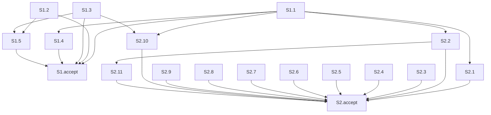

Критично: обязательная приёмка среза S2 склеивает два разных осмотра — перечень агентов без порога трёх модулей и команда дописывания без своего порядка. Все 34 текущих заголовка сценариев покрыты, остальные критерии срезов сходятся.

### Verdict

CRITICAL

Полный проход по текущим `tasks.md`, `design.md`, `proposal.md` и семи дельтам `specs/`. Режим: срезы (`# Срез S1`, `# Срез S2`). `changed_slices`: S1, S2. `reused_checks`: нет. `deterministic_results`: нет, граф собран заново. Предыдущие отчёты этой заявки входом не были. Фраза «не копируется» и профиль GPT-5.6 отдельными сценариями не считались: таких заголовков в дельтах нет. Снятое требование «Fable только как закрытая эскалация архитектора» сценариев не содержит.

### Slice Summary

| Slice | Scenario | Tasks | Acceptance | Dependencies | Gate |
|---|---|---|---|---|---|
| S1 Сильные шаги на Opus | Тяжёлый разбор, сверка с прошлым договором и просьба самой сильной модели описаны старшим Opus 5; строка «Разбор постановки (Fable)» не разрешена | S1.1–S1.5 (5) | S1.accept (4 буллета: 1 обязательный + 3 опциональных; в связи 18 сценариев, остальные закрыты задачами) | нет | `<!-- slice-gate -->` есть |
| S2 Один хозяин на шаг | Один порядок на шаг, обследование без порога трёх модулей, команда без своего списка, пакет развилок одним сообщением | S2.1–S2.11 (11) | S2.accept (3 буллета: 1 обязательный из двух осмотров + 2 опциональных; в связи 13 сценариев) | S1 | `<!-- slice-gate -->` есть |

Ровно один `S1.accept` и один `S2.accept`. Маркера `<!-- phase-gate -->` нет. Задач вида `S<N>.T<M>` нет.

### Scenario Coverage

34 заголовка `#### Scenario:`, 31 уникальное имя. Три имени повторены в MODIFIED и ADDED с тем же WHEN/THEN; одна задача закрывает оба заголовка.

| Scenario | Covered by | Status |
|---|---|---|
| Заголовок раздела не называет Fable (мэппинг ролей, MODIFIED) | S1 Primary, S1.1 | покрыт |
| Заголовок раздела не называет Fable (бывшие сильные шаги, ADDED) | S1 Primary, S1.1 | покрыт |
| В списке нет Opus 5 для бывшего сильного шага (самосверка, MODIFIED) | S1.1 | покрыт |
| В списке нет Opus 5 для бывшего сильного шага (бывшие сильные шаги, ADDED) | S1.1 | покрыт |
| Тяжёлый разбор идёт на Opus, даже если Fable в списке | S1 Primary, S1.1 | покрыт |
| Сверка с прошлым договором идёт на Opus | S1 Primary (три бывших сильных шага), S1.1 | покрыт |
| Просьба самой сильной модели не вызывает Fable | S1 Primary, S1.1 | покрыт |
| Написание и ревью не получают слаг Fable | S1.1, S1.accept опционально | покрыт |
| Сбой Opus не включает Fable | S1.1, S1.accept опционально | покрыт |
| Обычный разбор без тяжёлого признака не отменяется | S1.1 | покрыт |
| Сбой написания не повторяет тот же вызов (двухшаговая цепочка, MODIFIED) | S2.1 | покрыт |
| Сбой написания не повторяет тот же вызов (цепочка из строки роли, ADDED) | S2.1 | покрыт |
| Простая готовность задач без отдельной модели | S2.1 | покрыт |
| Пример ревью не теряет модель роли | S2.2 | покрыт |
| Один модуль тоже обследование | S2 Primary, S2.2 | покрыт |
| Короткий текст ошибки без трассы | S2.3, S2.accept опционально | покрыт |
| Обследование BSL при недоступном кастомном агенте | S2.11, сверка по тексту | покрыт |
| Не-1С файлы | S2.11, сверка по тексту | покрыт |
| Дописывание не зовёт проверку всегда | S2 Primary (второй осмотр), S2.4 | покрыт |
| Создание не ставит маркер раньше брифа | S2.6 | покрыт |
| Новая задача после подписи | S2.5 | покрыт |
| Раздел есть только в полном теле | S2.9 | покрыт |
| Две продуктовые развилки уходят одним сообщением | S2.10, S2.accept опционально | покрыт |
| Маркер и форма не сливаются | S2.10 | покрыт |
| Профиль Fable не идёт в бриф роли | S1.2, S1.accept опционально | покрыт |
| Профиль активен для известной модели | S1.2 | покрыт |
| Бриф субагента учитывает профиль его модели | S1.5 | покрыт |
| Неизвестная модель | S1.5 | покрыт |
| Строка про Fable не исключение проверки | S1 Primary (бюджет реплик), S1.3 | покрыт |
| Канон в том же ходе | S1.5 | покрыт |
| Токен не печатается | S1.5 | покрыт |
| Фон не отменяется | S1.5 | покрыт |
| Verify без английского progress | S1.3 | покрыт |
| Progress на русском | S1.5 | покрыт |

Имена в опциональных буллетах совпадают с заголовками spec буквально. Чужого сценария в приёмке нет. Пропусков нет.

### Dependency Graph

Срез S2 объявляет зависимость от S1. Обратного ребра нет. Цикла нет. Приёмка S1 не требует S2. Приёмка S2 не повторяет путь S1.

Общие файлы закрыты объявленными рёбрами: `model-selection.mdc` (S1.1 → S2.1), `tool-name-guard.mdc` и `architect-gate.mdc` (S1.1 → S2.2), `openspec-verify-change/SKILL.md` (S1.1 и S1.3 → S2.10). Внутри S2 `session-discipline.mdc` правят S2.8 и S2.9 подряд; отдельного ребра нет, порядок в файле это закрывает.

### Checklist

| Критерий | S1 | S2 |
|---|---|---|
| 1. Покрытие сценариев | выполнено | выполнено |
| 2. Независимость | выполнено: приёмка не ждёт S2 | выполнено: зависимость только назад, путь приёмки другой |
| 3. Полнота | выполнено: правило назначения — S1.1, бюджет реплик — S1.3 | выполнено: перечень и таблица остановок — S2.2, диспетчер при остатке порога — S2.11, команда дописывания — S2.4 |
| 4. Граф | выполнено | выполнено: зависимость S1 есть, объявленные предшественники есть |
| 5. Целостность ворот | выполнено: один accept, маркер есть | выполнено: один accept, маркер есть |
| 5b. Чеклист приёмки | выполнено: Primary в метаданных и первым пунктом | выполнено по наличию Primary; простота — критерий 10 |
| 6. Риск переделки | выполнено | выполнено: сценарии срезов не повторяются |
| 8. Наблюдаемость | выполнено: открыть правило и бюджет и прочитать текст | выполнено: оба осмотра — чтение текста, не вызов процедуры |
| 8b. Достижимость внутри среза | выполнено: S1.1 и S1.3 дают обязательный итог | выполнено: оба осмотра делаются задачами S2, дубля с S1 нет |
| 9. Заготовка с воротами | не выполняется: у S1 свой наблюдаемый итог | не выполняется: S2 зависит от S1, но приёмка S1 наблюдаемая |
| 10. Простота приёмки | выполнено: один осмотр | CRITICAL, алерт 1 |
| 11. Контракт задач | выполнено | выполнено |
| 7. Читаемость задач | выполнено | выполнено |

Критерий 8. Обязательный пункт S1 — открыть правило назначения, увидеть раздел «Таблица шагов архитектора» и прочитать, что три бывших сильных шага вызывают старший Opus 5 со строкой «Разбор постановки (Opus 5)», а в бюджете реплик проверки постановки строки про Fable нет. Обязательный пункт S2 — открыть перечень и команду и прочитать два текста. Это чтение правил набора, не вызов процедуры и не просмотр типа. `slice-not-vertical` не ставится.

Критерий 8b. Итог S1 собирают S1.1 и S1.3. Итог S2 собирают S2.2, S2.11 и S2.4. Более позднего среза нет. `slice-accept-not-self-achievable` не ставится.

Критерий 9. У S1 есть accept и slice-gate, S2 зависит от S1, и при этом приёмка S1 сама описывает наблюдаемый итог. Третье условие ложной заготовки не выполнено. `slice-foundation-with-gate` не ставится.

Критерий 10, S1. В теле один пункт без пометки «опционально». Три строки таблицы и фраза бюджета — один осмотр одной реплики: бывший сильный шаг читается как Opus 5, парная строка про Fable в списке разрешённых не остаётся. Старт один. Три остальных буллета помечены «(опционально)».

Критерий 10, S2. См. алерт 1.

Критерий 11. В `S1.1`–`S1.5` и `S2.1`–`S2.11` нет поручения пользователю на информационную базу, стенд, консоль, отладчик или вызов API. Условных цепочек «после проверки» и «после стенда» нет. S1.5 и S2.11 — сверка текста правил агентом. Чтение правил на границе среза стоит в `S<N>.accept`.

### Alerts

#### 1. `acceptance-simplicity-overload` — CRITICAL — S2 / `S2.accept`

- Срез: S2, поле `**Primary acceptance:**` и первый пункт `S2.accept`. Тот же текст в `design.md` § Slices, строка S2.
- Серьёзность: CRITICAL.
- Факт: обязательный пункт задаёт два осмотра с разными файлами и разным исходом. Первый — открыть перечень агентов и увидеть, что обследование кода не ограничено тремя модулями (сценарий «Один модуль тоже обследование», задачи S2.2 и S2.11). Второй — открыть команду дописывания и увидеть, что своего списка шагов и обязательной проверки после каждого дописывания нет (сценарий «Дописывание не зовёт проверку всегда», задача S2.4). Оба без пометки «опционально». Один может сойтись, пока второй нет. Это не цепочка «открыл одно → увидел один итог». Маркер конца S2 повторяет оба осмотра. Вводная фраза design («второй виден в перечне агентов и в тексте команды дописывания») держит ту же склейку.
- Что сделать: оставить обязательным первый осмотр. Второй перенести в опциональный пункт с буквальным именем сценария. Покрытие сценария сохранится: S2.4 и опциональный буллет.

### Remediation (auto-repair)

- alert: `acceptance-simplicity-overload`
- target: `openspec/changes/drop-fable-escalation/tasks.md`, срез S2 (поле `**Primary acceptance:**`, заголовок `S2.accept`, первый пункт, маркер `<!-- slice-gate -->`); `openspec/changes/drop-fable-escalation/design.md` § Slices, строка S2, и вводная фраза «Второй виден…»
- action: В `**Primary acceptance:**`, в первом пункте `S2.accept` и в Primary строки S2 в `design.md` оставить одно: «открыть перечень агентов и увидеть, что обследование кода не ограничено тремя модулями.» Заголовок приёмки: «Принять срез S2 «Один хозяин на шаг» — обследование кода не ограничено тремя модулями:». В `S2.accept` добавить пункт: «Scenario «Дописывание не зовёт проверку всегда» (опционально): открыть команду дописывания — своего списка шагов и обязательной проверки после каждого дописывания нет.» Маркер заменить на: `<!-- slice-gate: обследование кода не ограничено тремя модулями -->`. Во вводной фразе design оставить видимым перечень агентов; команду дописывания назвать проверкой того же среза, которая приёмку не блокирует. `**Связь со spec:**` и задачи S2.4–S2.11 не удалять.

### Task Readability

Задачи `S1.1`–`S1.5` и `S2.1`–`S2.11` держат глагол, файл и зачем. Глаголы: «Заменить», «Дописать», «Убрать», «Поправить», «Сверить». Опорные ссылки D1–D10 стоят в скобках. Короче восьми слов задач нет. Голого номера решения в заголовке нет. Заголовки `S1.accept` и `S2.accept` называют бизнес-результат среза. Имена сценариев в ёлочках, где они есть, буквальны. `task-opaque-title`, `task-too-short`, `task-opaque-acceptance`, `legacy-acceptance-format` не ставятся.

S2.7 (шапка обзора, сборщик манифеста) и S2.8 (свежая передача и список шаблонов) сценария в дельтах не закрывают. Это работы решения D8 внутри среза, не дыра покрытия.

### Recommendations

Автоматически, без решения заказчика:

1. `acceptance-simplicity-overload` (S2) — сузить обязательный осмотр до перечня агентов; команду дописывания оставить опциональным пунктом и задачей S2.4; синхронизировать `design.md` и маркер конца среза.

Решение заказчика не требуется. Срезы не сливать: видимый итог S1 — раздел шагов и реплика проверки постановки, видимый итог S2 — перечень агентов. Сужение приёмки S2 состав требований не меняет.

Заметка к полноте S2, отдельным алертом не ставится: хозяин порога в design — правило делегирования. S2.2 снимает «3+ модулей» в перечне вызова и в таблице остановок. S2.11 дописывает диспетчер, если порог в его таблице останется. Слой в срезе есть.

### Reused scope vs new findings

- Переиспользовано: нет.
- Новые находки: алерт 1 по текущему тексту S2. S1 по критериям 1–6, 8, 8b, 9–11 и по читаемости задач замечаний не даёт.
