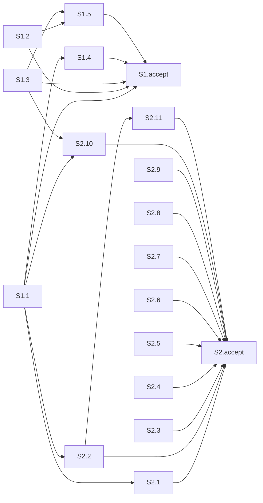

Срез S2 сходится: обязательный осмотр один — перечень агентов, обследование кода не ограничено тремя модулями. Команда дописывания стоит опциональным пунктом и задачей S2.4. Срез S1 не пересобирался: опора — `reports/quality-control-2026-11-10-3.md`, там по S1 замечаний нет, набор сценариев S1 и обязательный пункт S1 не менялись.

### Verdict

`OK`

Проверен только срез S2 после сужения обязательной приёмки. Критерии 1–6, 8, 8b, 9–11. Режим: срезы (`# Срез S1`, `# Срез S2`). `changed_slices`: S2. `reused_checks`: S1 из `quality-control-2026-11-10-3.md`. `deterministic_results`: нет; рёбра графа, которые не касаются приёмки S2, взяты из того отчёта. `User Task Contract` pre-check и ручной конфиг в промпте не переданы; строки задач S2 прочитаны заново.

### Slice Summary

| Slice | Scenario | Tasks | Acceptance | Dependencies | Gate |
|---|---|---|---|---|---|
| S1 Сильные шаги на Opus | **reused** — отчёт 2026-11-10-3, строка сводки S1 | S1.1–S1.5 (5), без правок в этом проходе | S1.accept (4 буллета: 1 обязательный + 3 опциональных) — **reused**, обязательный пункт не менялся | нет | `<!-- slice-gate -->` есть — **reused** |
| S2 Один хозяин на шаг | Обследование кода не ограничено тремя модулями. Команда дописывания, короткий текст ошибки и пакет развилок остаются в срезе и приёмку не блокируют | S2.1–S2.11 (11), состав задач тот же | S2.accept (4 буллета: 1 обязательный + 3 опциональных; в связи 13 имён сценариев) | S1 | `<!-- slice-gate -->` есть, одна фраза про перечень |

Ровно один `S2.accept`. Маркера `<!-- phase-gate -->` нет. Задач вида `S2.T<M>` нет.

### Scenario Coverage

Заголовки S1 и их покрытие **reused** из `quality-control-2026-11-10-3.md` (18 имён в связи S1, оба заголовка «Заголовок раздела не называет Fable» и оба «В списке нет Opus 5 для бывшего сильного шага»). В этом проходе таблица S1 не пересобиралась.

Ниже — сценарии, связанные со срезом S2. Оба заголовка «Сбой написания не повторяет тот же вызов» (MODIFIED и ADDED) закрывает одна задача S2.1.

| Scenario | Covered by | Status |
|---|---|---|
| Один модуль тоже обследование | S2 Primary, S2.2, при остатке порога в диспетчере — S2.11 | покрыт |
| Короткий текст ошибки без трассы | S2.3, S2.accept опционально | покрыт |
| Обследование BSL при недоступном кастомном агенте | S2.11, сверка по тексту | покрыт |
| Не-1С файлы | S2.11, сверка по тексту | покрыт |
| Сбой написания не повторяет тот же вызов (двухшаговая цепочка, MODIFIED) | S2.1 | покрыт |
| Сбой написания не повторяет тот же вызов (цепочка из строки роли, ADDED) | S2.1 | покрыт |
| Простая готовность задач без отдельной модели | S2.1 | покрыт |
| Пример ревью не теряет модель роли | S2.2 | покрыт |
| Дописывание не зовёт проверку всегда | S2.4, S2.accept опционально | покрыт |
| Создание не ставит маркер раньше брифа | S2.6 | покрыт |
| Новая задача после подписи | S2.5 | покрыт |
| Раздел есть только в полном теле | S2.9 | покрыт |
| Две продуктовые развилки уходят одним сообщением | S2.10, S2.accept опционально | покрыт |
| Маркер и форма не сливаются | S2.10 | покрыт |

S2.7 (шапка обзора, сборщик манифеста) и S2.8 (свежая передача и список шаблонов) по-прежнему закрывают решение D8 внутри среза и не являются дырой покрытия. Это та же заметка, что в отчёте 2026-11-10-3; отдельным алертом не ставится.

### Dependency Graph

Рёбра задач **reused** из отчёта 2026-11-10-3: состав S2.1–S2.11 и объявленные зависимости не менялись. Обновлён только смысл обязательной приёмки: блокирующий итог S2 больше не включает осмотр команды дописывания. S2.4 остаётся в срезе и кормит опциональный пункт.

Срез S2 объявляет зависимость от S1. Обратного ребра нет. Цикла нет. Приёмка S2 не повторяет путь S1 и не требует среза после S2: следующего среза нет.

Общие файлы по-прежнему закрыты объявленными рёбрами: `model-selection.mdc` (S1.1 → S2.1), `tool-name-guard.mdc` и `architect-gate.mdc` (S1.1 → S2.2), `openspec-verify-change/SKILL.md` (S1.1 и S1.3 → S2.10). Внутри S2 `session-discipline.mdc` правят S2.8 и S2.9 подряд.

### Checklist

| Критерий | S1 | S2 |
|---|---|---|
| 1. Покрытие сценариев | **reused**, выполнено | выполнено: 13 имён связи и оба заголовка «Сбой написания» закрыты Primary, опциональным пунктом или задачей |
| 2. Независимость | **reused**, выполнено | выполнено: зависимость только назад, на S1; более позднего среза нет |
| 3. Полнота | **reused**, выполнено | выполнено: перечень вызова и таблица остановок — S2.2; диспетчер, если порог в его таблице останется, — S2.11; команда дописывания для опционального пункта — S2.4 |
| 4. Граф | **reused**, выполнено | выполнено: зависимость S1 объявлена, предшественники S1.1 и S1.3 есть, цикла нет |
| 5. Целостность ворот | **reused**, выполнено | выполнено: один `S2.accept`, один `<!-- slice-gate -->` |
| 5b. Чеклист приёмки | **reused**, выполнено | выполнено: `**Primary acceptance:**` есть, первый пункт обязательный, чужих сценариев в чеклисте нет, пустого тела нет |
| 6. Риск переделки | **reused**, выполнено | выполнено: сценарии S2 не повторяют сценарии S1; опора на S1 объявлена |
| 8. Наблюдаемость | **reused**, выполнено | выполнено: обязательный пункт — открыть перечень агентов и прочитать, что обследование кода не ограничено тремя модулями |
| 8b. Достижимость внутри среза | **reused**, выполнено | выполнено: итог собирают S2.2 и S2.11; дубля Primary с S1 нет; более позднего среза нет |
| 9. Заготовка с воротами | **reused**, не выполняется | не выполняется: S2 — последний срез; приёмка S1 по опоре наблюдаемая |
| 10. Простота приёмки | **reused**, выполнено | выполнено: в теле один пункт без пометки «опционально» |
| 11. Контракт задач | **reused**, выполнено | выполнено: в S2.1–S2.11 нет поручения пользователю на базу, стенд, консоль, отладчик или вызов API |

Критерий 8. Обязательный пункт S2 — открыть перечень агентов и увидеть один итог: обследование кода не ограничено тремя модулями. Это чтение правила набора, не вызов процедуры и не просмотр типа. `slice-not-vertical` не ставится.

Критерий 8b. Строку «3+ модулей» у обследователя снимает S2.2 (перечень вызова и таблица остановок). Если та же строка останется в таблице типов задач диспетчера, S2.11 дописывает этот файл в S2.2, новый срез не открывается. Хозяин порога в design — правило делегирования; слой лежит в этом срезе. Команда дописывания для этого итога не нужна. `slice-accept-not-self-achievable` не ставится.

Критерий 9. У S1 есть accept и slice-gate, S2 зависит от S1. Третье условие ложной заготовки — приёмка S1 только программная — по отчёту 2026-11-10-3 не выполнено, обязательный пункт S1 в этом проходе не менялся. У S2 нет зависимого среза S3. `slice-foundation-with-gate` не ставится.

Критерий 10. В `S2.accept` один обязательный пункт: перечень агентов. Три остальных помечены «(опционально)»: «Дописывание не зовёт проверку всегда», «Короткий текст ошибки без трассы», «Две продуктовые развилки уходят одним сообщением». Имена в ёлочках совпадают с заголовками `#### Scenario:`. Маркер конца среза — одна фраза: обследование кода не ограничено тремя модулями. В `design.md` § Slices Primary S2 совпадает с этой фразой, команда дописывания названа проверкой того же среза и приёмку не блокирует. Прежний алерт `acceptance-simplicity-overload` из отчёта 2026-11-10-3 закрыт. Новый не ставится.

Критерий 11. В строках `S2.1`–`S2.11` нет «тестовой ИБ», «на стенде», «runtime-verify», «спайк», «в консоли», «отладчик», «эмулировать вызов», «вызвать API». Нет цепочек «после verify» и «после стенда». S2.11 — сверка текста правил агентом; условие «если после S2.2 порог останется» дописывает файл в ту же задачу S2.2. Чтение перечня на границе среза стоит в `S2.accept`. `user-task-contract-violation` не ставится.

### Alerts

Нет.

### Task Readability

Заголовки `S2.1`–`S2.11` в этом проходе не менялись. Читаемость этих задач **reused**: глагол, файл и зачем на месте, `task-opaque-title` и `task-too-short` не ставились.

Заголовок `S2.accept` теперь называет итог среза: обследование кода не ограничено тремя модулями. `task-opaque-acceptance` и `legacy-acceptance-format` не ставятся.

### Recommendations

Автоматических правок нет. Решение заказчика не требуется. Срезы не сливать: видимый итог S1 — раздел шагов и реплика проверки постановки, видимый итог S2 — перечень агентов.

### Reused scope vs new findings

- Переиспользовано: срез S1 целиком (критерии 1–6, 8, 8b, 9–11, читаемость задач, покрытие сценариев S1) из `openspec/changes/drop-fable-escalation/reports/quality-control-2026-11-10-3.md`. Рёбра графа задач S2.1–S2.11 из того же отчёта.
- Новые находки: обязательная приёмка S2 — один осмотр перечня; «Дописывание не зовёт проверку всегда» покрыто S2.4 и опциональным пунктом; алерт `acceptance-simplicity-overload` снят. Новых CRITICAL, WARNING и SUGGESTION нет.
