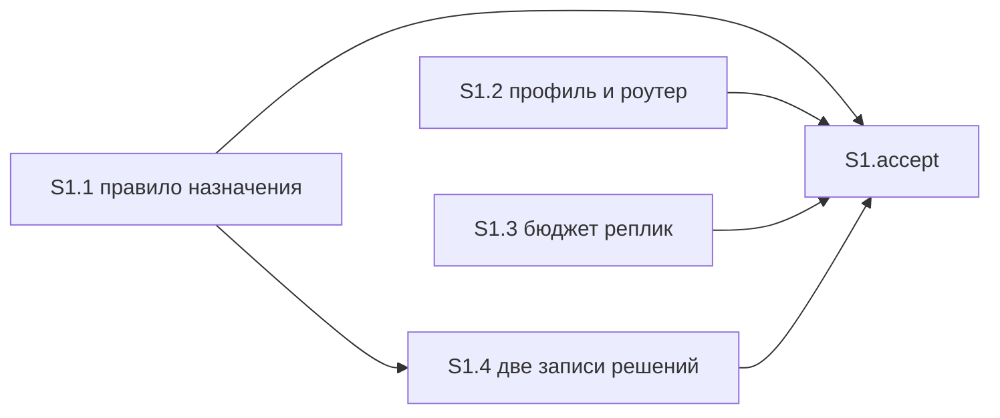

# Quality control — drop-fable-escalation — 2026-11-10

## Scope

- Mode: slice (`tasks.md` содержит `# Срез S1`). Кэш промах, `changed_slices: all`. Оценён весь текущий план.
- `reused_checks`: нет. Переиспользованных вердиктов нет.
- `deterministic_results`: нет. Граф и матрица покрытия собраны по текущему тексту, не взяты из снимка.
- `linked_scenarios`: имена из `**Связь со spec:**` среза S1. Полный контроль сверил все `#### Scenario:` дельты, не только этот список.
- `affected_contract_ids`: нет.
- Новые находки: полный прогон ниже.
- Ручной чеклист конфигуратора: нет. Механические замечания чекбоксов, пустых буллетов, phase-gate и формы: нет. Предпроверка контракта задач пустая; критерий 11 прогнан по тексту S1.1–S1.4.
- Исполнимость приёмки на информационной базе и тестовые данные не оценивались. Конфигурации 1С нет: наблюдаемый результат — текст правила назначения и бюджета реплик.

Источники: `tasks.md`, `design.md` § Slices и Non-Goals, `proposal.md`, четыре дельты `specs/**/spec.md` (29 `#### Scenario:`).

`no-slices` не выпускается. `deprecated-phase-gate` не выпускается: маркера фаз нет. `legacy-acceptance-format` неприменим: `S1.T*` нет.

## Verdict

`WARNING`

Один срез, одна приёмка, один обязательный заход. Объединять нечего. Дыра одна: в дельте требований 13 сценариев не названы ни в приёмке, ни в рабочих задачах. Правится одной сверкой по тексту внутри того же среза.

## Slice Summary

| Slice | Scenario | Tasks | Acceptance | Dependencies | Gate |
|---|---|---|---|---|---|
| S1: Сильные шаги на Opus | Тяжёлый разбор, сверка с прошлым договором и просьба самой сильной модели описаны старшим Opus 5; строка «Разбор постановки (Fable)» нигде не разрешена | S1.1–S1.4 (4) | `S1.accept` (1 обязательный + 3 необязательных; в связи 11 имён, буквально в чеклисте 3) | нет | есть, один |

Объём — 5 чекбоксов. Для этого размера один срез уместен. Второй срез не нужен: правило назначения, профиль, бюджет реплик и две записи решений дают один видимый текст. `design.md` ## Slices совпадает: один срез, те же файлы, зависимости нет.

`**Primary acceptance:**` и подпункт `**Primary (обязательно):**` совпадают дословно и совпадают с `design.md` § Slices.

Перечень покрытия в `design.md` § Slices короче связи в `tasks.md` на имя «Профиль активен для известной модели». Задача S1.2 это имя уже содержит. На структуру среза не влияет.

## Scenario Coverage

В дельте 29 сценариев. Закрыто 16. Не закрыто 13.

| Scenario | Covered by | Status |
|---|---|---|
| Тяжёлый разбор идёт на Opus, даже если Fable в списке | S1 Primary, S1.1 (имя буквально) | OK |
| Сверка с прошлым договором идёт на Opus | S1 Primary (три шага одной таблицей), S1.1 | OK |
| Просьба самой сильной модели не вызывает Fable | S1 Primary, S1.1 | OK |
| Написание и ревью не получают слаг Fable | S1.accept необязательный пункт, S1.1 | OK |
| В списке нет Opus 5 для бывшего сильного шага | S1.1 | OK |
| Сбой Opus не включает Fable | S1.accept необязательный пункт, S1.1 | OK |
| Обычный разбор без тяжёлого признака не отменяется | S1.1 | OK |
| Профиль активен для известной модели | S1.2 | OK |
| Бриф субагента учитывает профиль его модели | S1.2: учёт профиля GPT и Opus в брифе роли остаётся. Имя в задаче не стоит | OK |
| Профиль Fable не идёт в бриф роли | S1.accept необязательный пункт, S1.2 | OK |
| Неизвестная модель | нигде | GAP |
| Канон в том же ходе | S1.3: канон про недоступные дорогие модели остаётся и может быть сказан до итоговой карточки. Имя в задаче не стоит | OK |
| Токен не печатается | нигде | GAP |
| Фон не отменяется | нигде | GAP |
| Строка про Fable не исключение проверки | S1.3, часть обязательного пункта про бюджет реплик | OK |
| Progress на русском | нигде | GAP |
| Verify без английского progress | S1.3 | OK |
| Вызов архитектора без ошибки enum | нигде | GAP |
| Команда на Grok 4 без смены чата | нигде | GAP |
| Рантайм свободен от мёртвых слагов | нигде | GAP |
| Ревью кода на модели Gemini из списка | нигде | GAP |
| В списке нет семейства Gemini | нигде | GAP |
| Сверка одного среза на модели чата | S1.1: пять мест проверки нескольких частей не меняются. Имя в задаче не стоит | OK |
| Сверка нескольких срезов на профиле GPT-5.6 | S1.1: фразы про профиль GPT-5.6 не меняются. Имя в задаче не стоит | OK |
| В списке нет профиля GPT-5.6 | S1.1, та же оговорка | OK |
| Готовность задач на модели чата | нигде | GAP |
| Готовность при неизвестном перехвате или вызове платформы | нигде | GAP |
| Сбой единственного вызова готовности задач | нигде | GAP |
| Слаг таблицы отсутствует в enum сборки | нигде | GAP |

Имена трёх необязательных пунктов совпадают с `#### Scenario:` буквально. Чужого сценария в чеклисте нет. Обязательный пункт не цитирует заголовки: его текст — общий итог трёх шагов таблицы и отсутствия строки про Fable в бюджете. Эти заголовки стоят в S1.1 и в `**Связь со spec:**`.

Пять сценариев закрыты смыслом задачи, без ёлочек. Это покрытие, не дыра: оговорка S1.1 про пять мест и профиль GPT-5.6 однозначно держит три сценария сверки срезов; S1.2 прямо оставляет учёт профиля GPT и Opus в брифе; S1.3 прямо оставляет канон до карточки.

`design.md` Non-Goals запрещает менять модель ревью, написания, обследования, трассы, упрощения, готовности задач и проверки нескольких частей. В `tasks.md` из этого списка удержаны проверка нескольких частей и запрет передать семейство Fable в написание, обследование, трассу, ревью и упрощение. Готовность задач, пустой отбор Gemini, обычная строка архитектора, смена чата, мёртвые слаги и самосверка enum в задачах не названы. Non-Goals задачей не является.

## Dependency Graph

Объявленные рёбра между срезами: нет. Циклов нет. Приёмка не смотрит вперёд: второго среза нет. Необъявленного предшественника, без которого срез нельзя принять, нет.

Внутри среза:

- S1.1, S1.2, S1.3: зависимостей нет. Разные файлы, параллельно допустимы.
- S1.4: объявлено `S1.1`. Задача существует. Цикла нет. Запись ADR-0005 фиксирует одну строку про Opus 5; ту же строку из бюджета убирает S1.3. Ждать S1.3, чтобы написать запись, не требуется: текст берётся из решения D6. Оба пункта всё равно стоят до приёмки.

## Checklist Results

| # | Criterion | Result |
|---|---|---|
| 1 | Scenario Coverage | Пропуск — 16/29. Тринадцать `#### Scenario:` дельты нет ни в обязательном пункте, ни в необязательных, ни в S1.1–S1.4. Алерт `accept-bullets-missing-scenario` |
| 2 | Slice Independence | Выполнено. Следующих срезов нет. Приёмка S1 не ждёт более поздний срез |
| 3 | Slice Completeness | Выполнено для обязательного захода. Текст правила — S1.1. Бюджет реплик — S1.3. Профиль для необязательного пункта — S1.2. Записи решений — S1.4. Метаданные, формы и код 1С не требуются. Файлы из `proposal.md` ## Scope, которые правятся, все есть в задачах |
| 4 | Slice Dependency Graph | Выполнено. Межсрезовых рёбер нет, объявлено «нет». Внутреннее ребро S1.4 → S1.1 существует, цикла нет |
| 5 | Slice Gate Integrity | Выполнено. Ровно один `S1.accept` и один `<!-- slice-gate -->` |
| 5b | Acceptance Checklist Coverage | Пропуск по покрытию дельты — тот же `accept-bullets-missing-scenario`. `**Primary acceptance:**` и `**Primary (обязательно):**` есть. Чеклист не пуст. `accept-bullet-foreign-scenario` нет |
| 6 | Rework Risk | Выполнено. Опоры на непринятый предыдущий срез нет. Один сценарий двум срезам не отдан. Общий файл с соседней заявкой на проверку нескольких частей разрезан оговоркой «пять мест не меняются» |
| 7 | Task readability | Выполнено. `task-opaque-title`, `task-too-short`, `task-opaque-acceptance` нет |
| 8 | Slice Verticality | Выполнено. Единственный обязательный пункт — открыть правило назначения и бюджет реплик и увидеть текст: три бывших сильных шага вызывают старшую модель семейства Opus, мажор 5, со строкой «Разбор постановки (Opus 5)», даже если семейство Fable есть в списке, а в бюджете проверки постановки строки про Fable нет. Это чтение текста правил, не вызов процедуры и не просмотр типа. `slice-not-vertical` не срабатывает |
| 8b | Self-Achievable Acceptance | Выполнено. Соседнего среза нет. Дубля захода нет. Правило собирает S1.1, бюджет — S1.3. Оба в этом срезе |
| 9 | Foundation slice with gate | Выполнено. Потребителя S2 нет. Приёмка описывает видимый текст назначения и бюджета, не отдельную сверку заготовки |
| 10 | Acceptance Simplicity | Выполнено. В теле приёмки один обязательный пункт. Три строки таблицы с одним итогом и фраза бюджета — один заход: снятие семейства Fable видно в правиле и в списке разрешённых реплик. Три остальных буллета помечены «(опционально)». `acceptance-simplicity-overload` не срабатывает |
| 11 | User Task Contract | Выполнено. В S1.1–S1.4 нет поручения человеку на информационную базу, стенд, консоль, отладчик, спайк или вызов API и нет цепочки «после verify / после стенда». Рабочие задачи — правки текстов kit. Чтение правила и бюджета стоит в поле `**Приёмка:**` и в `S1.accept` |

## Task readability

| Task | Title | Result |
|---|---|---|
| S1.1 | Заменить в `.cursor/rules/model-selection.mdc` выбор семейства Fable на старший Opus 5, чтобы тяжёлый разбор, сверка с договором и просьба самой сильной модели не вызывали Fable (D1, D2, D5) | Файл, изменение и зачем в заголовке. Семь имён сценариев в теле буквальные. Ссылка на решения — в скобках и читается по `design.md` ## Decisions |
| S1.2 | Дописать `.cursor/rules/model-fable5.mdc` и `.cursor/rules/model-adaptation.mdc`: профиль Fable остаётся для чата на этой модели и не берётся в бриф роли, чтобы роль не получала манеру ответа Fable (D4) | Два файла, что остаётся и зачем |
| S1.3 | Убрать строку «Разбор постановки (Fable)» из пяти файлов бюджета и проверки постановки, чтобы проверка постановки не разрешала эту реплику (D3) | Строка, файлы и зачем |
| S1.4 | Поправить две записи решений: оставить одну строку про Opus 5 и перевести сверку с договором на Opus, не переименовывая раздел таблицы (D6) | Оба пути, что меняется, граница «раздел не переименовывать» |
| S1.accept | Принять срез S1 «Сильные шаги на Opus» — тяжёлый разбор, сверка с договором и просьба самой сильной модели идут на Opus, строки про Fable в чате нет | Бизнес-результат одной фразой. Имена трёх необязательных сценариев буквальные |

Короче 8 слов нет. Голого идентификатора решения вместо файла нет. Legacy `S1.T*` нет.

Номера D1–D6 в скобках задач совпадают с `design.md` ## Decisions. В `proposal.md` ## Decisions те же номера D1–D5 означают другие решения; D6 там нет. Заголовки задач от номера не зависят.

## Verticality, self-achievable, simplicity

Обязательный заход один. Открыть правило назначения и увидеть три бывших сильных шага на старшем Opus 5 со строкой «Разбор постановки (Opus 5)». Вторая фраза того же пункта — в бюджете реплик проверки постановки строки про Fable нет. Это две поверхности одного снятия, не второй обязательный запуск. Маркер конца среза говорит то же одним предложением.

S1.2 и S1.4 для этого захода не нужны. Они закрывают профиль и записи решений до той же приёмки и не образуют отдельный видимый итог.

Три необязательных пункта — границы того же запрета: слаг не уходит в написание и ревью, профиль не берётся в бриф роли, сбой Opus не подставляет семейство Fable. Они не блокируют `[x]`.

## User task contract

Строки S1.1–S1.4 не содержат: тестовая ИБ, стенд, консоль, отладчик, спайк, вызов API, «после стенда», «после verify». Условие «даже если Fable есть в списке» — текст, который правило должно содержать, не поручение человеку прогнать вызов. Приёмка человека — `S1.accept`.

## Alerts

### 1. `accept-bullets-missing-scenario`

- affected slice/task: S1, дельта `specs/**/spec.md`, задачи S1.1–S1.4
- alert type: `accept-bullets-missing-scenario`
- severity: `WARNING`
- evidence: в четырёх файлах дельты 29 `#### Scenario:`. В `tasks.md` по имени или по прямому смыслу закрыты 16. Не закрыты:
  1. «Вызов архитектора без ошибки enum»
  2. «Команда на Grok 4 без смены чата»
  3. «Рантайм свободен от мёртвых слагов»
  4. «Ревью кода на модели Gemini из списка»
  5. «В списке нет семейства Gemini»
  6. «Готовность задач на модели чата»
  7. «Готовность при неизвестном перехвате или вызове платформы»
  8. «Сбой единственного вызова готовности задач»
  9. «Слаг таблицы отсутствует в enum сборки»
  10. «Неизвестная модель»
  11. «Токен не печатается»
  12. «Фон не отменяется»
  13. «Progress на русском»

  Носители этих сценариев — те же файлы, которые S1.1 и S1.3 переписывают: правило назначения (ветки семейства Fable стоят рядом с обычным вызовом архитектора, пустым отбором и готовностью задач) и бюджет реплик (строка про Fable стоит в том же абзаце, что канон и поведение фона). `design.md` Non-Goals часть моделей удерживает, задачи — нет.
- recommendation: не открывать второй срез и не добавлять 13 обязательных пунктов приёмки. Одна задача агента до `S1.accept`: сверить по тексту, что эти сценарии по-прежнему читаются, и не менять их носители, кроме строк, которые S1.1–S1.3 уже задают.

### Remediation (auto-repair)

- alert: `accept-bullets-missing-scenario`
- target: `openspec/changes/drop-fable-escalation/tasks.md`, срез S1
- action: перед `S1.accept` добавить одну задачу, не второй срез и не обязательный пункт приёмки. Формулировка: в `.cursor/rules/model-selection.mdc`, `.cursor/rules/model-adaptation.mdc`, `.cursor/rules/chat-output-budget.mdc`, `.cursor/rules/chat-output-budget-full.mdc`, `.cursor/rules/verify-user-communication.mdc` и `.cursor/skills/openspec-verify-change/SKILL.md` сверить по тексту, что перечисленные сценарии по-прежнему читаются, и не менять их носители, кроме строк, которые S1.1–S1.3 уже задают. Имена буквально, все 13 из алерта. В ту же сверку можно дописать пять уже закрытых смыслом, но без ёлочек: «Сверка одного среза на модели чата», «Сверка нескольких срезов на профиле GPT-5.6», «В списке нет профиля GPT-5.6», «Бриф субагента учитывает профиль его модели», «Канон в том же ходе». Зависимости: S1.1, S1.2, S1.3. Те же 13 имён дописать в `**Связь со spec:**`. В `S1.accept` их не ставить: для `[x]` остаётся один обязательный пункт.

## Recommendations

**Автоправка**

Одна задача сверки по тексту внутри S1, как в блоке remediation. Обязательный пункт приёмки не дробить. Второй срез не открывать.

**Решение о структуре срезов**

Не требуется. Срез один, обязательный заход достижим его задачами, видимый результат один. Карточка «объединить срезы или переписать приёмку» не нужна.

**При исполнении**

Правило назначения делит абзацы с соседней заявкой на проверку нескольких частей. S1.1 уже запрещает менять пять мест этой проверки и фразы про профиль GPT-5.6. Эти абзацы не переписывать вместе с ветками семейства Fable.

**Не выпущено**

`primary-acceptance-missing`, `accept-checklist-empty`, `accept-bullet-foreign-scenario`, `slice-not-vertical`, `slice-accept-not-self-achievable`, `slice-foundation-with-gate`, `acceptance-simplicity-overload`, `user-task-contract-violation`, `task-opaque-title`, `task-too-short`, `task-opaque-acceptance`, `legacy-acceptance-format`, `no-slices`, `deprecated-phase-gate`.

## Reused vs new

- reused: none
- new: полный прогон среза S1 и всех 29 сценариев четырёх дельт по текущему тексту `tasks.md`, `design.md`, `proposal.md`
