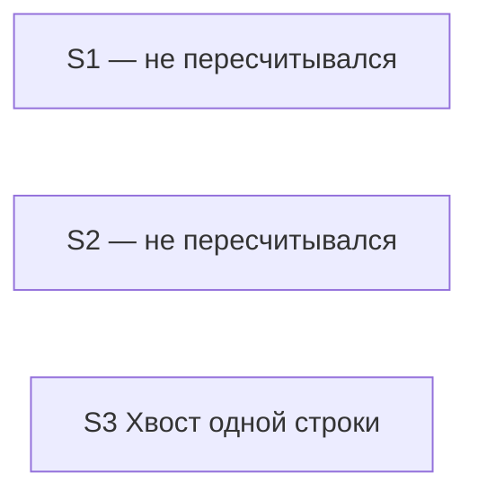
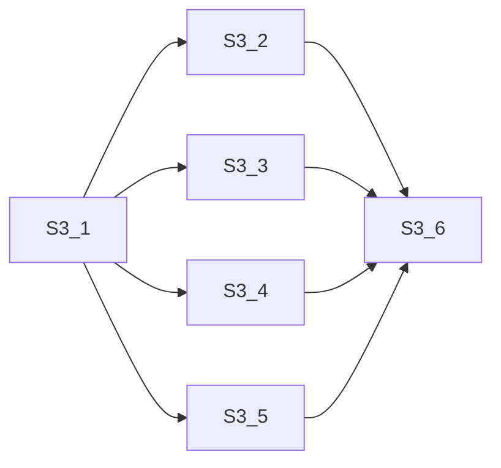

# Quality Control — handoff-empty-explore (срез «Хвост одной строки», после дописки сценариев)

Дата: 2026-11-10. Режим: срезы (`# Срез S3`). Объём нового контроля: только S3, целиком. Набор названий сценариев этого среза изменился, поэтому прежний разбор S3 из `reports/quality-control-2026-11-10.md` не переносится.

Опора для S1 и S2: `reports/quality-control-2026-11-10.md`. Прежняя опора: `reports/quality-control-2026-10-23-2.md`. Уточнение опциональной строки S1 про недособранную заявку контроль не сбрасывает. Новый полный контроль S1 и S2 с нуля не создавался.

Источники нового объёма: `tasks.md` (срез S3), `design.md` (решение «Хвост одной строки», `## Slices`, матрица приёмки), `specs/change-marker-placement/spec.md`; правила `.cursor/rules/vertical-slices.mdc` (критерии 1–6, 8, 8b, 9–11, User Task Contract, формат приёмки), `.cursor/rules/task-readability.mdc`.

Вне оценки: выполнима ли приёмка прямо сейчас, нужны ли тестовые данные. Способ приёмки среза — сверка текстов правил, без прогона в базе.

Хвост в другую заявку этот контроль не предлагает.

## Verdict

`OK`

По S3 блокирующих и предупреждающих находок нет.

## Slice Summary

| Slice | Scenario | Tasks | Acceptance | Dependencies | Gate |
|---|---|---|---|---|---|
| S1 «Постановка не теряется» | не пересчитывался | не пересчитывался | не пересчитывался | не пересчитывался | не пересчитывался |
| S2 «Признаки только модуля» | не пересчитывался | не пересчитывался | не пересчитывался | не пересчитывался | не пересчитывался |
| S3 «Хвост одной строки» | Одна изменённая строка вне текста запроса и без своего смыслового комментария заканчивается одной пометкой, без второй служебной строки | S3.1–S3.6 (6 задач: грамматика, оформление при разработке, сборка пометки, проверка комментариев, отсылка в обзоре слоёв, сверка с требованием) | `S3.accept` (Primary + 6 опциональных; 7/7) | нет | есть |

S1 и S2 в этой таблице не заполнены заново. Итог по ним — в файле опоры `reports/quality-control-2026-11-10.md`, который сам опирается на `reports/quality-control-2026-10-23-2.md`. Вердикт опоры по этим двум срезам — `OK`.

## Проверка переданных фактов

| Факт | Итог |
|---|---|
| Семь сценариев названы в `design.md` `## Slices` | Да. В строке таблицы среза — короткий сценарий, не семь имён. Семь имён стоят в подразделе «Матрица приёмки» той же секции, буквально как в `#### Scenario:` |
| Семь названы в `**Связь со spec:**` | Да, буквально |
| Семь покрыты в `S3.accept` | Шесть — строками `Scenario «…» (опционально)`. «Одна строка — один хвост» закрыт обязательной проверкой, без повторения заголовка в буллете. Так и задан формат: первая строка приёмки — текст обязательной проверки |
| Старое имя «Строка внутри текста запроса» как заголовок сценария | Снято. В приёмке, связи со spec и матрице его нет. На его месте «Строка внутри строковой константы». В тексте опциональной строки и в пункте поведения 13 слова «текст запроса» остаются описанием случая, не вторым именем сценария |
| Новый сценарий «Строка внутри удаления перехвата» | Есть в требовании, в матрице, в связи со spec и отдельной опциональной строкой приёмки. Имя совпадает буквально |
| Ровно один `S3.accept` | Да, один |
| Ровно один маркер конца среза у S3 | Да, один `<!-- slice-gate: … -->` после приёмки S3 |
| Зависимости среза: нет | Да. В шапке «нет». Задачи S3 не ссылаются на S1 или S2 |
| Обязательная проверка в шапке и первая строка `S3.accept` совпадают | Да, дословно: «Одна изменённая строка вне текста запроса и без своего смыслового комментария заканчивается одной пометкой, без второй служебной строки.» Текст обязательной приёмки в этом проходе не менялся |
| Запрещённые формулировки задач (тестовая база, стенд, консоль, отладчик, эмуляция вызова, «после успешной проверки», «после стенда») | Совпадений нет. Переданная проверка и повторный просмотр S3.1–S3.6 совпали: правки и сверка текстов набора, не работа пользователя в базе |

Абзац `**Primary acceptance:**` в `design.md` для S3 совпадает с шапкой и с первой строкой приёмки. В сводной таблице `## Slices` формулировка короче («не обрастает второй служебной строкой»); это тот же видимый результат, не второй обязательный путь.

Обязательная проверка по-прежнему говорит «вне текста запроса». Положительный сценарий в требовании теперь ограничен строкой вне строковой константы. Это не вторая обязательная проверка и не дыра покрытия: расширенное исключение закрыто опциональной строкой «Строка внутри строковой константы», а S3.1 и S3.2 уже говорят про строковую константу. Блокирующая проверка остаётся одним путём — одна строка, одна пометка.

## Scenario Coverage

Только `specs/change-marker-placement/spec.md`, Requirement «Правка одной строки помечается одним хвостом». Семь заголовков `#### Scenario:`.

| Scenario | Covered by | Status |
|---|---|---|
| Одна строка — один хвост | S3 Primary + S3.1 (одна оставшаяся строка вне строковой константы несёт хвост), S3.2–S3.5 (то же размещение в оформлении, сборке, проверке и отсылке) | OK |
| Несколько строк — одна пара | `S3.accept` опционально + S3.2 (несколько соседних строк) + S3.4 (сжатие соседних хвостов одного изменения в пару) | OK |
| Конец процедуры остаётся парой | `S3.accept` опционально. В S3.1–S3.5 по имени не назван; сохранение текущего обрамления процедуры входит в сверку S3.6 с требованием целиком | OK |
| Строка внутри строковой константы | `S3.accept` опционально (нет служебного комментария в конце строки, пара вокруг оператора) + S3.1 (строка строковой константы хвост не получает) + S3.2 (строковая константа) | OK |
| Строка внутри удаления перехвата | `S3.accept` опционально (на строке внутри блока удаления нет служебного комментария; если несущей строки не осталось, фрагмент обрамлён парой) + S3.1 (строка внутри блока удаления хвост не получает) + S3.2 (строка внутри блока удаления). Вторая половина исхода — пара, когда несущей строки не осталось, — в требовании и в опциональной строке; S3.6 сверяет тексты правил с требованием целиком | OK |
| Свой комментарий строки сохраняется | `S3.accept` опционально + S3.2 (строка со своим комментарием) | OK |
| Уже стоящие пары не переписываются | `S3.accept` опционально. В S3.1–S3.5 по имени не назван; запрет переписывать уже стоящие пары входит в сверку S3.6 с требованием целиком | OK |

Имена в опциональных строках совпадают с заголовками `#### Scenario:` буквально, включая новое имя и переименованное. Сценариев другого среза в приёмке S3 нет. Обязательная проверка описывает тот же видимый шаг, что сценарий «Одна строка — один хвост»: одна строка без своего смыслового комментария заканчивается одной пометкой, второй служебной строки нет.

Правило про одну добавленную строку внутри блока вставки (хвост на строке, не на директиве) отдельного сценария не имеет. В покрытие сценариев оно не входит. В задачах оно названо в S3.2.

Три исхода («конец процедуры», «уже стоящие пары», вторая половина удаления без несущей строки) не расписаны отдельной фразой в S3.1–S3.5. Покрытие есть: опциональная строка приёмки и сверка S3.6 с требованием целиком. Отдельное предупреждение из этого не следует: дыры покрытия нет, имя в приёмке стоит.

## Dependency Graph

Между срезами, только рёбра, которые касаются S3: их нет. S3 не объявляет зависимость и сам никому не объявлен. Цикла нет. Приёмка S3 не ждёт более поздний срез: более позднего среза нет. Приёмка S3 не повторяет обязательную проверку S1 или S2.

Внутри S3 (все рёбра объявлены в задачах; набор задач и зависимости в этом проходе те же, граф собран заново по текущему тексту):

Циклов нет, ссылок вперёд нет, необъявленных рёбер нет. S3.2, S3.3, S3.4 и S3.5 опираются на грамматику S3.1 и друг от друга не зависят. Сверка S3.6 стоит после всех четырёх. В тексте S3.6 обзор слоёв отдельной фразой не выделен, но зависимость от S3.5 объявлена, поэтому порядок прохода безопасен.

Граф S1 и S2 из файлов опоры заново не строился.

## Оценка по критериям

| № | Критерий | S3 |
|---|---|---|
| 1 | Покрытие сценариев | OK: 7/7. Один — обязательная проверка, шесть — опциональные строки приёмки. Переименованный сценарий строковой константы и новый сценарий удаления перехвата ещё и в S3.1 и S3.2 |
| 2 | Независимость | OK: срез принимается без S1, S2 и без какого-либо следующего среза |
| 3 | Полнота | OK: для обязательной проверки внутри среза есть грамматика (S3.1), оформление при разработке (S3.2), сборка пометки (S3.3), признание одиночного хвоста и сжатие соседних хвостов (S3.4), отсылка в обзоре и заготовке (S3.5). Исключение строковой константы и строки внутри блока удаления входит в S3.1 и S3.2. Отдельного недостающего слоя нет |
| 4 | Граф зависимостей | OK: у среза объявлено «нет», и задачи это подтверждают. Внутренние зависимости объявлены и существуют |
| 5 | Целостность границы | OK: ровно одна приёмка `S3.accept`, ровно один маркер конца среза |
| 5b | Покрытие чеклиста приёмки | OK: обязательная проверка есть в шапке и первой строкой приёмки, тексты совпадают. Пустого чеклиста нет. Чужих сценариев нет. Все семь имён требования покрыты |
| 6 | Риск переделки | Низкий. Файлы S3 не пересекаются с файлами S1 и S2. Обязательная проверка S3 не повторяет путь постановки и не повторяет вопрос о поставке формы. Новый и переименованный сценарии сидят в том же срезе, до его приёмки. Расхождение текстов ловит последняя сверка того же среза |
| 8 | Наблюдаемость приёмки | OK: обязательная проверка — что видно на изменённой строке: одна пометка в конце, второй служебной строки нет. Опциональные строки тоже про видимый текст строки или пары вокруг неё. Это не вызов процедуры и не просмотр внутреннего результата |
| 8b | Достижимость приёмки внутри среза | OK: видимый хвост на одной строке дают задачи S3.1–S3.5. Ни S1, ни S2, ни более поздний срез для этого не нужны. Обязательные проверки трёх срезов — про разные видимые результаты. Новый сценарий удаления не переносит момент приёмки |
| 9 | Подготовительный срез с отдельной границей | Нет. Следующего среза, который забирал бы видимый результат S3, нет. Приёмка S3 сама описывает этот видимый результат |
| 10 | Одна обязательная проверка | OK: в теле приёмки одна обязательная последовательность. Шесть остальных строк помечены «опционально» |
| 11 | Задачи пользователю посередине среза | Нет. S3.1–S3.6 — правки и сверка текстов агентом. Запрещённых формулировок нет, близких по смыслу («прогнать в базе», «открыть отладчик», «после стенда») тоже нет. Сверка текстов правил стоит на границе приёмки, не отдельной задачей пользователя в середине среза |
| — | Читаемость задач | OK: S3.1–S3.5 — глагол, путь к файлу, что меняется, зачем, ссылка на решение «Хвост одной строки». S3.1 и S3.2 называют строковую константу и строку внутри блока удаления. S3.6 называет четыре области и требование, расхождение правит текст правила. Заголовок приёмки содержит результат среза одной фразой |

## Alerts

Нет.

## Recommendations

### Автоматическая правка

Нет.

### Нужен выбор заказчика

Нет.

Видимый результат S3 (одна пометка на изменённой строке, без второй служебной строки) и момент его приёмки не менялись. Новый сценарий и переименование остались внутри этого среза. Срезы не сливаются. Хвост в другую заявку не выносится.

## Reused scope vs new findings

- Reused: S1 и S2 целиком, включая их сценарии, граф и вердикт `OK`, — опора на `reports/quality-control-2026-11-10.md`. Прежняя опора того файла — `reports/quality-control-2026-10-23-2.md`. Упорядоченный набор названий сценариев и текст обязательной приёмки этих срезов в этом проходе не переоценивались. Уточнение опциональной строки S1 про недособранную заявку контроль не сбрасывает. Новый полный контроль с нуля не создавался.
- Invalidated, не reused: прежний контроль S3 в `reports/quality-control-2026-11-10.md`. Причина: добавлен сценарий «Строка внутри удаления перехвата», сценарий «Строка внутри текста запроса» переименован в «Строка внутри строковой константы».
- New: S3 целиком (критерии 1–6, 8, 8b, 9–11 и читаемость задач) по текущим текстам. Находок нет.
