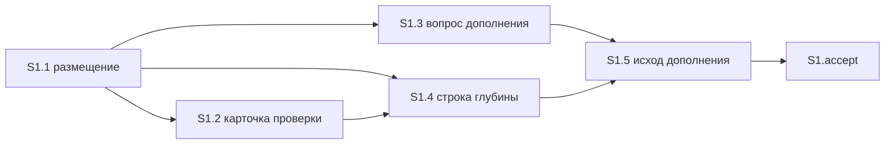

# Quality control — fix-route-from-analysis — 2026-10-16-2

## Scope

- Mode: slice (`# Срез S1`). Дельта: `changed_slices: S1`. Контроль целиком, прошлый `reports/quality-control-2026-10-16.md` не использовался как опора и не перезаписан.
- `reused_checks`: нет. `deterministic_results`: нет — покрытие и граф пересчитаны по текущим `tasks.md`, `design.md`, `proposal.md`, `specs/pipeline-light-route/spec.md`.
- `affected_contract_ids`: нет.
- Переиспользованных вердиктов нет. Новые находки: нет.
- Ручной чеклист конфигуратора не найден. Механические замечания шагов 7A–7E не переданы. Предпроверка контракта задач пустая; критерий 11 прогнан по тексту S1.1–S1.5.
- Исполнимость приёмки на информационной базе и наличие тестовых данных не оценивались.
- Конфигурации 1С нет. Слои среза — три уже существующих текста kit: `.cursor/rules/vertical-slices.mdc`, `.cursor/skills/openspec-verify-change/SKILL.md`, `.cursor/skills/openspec-extend-change/SKILL.md`.

## Verdict

OK

## Slice Summary

| Slice | Scenario | Tasks | Acceptance | Dependencies | Gate |
|---|---|---|---|---|---|
| S1 Маршрут починки с прежним результатом | Починка запроса после первой проверки оставляет проведение, сумму и справку и не спрашивает, куда положить задачи | S1.1–S1.5 (5) | S1.accept (1 primary + 8 optional; сценарии 9/9) | нет | `<!-- slice-gate -->` есть, один |

Объём — 6 чекбоксов (5 рабочих + приёмка). Для этого размера по умолчанию один срез. Девять Scenario — один маршрут и его границы, не девять самостоятельных результатов. Второй срез не нужен: уже открытая приёмка из текста ошибки, два разных результата и ответ внутри выбранного подхода остаются на том же пути. `design.md` ## Slices совпадает: один срез, отдельный срез на «проводится» не заводится.

## Criteria

| # | Criterion | Result |
|---|---|---|
| 1 | Scenario coverage | PASS — 9/9. У каждого Scenario видимый исход в чате. Отдельный путь «верифицировать по коду» не требуется: все девять закрыты Primary или optional accept. Статические «Проверка:» в S1.1–S1.5 дублируют то же покрытие по тексту правил. |
| 2 | Slice independence | PASS. Следующих срезов нет. Приёмка S1 не ждёт более поздний срез. Циклов нет. |
| 3 | Slice completeness | PASS. Для Primary нужны правило размещения, снятие карточки в проверке, снятие ожидания ответа в дополнении, строка глубины и исход «проверка не требуется». Это S1.1–S1.5. Три новых границы закрыты теми же задачами. Метаданных, формы и BSL у заявки нет. |
| 4 | Dependency graph | PASS. Между срезами рёбер нет, объявлено «нет». Внутри среза объявленные зависимости существуют, циклов нет. |
| 5 | Slice gate integrity | PASS. Ровно один `S1.accept` и один маркер `<!-- slice-gate -->`. `S1.T*` и `<!-- phase-gate -->` нет. |
| 5b | Acceptance checklist | PASS. Есть `**Primary acceptance:**` и один sub-bullet `**Primary (обязательно):**`. Чеклист не пуст. Чужих Scenario нет. Имена восьми optional совпадают с `#### Scenario:` буквально. |
| 6 | Rework risk | PASS. Опоры на непринятый предыдущий срез нет. Сценарий не повторён вторым срезом. S1.2 и S1.4 правят разные места одного скилла проверки, S1.3 и S1.5 — разные места скилла дополнения; порядок задан зависимостями. |
| 7 | Task readability | PASS. Нет `task-opaque-title`, `task-too-short`, `task-opaque-acceptance`. |
| 8 | Slice verticality | PASS. Единственный mandatory Primary — чёрный ящик чата: после первой полной проверки, при открытой приёмке и прежней сумме и справке нет карточки «в какой срез», нет приёмки «проводится», следующий шаг — реализация. |
| 8b | Self-achievable acceptance | PASS. Соседнего среза нет. Дубля journey нет. Карточка, приёмка «проводится» и шаг «реализация» собираются задачами S1.1–S1.5. Три новых границы тоже закрываются этими задачами. |
| 9 | Foundation slice with gate | PASS. Потребителя S2 с зависимостью от S1 нет. Accept S1 — видимый маршрут в чате, не приёмка «ревью контракта». |
| 10 | Acceptance simplicity | PASS. В `S1.accept` один mandatory journey. Восемь остальных буллетов помечены «(опционально)». |
| 11 | User task contract | PASS. В S1.1–S1.5 нет DENY-маркеров и нет цепочки «после проверки / после стенда» как обязанности человека. Рабочие задачи — правки текстов kit. Проход в чате указан в поле приёмки и в `S1.accept`. |

## Scenario Coverage

| Scenario | Covered by | Status |
|---|---|---|
| Починка запроса после первой проверки | S1 Primary, S1.1–S1.5 | OK |
| Уже открытая приёмка из текста ошибки снимается | S1.accept optional, S1.1, S1.2, S1.3, S1.4, S1.5 | OK |
| До первой полной проверки строка не срабатывает | S1.accept optional, S1.4 | OK |
| Смена формулы ведёт к проверке | S1.accept optional, S1.2, S1.4, S1.5 | OK |
| Разный момент приёмки оставляют вопросом | S1.accept optional, S1.1, S1.2, S1.3 | OK |
| Два разных результата оставляют вопросом | S1.accept optional, S1.1, S1.2, S1.3 | OK |
| Подписанная приёмка не дописывается | S1.accept optional, S1.1 | OK |
| Ответ внутри выбранного подхода остаётся короткой сверкой | S1.accept optional, S1.4, S1.5 | OK |
| Повторный запуск проверки не становится полным разбором | S1.accept optional, S1.4 | OK |

Покрытие Primary для «Починка запроса после первой проверки» — по совпадению пути, не по отдельной строке с именем в ёлочках. WHEN/THEN этого Scenario и `**Primary acceptance:**` описывают один заход: первая полная проверка уже была, приёмка проведения открыта, сумма и справка прежние → нет карточки «в какой срез», нет приёмки «проводится», следующий шаг — реализация. Имя сценария стоит в `**Связь со spec:**`. Текст Primary в metadata и mandatory sub-bullet совпадают. Пропусков нет.

Три сценария, добавленные к набору имён, закрыты отдельно от Primary:

- «Уже открытая приёмка из текста ошибки снимается» — S1.1 снимает лишний заголовок и приёмку до таблицы глубины; S1.2 не показывает карточку, когда такая приёмка уже открыта; S1.3 не ждёт ответ и не оставляет эту приёмку; S1.4–S1.5 дают шаг реализации, когда строка глубины сработала после снятия.
- «Два разных результата оставляют вопросом» — S1.1 оставляет вопрос, если одна правка меняет два уже записанных результата; S1.2 оставляет карточку при расхождении результата; S1.3 оставляет вопрос при двух разных результатах.
- «Ответ внутри выбранного подхода остаётся короткой сверкой» — S1.4 не даёт строке глубины перехватить дополнение без задач починки; S1.5 не включает этот ответ в две причины исхода «проверка не требуется».

## Dependency Graph

Объявленные рёбра между срезами: нет. Циклов нет. Вперёд (приёмка более раннего среза ждёт более поздний) нет. Необъявленных рёбер между срезами нет.

`S1.accept` своей строки «Зависимости:» не имеет. Это закрывающая задача среза после S1.1–S1.5.

Внутри среза:

- S1.1: зависимостей нет. Размещение, снятие уже открытой приёмки из текста ошибки, вопрос при двух разных результатах, признак подписанной приёмки.
- S1.2: S1.1. Тот же файл, что у S1.4, другой абзац: карточка «объединить срезы или переписать приёмку», в том числе когда приёмка из текста ошибки уже открыта.
- S1.3: S1.1. Тот же файл, что у S1.5, другой абзац: слияние без вопроса при той же сумме и том же моменте; вопрос остаётся при двух разных результатах.
- S1.4: S1.1, S1.2. Строка таблицы §1c; ответ внутри выбранного подхода без задач починки строка не перехватывает; шаг «оставить текст или переписать срез» не меняет.
- S1.5: S1.3, S1.4. Пункт «проверка не требуется» называет строку из S1.4; третьего исхода нет; ответ внутри выбранного подхода в эти две причины не входит.

Общие файлы с явной границей и объявленным порядком:

- `.cursor/rules/vertical-slices.mdc`: только S1.1.
- `.cursor/skills/openspec-verify-change/SKILL.md`: S1.2, затем S1.4.
- `.cursor/skills/openspec-extend-change/SKILL.md`: S1.3, затем S1.5.

## Verticality, self-achievable, simplicity

S1 Primary — один заход Scenario «Починка запроса после первой проверки». Наблюдается в чате по заявке, у которой первая полная проверка уже была, а приёмка проведения ещё открыта. Три следствия (нет карточки, нет приёмки «проводится», дальше реализация) — один THEN, не три обязательных journey.

Задачи того же среза этот THEN закрывают: S1.1–S1.3 убирают вопрос и отдельную приёмку из текста ошибки, в том числе уже открытую; S1.4–S1.5 ставят исход «проверка не требуется» и шаг реализации, когда условия строки выполнены. Более позднего среза, у которого лежал бы этот результат, нет.

Критерий 9 не срабатывает: второго среза нет, accept не является приёмкой ревью контракта.

Восемь optional-буллетов — границы того же маршрута. Они не блокируют `[x]`. Среди них три новых имени: уже открытая приёмка снимается; два разных результата оставляют вопрос; ответ внутри выбранного подхода остаётся короткой сверкой. Ни один из них не помечен обязательным.

## Task readability

| Task | Title | Result |
|---|---|---|
| S1.1 | Сузить в `vertical-slices.mdc` причину нового среза, чтобы починка без вопроса вставала в открытую приёмку (решения 2 и 5) | Файл, изменение и зачем в заголовке. Ссылка на решения — в скобках, заголовок читается без `design.md`. |
| S1.2 | Убрать в скилле проверки вопрос о срезе при той же сумме и том же моменте (решение 3) | Глагол, файл, зачем. |
| S1.3 | Снять в скилле дополнения ожидание ответа перед раскладкой при той же сумме и моменте (решение 3) | Глагол, файл, зачем. |
| S1.4 | Добавить в скилле проверки строку глубины: прежняя формула после первой проверки идёт на реализацию (решение 4) | Глагол, файл, зачем. |
| S1.5 | Дописать в скилле дополнения исход «проверка не требуется» по той же таблице (решение 4) | Глагол, файл, зачем. |
| S1.accept | Принять срез — починка не спрашивает, куда её положить, и идёт в реализацию | Бизнес-результат одной фразой. Имена optional Scenario буквальные. |

Короче 8 слов нет. Голого идентификатора решения вместо файла нет. Legacy `S1.T*` нет.

## User task contract

Строки `S1.1`–`S1.5` не содержат: тестовая ИБ, стенд, консоль, отладчик, спайк, вызов API, «после стенда», «после проверки» как условие запуска задачи человеком. Фразы «вопрос человеку» и «оставляют вопрос» описывают поведение правила, а не поручение человеку выполнить задачу. Блоки «Проверка:» — сверка текста правила агентом после правки. Приёмка человека — только `S1.accept` и поле `**Приёмка:**` (проход в чате).

## Alerts

Нет.

## Recommendations

### Automatic fix

Нет.

### Decision required

Нет. Срез один, Primary достижим его задачами, обязательный заход один.

### Remediation (auto-repair)

Нет.
