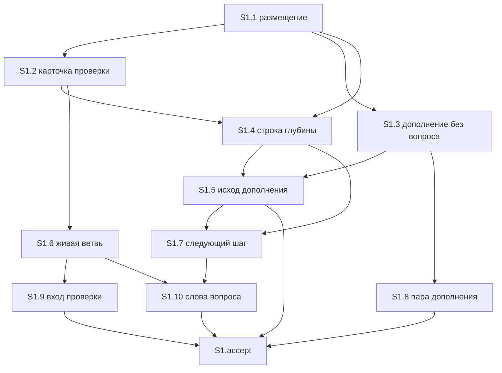

# Quality Control — Slice Coherence

- Change: `fix-route-from-analysis`
- Date: 2026-11-05
- Scope: S1 only («Маршрут починки с прежним результатом»). В изменении один срез.
- Mode: slice (`# Срез S1` есть). Legacy-приёмки `S1.T*` нет. `<!-- phase-gate` нет.
- Sources: `tasks.md`, `design.md`, `proposal.md`, `specs/pipeline-light-route/spec.md`, `.cursor/rules/vertical-slices.mdc`, `.cursor/rules/task-readability.mdc`.
- Reused checks: нет. `reports/quality-control-2026-11-05.md` как результат не использовался. S1 переоценён целиком по текущему набору сценариев.
- Affected contracts (контекст, новых находок нет):
  - EC-1 — запрет снятия снят 2026-11-05T17:14, текст правила не менялся. QC этот запрет не переоткрывает.
  - EC-2 — формулировка вопроса уже подтверждена заказчиком. QC выбор слов не переоткрывает.

## Verdict

`OK`

## Criteria

| # | Критерий | Результат |
|---|---|---|
| 1 | Scenario Coverage | PASS — 14/14 |
| 2 | Slice Independence | PASS — других срезов нет, зависимостей «вперёд» нет |
| 3 | Slice Completeness | PASS — слои правила, проверки и дополнения, нужные для приёмки, есть в S1 |
| 4 | Slice Dependency Graph | PASS — у среза `нет`; циклов нет; объявленных чужих срезов нет |
| 5 | Slice Gate Integrity | PASS — ровно один `S1.accept` и один `<!-- slice-gate -->` |
| 5b | Acceptance Checklist Coverage | PASS — Primary в metadata и в теле accept; пустого чеклиста нет; чужих сценариев нет |
| 6 | Rework Risk | PASS |
| 7 | Task Readability | PASS |
| 8 | Slice Verticality | PASS — обязательный Primary наблюдаем в чате |
| 8b | Self-Achievable Acceptance | PASS — Primary достижим задачами этого же среза |
| 9 | Foundation slice with gate | PASS — второго среза нет, условия не собраны |
| 10 | Acceptance Simplicity | PASS — обязательный black-box путь один |
| 11 | User Task Contract | PASS — предпроверка оркестратора подтверждена |

## Slice Summary

| Slice | Scenario | Tasks | Acceptance | Dependencies | Gate |
|---|---|---|---|---|---|
| S1 Маршрут починки с прежним результатом | Починка запроса после первой проверки (Primary); ещё 13 сценария — границы того же маршрута | S1.1–S1.10 (S1.1–S1.5 закрыты, S1.6–S1.10 открыты) | S1.accept (14/14): 1 обязательный Primary + 13 опциональных | нет | `<!-- slice-gate -->` есть |

Один срез при 10 рабочих задачах совпадает с порогом «6–15 задач → один срез, пока нет второго самостоятельного результата». Отдельный срез на приёмку «проводится» в `design.md` § Slices явно не заводится.

В срезе 14 сценариев при ориентире «1–3 связанных». Это не повод дробить: остальные 13 — границы одного маршрута (когда строка не срабатывает, когда вопрос остаётся, как звучит вопрос). Отдельной приёмки у них нет. Вынос в S2 дал бы ложную границу без собственного результата.

## Scenario Coverage

Спека `pipeline-light-route`: 9 сценариев требования «Починка с прежним результатом идёт на реализацию» и 5 сценариев требования «В пару не ставится ветвь, которая не выполняет уже сказанное». Имена в `**Связь со spec:**` и в опциональных буллетах совпадают с `#### Scenario:` буквально.

| Scenario | Covered by | Status |
|---|---|---|
| Починка запроса после первой проверки | Primary metadata + обязательный буллет `S1.accept`; задачи S1.1–S1.5 | покрыт |
| Уже открытая приёмка из текста ошибки снимается | опциональный буллет `S1.accept`; S1.1–S1.3 | покрыт |
| До первой полной проверки строка не срабатывает | опциональный буллет `S1.accept`; проверка в S1.4 | покрыт |
| Смена формулы ведёт к проверке | опциональный буллет `S1.accept`; S1.4, S1.5 | покрыт |
| Разный момент приёмки оставляют вопросом | опциональный буллет `S1.accept`; S1.1–S1.3 | покрыт |
| Два разных результата оставляют вопросом | опциональный буллет `S1.accept`; S1.1–S1.3 | покрыт |
| Подписанная приёмка не дописывается | опциональный буллет `S1.accept`; S1.1 | покрыт |
| Ответ внутри выбранного подхода остаётся короткой сверкой | опциональный буллет `S1.accept`; S1.4, S1.5 | покрыт |
| Повторный запуск проверки не становится полным разбором | опциональный буллет `S1.accept`; S1.4 | покрыт |
| Мёртвая ветвь карточки проверки не спрашивается | опциональный буллет `S1.accept`; S1.6 | покрыт |
| Карточка дополнения не предлагает не делать уже названное | опциональный буллет `S1.accept`; S1.8 | покрыт |
| Вход проверки не прячет уже сказанную фразу | опциональный буллет `S1.accept`; S1.9 | покрыт |
| Следующий шаг после ответа берётся из таблицы глубины | опциональный буллет `S1.accept`; S1.7 | покрыт |
| Вопрос показывается словами уже записанного результата | опциональный буллет `S1.accept`; S1.10 | покрыт |

Primary не повторяет заголовок сценария в ёлочках. Это тот же путь: первая полная проверка уже была, приёмка проведения открыта, сумма и справка прежние → карточки «в какой срез» нет, приёмки «проводится» нет, следующий шаг — реализация. Покрытие через Primary допустимо.

## Dependency Graph

Срез один. В метаданных `**Зависимости:** нет`. Рёбер между срезами нет. Циклов нет. Ссылок на несуществующий срез нет.

Внутри S1 рёбра задач объявлены и смотрят только назад:

S1.9 и S1.10 оба правят `.cursor/skills/openspec-verify-change/SKILL.md` в разных местах (вход проверки и слова вопроса). У S1.10 объявлены S1.6 и S1.7, не S1.9. Это не цикл и не зависимость приёмки от другого среза. Параллелить эти две задачи по одному файлу не стоит; на связность среза это не влияет.

## Slice Independence

Принять S1 можно, не ожидая следующего среза: следующего нет. Primary не дублирует чужой путь и не требует слоя из S2.

## Slice Completeness

Для приёмки нужны правки правил маршрута, а не метаданные, форма или модуль 1С (`proposal.md`: конфигурация не меняется, `form_mode: n/a`).

| Наблюдаемый кусок Primary | Где в S1 |
|---|---|
| Нет вопроса «в какой срез», нет отдельной приёмки из текста ошибки, подписанная приёмка не трогается | S1.1, S1.2, S1.3 |
| После первой полной проверки следующий шаг — реализация; смена формулы остаётся полной проверкой | S1.4, S1.5 |
| Мёртвая ветвь, шаг из таблицы глубины, карточка дополнения, вход проверки, слова вопроса | S1.6–S1.10 (опциональные сценарии того же среза) |

Пропуск слоя, без которого Primary нечем получить, не найден.

## Slice Gate Integrity

- Рабочие задачи: S1.1–S1.10.
- Приёмка: одна, `S1.accept`, чекбокс открыт.
- Маркер конца: одна строка `<!-- slice-gate: починка с прежней суммой и справкой после первой полной проверки не спрашивает, в какой срез её положить, отдельной приёмки «проводится» нет, следующий шаг — реализация -->`.
- Дубля `S1.accept` нет. `S1.T*` нет.

## Acceptance Checklist Coverage

- `**Primary acceptance:**` в метаданных S1 есть и совпадает с обязательным буллетом.
- Первый буллет тела — `**Primary (обязательно):**`.
- Остальные 13 буллетов помечены «(опционально)» и называют сценарии спеки буквально.
- Сценарий другого среза в чеклист не входит.
- `accept-checklist-empty` не срабатывает.
- `primary-acceptance-missing` не срабатывает.
- `accept-bullets-missing-scenario` не срабатывает.
- `accept-bullet-foreign-scenario` не срабатывает.

## Rework Risk

Предыдущего непринятого среза нет. Сценарий S1 не повторён во втором срезе. S1.6–S1.10 продолжают тот же маршрут и опираются на уже указанные задачи S1, а не на чужую приёмку. Отдельного риска переделки из-за границы срезов нет.

## Slice Verticality

Обязательный Primary — проход в чате по заявке: карточки «в какой срез» нет, приёмки «проводится» нет, следующий шаг — реализация. Это действие человека в маршруте и видимый итог, без отладчика, вызова процедуры и сверки контракта API.

`**Приёмка:**` тоже задаёт проход в чате, а не чтение файла правила.

Опциональные буллеты такие же: вопрос виден или нет, шаг назван, приёмка снята или не снята. Ни один обязательный пункт не сводится к проверке текста файла.

`slice-not-vertical` не срабатывает.

## Self-Achievable Acceptance

Второго среза нет, сравнивать Primary с S2 не с чем.

Обязательный путь закрывается задачами этого же среза: размещение и снятие лишней приёмки (S1.1–S1.3), строка глубины и исход «проверка не требуется» (S1.4–S1.5). S1.6–S1.10 для этого пути не нужны; они закрывают другие сценарии внутри S1.

`slice-accept-not-self-achievable` не срабатывает. Карточка «объединить срезы или переписать приёмку» не нужна: видимый результат один, момент приёмки один, срезов больше одного нет.

## Foundation slice with gate

Нет среза S2 с зависимостью от S1 и с пользовательской приёмкой поверх программного S1. `slice-foundation-with-gate` не срабатывает.

## Acceptance Simplicity

В `S1.accept` один обязательный black-box путь. Тринадцать остальных буллетов помечены «(опционально)» и не блокируют `[x]`.

`acceptance-simplicity-overload` не срабатывает.

## User Task Contract

Предпроверка оркестратора по рабочим задачам S1.1–S1.10 (не `S1.accept`): ни одной из строк `тестовой ИБ`, `на ИБ вериф`, `на стенде`, `runtime-verify`, `спайк`, `в консоли`, `отладчик`, `эмулировать вызов`, `вызвать API`, `При успешном verify`, `после verify`, `после стенда`.

Повторный просмотр `tasks.md` это подтверждает. Совпадений нет и во всём файле, включая приёмку.

Семантика рабочих задач: исполнитель — правка правила, скилла или шаблона. Блоки «Проверка:» внутри S1.1–S1.10 — сверка текста правила или шаблона, не поручение человеку на ИБ, в консоли или в отладчике.

Фразы «после первой проверки» и «после настоящего ответа» — условие уже прошедшей полной проверки и шаг продукта после ответа человека. Это не цепочка «после verify S» / «после стенда» и не спайк посередине среза.

`S1.accept` — приёмка на границе среза. Для критерия 11 она допустима и в запрет не входит.

`user-task-contract-violation` не срабатывает.

## Task Readability

Заголовки S1.1–S1.10: глагол, файл, что меняется, зачем, ссылка на решение в скобках. Голого идентификатора решения нет. Короче 8 слов нет. Приёмка названа результатом среза, не словом «проверить» без предмета. Имена сценариев в буллетах совпадают со спекой.

`task-opaque-title`, `task-too-short`, `task-opaque-acceptance` не ставятся.

## Alerts

Нет.

## Recommendations

Автоматических правок нет. Решения человека нет.

S1 можно отдавать на реализацию оставшихся задач S1.6–S1.10 и затем на приёмку по обязательному Primary. Опциональные сценарии приёмку не блокируют.
