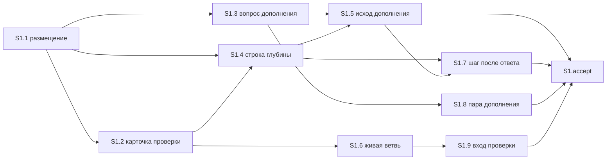

# Quality control — fix-route-from-analysis — 2026-11-05

## Scope

- Mode: slice (`# Срез S1`). Дельта: `changed_slices: S1`. Контроль целиком по текущим `tasks.md`, `design.md`, `proposal.md`, `specs/pipeline-light-route/spec.md`.
- Прошлый `reports/quality-control-2026-10-16-2.md` не использовался как опора. Набор названий сценариев другой: к прежним девяти добавлены четыре сценария живой ветви и следующего шага. Это первый контроль этого набора.
- `reused_checks`: нет. Переиспользованных вердиктов нет.
- `deterministic_results`: оркестратор сверил заголовки сценариев в матрице `design.md` и в приёмке среза. Эта сверка заголовков подтверждена чтением spec и приёмки. Она не заменяет оценку достижимости обязательной приёмки силами задач этого среза; достижимость оценена отдельно (критерий 8b).
- `affected_contract_ids`: EC-1. Правило карточки подтверждено заказчиком, parity совпадает. На состав задач и на приёмку среза не влияет. Отдельной находки нет.
- `linked_scenarios`: все 13 заголовков из spec (список в таблице покрытия).
- Ручной чеклист конфигуратора не найден. Механические замечания шагов 7A–7E не переданы. Предпроверка контракта задач пустая; критерий 11 прогнан по тексту рабочих задач S1.1–S1.9.
- Исполнимость приёмки на информационной базе и наличие тестовых данных не оценивались.
- Конфигурации 1С нет. Слои среза — уже существующие тексты kit. Файлы из задач существуют и непустые: `.cursor/rules/vertical-slices.mdc`, `.cursor/skills/openspec-verify-change/SKILL.md`, `.cursor/skills/openspec-extend-change/SKILL.md`, `.cursor/docs/templates/decision-block.md`, `.cursor/skills/openspec-verify-change/templates/chat-summary.md`, `.cursor/skills/openspec-verify-change/templates/card-decision.md`. `.cursor/docs/templates/brief-card.md` задача явно запрещает менять.

## Verdict

OK

## Slice Summary

| Slice | Scenario | Tasks | Acceptance | Dependencies | Gate |
|---|---|---|---|---|---|
| S1 Маршрут починки с прежним результатом | Починка запроса после первой проверки оставляет проведение, сумму и справку и не спрашивает, куда положить задачи. В связи со spec ещё 12 сценариев того же маршрута | S1.1–S1.9 (9): S1.1–S1.5 закрыты, S1.6–S1.9 открыты | S1.accept (13/13): 1 обязательный + 12 необязательных | нет | `<!-- slice-gate -->` есть, один |

Объём — 10 чекбоксов (9 рабочих + приёмка). Для этого размера по умолчанию один срез. Тринадцать Scenario — один маршрут в чате и его границы, не тринадцать самостоятельных результатов. Второй срез не нужен: живая ветвь, карточка дополнения, вход проверки и следующий шаг после ответа остаются на том же пути и не блокируют закрытие. `design.md` ## Slices совпадает: один срез, отдельный срез на «проводится» не заводится.

## Criteria

| # | Criterion | Result |
|---|---|---|
| 1 | Scenario coverage | PASS — 13/13. У каждого Scenario видимый исход в чате. Отдельный путь «верифицировать по коду» не требуется: все тринадцать закрыты Primary или optional accept. Статические «Проверка:» в рабочих задачах дублируют то же покрытие по тексту правил. |
| 2 | Slice independence | PASS. Следующих срезов нет. Приёмка S1 не ждёт более поздний срез. Циклов нет. |
| 3 | Slice completeness | PASS. Обязательный путь закрывают S1.1–S1.5. Четыре новых границы закрывают S1.6–S1.9 в том же срезе. Метаданных, формы и BSL у заявки нет. |
| 4 | Dependency graph | PASS. Между срезами рёбер нет, объявлено «нет». Внутри среза объявленные зависимости существуют, циклов нет. |
| 5 | Slice gate integrity | PASS. Ровно один `S1.accept` и один маркер `<!-- slice-gate -->`. `S1.T*` и `<!-- phase-gate -->` нет. |
| 5b | Acceptance checklist | PASS. Есть `**Primary acceptance:**` и один sub-bullet `**Primary (обязательно):**`. Текст metadata и обязательного буллета совпадают. Чеклист не пуст. Чужих Scenario нет. Имена двенадцати optional совпадают с `#### Scenario:` буквально. |
| 6 | Rework risk | PASS. Опоры на непринятый предыдущий срез нет. Сценарий не повторён вторым срезом. Общие файлы открытых задач либо упорядочены зависимостью, либо правят разные абзацы. |
| 7 | Task readability | PASS. Нет `task-opaque-title`, `task-too-short`, `task-opaque-acceptance`. |
| 8 | Slice verticality | PASS. Единственный mandatory Primary — чёрный ящик чата: после первой полной проверки, при открытой приёмке и прежней сумме и справке нет карточки «в какой срез», нет приёмки «проводится», следующий шаг — реализация. |
| 8b | Self-achievable acceptance | PASS. Соседнего среза нет. Дубля journey нет. Карточка, приёмка «проводится» и шаг «реализация» собираются задачами S1.1–S1.5. Четыре новые границы закрываются S1.6–S1.9 того же среза и обязательный путь не переносят на более поздний срез. |
| 9 | Foundation slice with gate | PASS. Потребителя S2 с зависимостью от S1 нет. Accept S1 — видимый маршрут в чате, не приёмка «ревью контракта». |
| 10 | Acceptance simplicity | PASS. В `S1.accept` один mandatory journey. Двенадцать остальных буллетов помечены «(опционально)». |
| 11 | User task contract | PASS. В S1.1–S1.9 нет DENY-маркеров и нет цепочки «после проверки / после стенда» как обязанности человека. Рабочие задачи — правки текстов kit. Проход в чате указан в поле приёмки и в `S1.accept`. |

## Scenario Coverage

| Scenario | Covered by | Status |
|---|---|---|
| Починка запроса после первой проверки | S1 Primary, S1.1–S1.5 | OK |
| Уже открытая приёмка из текста ошибки снимается | S1.accept optional, S1.1, S1.2, S1.3 | OK |
| До первой полной проверки строка не срабатывает | S1.accept optional, S1.4 | OK |
| Смена формулы ведёт к проверке | S1.accept optional, S1.2, S1.4, S1.5 | OK |
| Разный момент приёмки оставляют вопросом | S1.accept optional, S1.1, S1.2, S1.3 | OK |
| Два разных результата оставляют вопросом | S1.accept optional, S1.1, S1.2, S1.3 | OK |
| Подписанная приёмка не дописывается | S1.accept optional, S1.1 | OK |
| Ответ внутри выбранного подхода остаётся короткой сверкой | S1.accept optional, S1.4, S1.5 | OK |
| Повторный запуск проверки не становится полным разбором | S1.accept optional, S1.4 | OK |
| Мёртвая ветвь карточки проверки не спрашивается | S1.accept optional, S1.6 | OK |
| Карточка дополнения не предлагает не делать уже названное | S1.accept optional, S1.8 | OK |
| Вход проверки не прячет уже сказанную фразу | S1.accept optional, S1.9 | OK |
| Следующий шаг после ответа берётся из таблицы глубины | S1.accept optional, S1.7, S1.4, S1.5 | OK |

Покрытие Primary для «Починка запроса после первой проверки» — по совпадению пути, не по отдельной строке с именем в ёлочках. WHEN/THEN этого Scenario и `**Primary acceptance:**` описывают один заход: первая полная проверка уже была, приёмка проведения открыта, сумма и справка прежние → нет карточки «в какой срез», нет приёмки «проводится», следующий шаг — реализация. Имя сценария стоит в `**Связь со spec:**`. Текст Primary в metadata и mandatory sub-bullet совпадают дословно. Пропусков нет.

Четыре сценария, которых не было в прошлом наборе имён, закрыты отдельно от Primary и не делают его недостижимым:

- «Мёртвая ветвь карточки проверки не спрашивается» — S1.6 сужает состав карточки в скилле проверки и в `decision-block.md`. Снятие лишней приёмки из текста ошибки этим текстом не заменяется и остаётся до сборки пары (уже записано в S1.1–S1.3).
- «Карточка дополнения не предлагает не делать уже названное» — S1.8 не ставит пару «дописать или не делать», когда команда уже назвала заявку и правило. Общая карточка брифа не переписывается.
- «Вход проверки не прячет уже сказанную фразу» — S1.9 убирает из входа проверки предложения «будто фразы не было» и «отложить в заметки», когда требование сказано в той же команде.
- «Следующий шаг после ответа берётся из таблицы глубины» — S1.7 заменяет зашитый шаг в шаблонах ответа и, если та же фраза есть в скилле проверки, там же. Строка таблицы и имя исхода уже заданы S1.4 и S1.5. Этот заход — ответ на живую пару, не путь без карточки.

## Dependency Graph

Объявленные рёбра между срезами: нет. Циклов нет. Вперёд (приёмка более раннего среза ждёт более поздний) нет. Необъявленных рёбер между срезами нет.

`S1.accept` своей строки «Зависимости:» не имеет. Это закрывающая задача среза после рабочих задач.

Внутри среза:

- S1.1: зависимостей нет. Размещение, снятие уже открытой приёмки из текста ошибки, вопрос при двух разных результатах, признак подписанной приёмки. Закрыта.
- S1.2: S1.1. Карточка «объединить срезы или переписать приёмку» не показывается, когда результат и момент приёмки совпадают. Закрыта.
- S1.3: S1.1. Дополнение не ждёт ответ при той же сумме и том же моменте. Закрыта.
- S1.4: S1.1, S1.2. Строка таблицы глубины. До первой полной проверки и при смене формулы не срабатывает. Ответ внутри выбранного подхода без задач починки не перехватывает. Закрыта.
- S1.5: S1.3, S1.4. Исход «проверка не требуется» называет эту строку; третьего исхода нет. Закрыта.
- S1.6: S1.2. Состав карточки выбора. Открыта.
- S1.7: S1.4, S1.5. Следующий шаг после настоящего ответа читается из таблицы глубины. Открыта.
- S1.8: S1.3. Нумерованная пара дополнения. Открыта.
- S1.9: S1.6. Вход проверки. Открыта.

Общие файлы:

- `.cursor/rules/vertical-slices.mdc`: только S1.1.
- `.cursor/skills/openspec-verify-change/SKILL.md`: S1.2, затем S1.4 (оба закрыты); далее S1.6 и после неё S1.9. S1.7 трогает скилл только если в нём повторяется зашитая фраза следующего шага. Отдельного ребра S1.6 → S1.7 нет: S1.6 меняет состав карточки, S1.7 — фразу следующего шага, S1.9 — вход. Это разные абзацы, цикла нет, приёмка более ранней задачи не ждёт более позднюю.
- `.cursor/skills/openspec-extend-change/SKILL.md`: S1.3, затем S1.5 (оба закрыты); S1.8 правит показ нумерованной пары и исход §7 не меняет.
- `.cursor/docs/templates/decision-block.md`: только S1.6.
- Шаблоны `chat-summary.md` и `card-decision.md`: только S1.7.
- `.cursor/docs/templates/brief-card.md`: S1.8 явно не меняет.

## Verticality, self-achievable, simplicity

S1 Primary — один заход Scenario «Починка запроса после первой проверки». Наблюдается в чате по заявке, у которой первая полная проверка уже была, а приёмка проведения ещё открыта. Три следствия (нет карточки, нет приёмки «проводится», дальше реализация) — один THEN, не три обязательных journey.

Задачи того же среза этот THEN закрывают, без более позднего среза:

- нет карточки «в какой срез» и нет приёмки «проводится», в том числе когда приёмка из текста ошибки уже открыта — S1.1, S1.2, S1.3;
- следующий шаг — реализация, когда строка глубины сработала — S1.4 и строка чата исхода в S1.5.

S1.6–S1.9 этот обязательный заход не подменяют. S1.6 прямо оставляет снятие лишней приёмки до сборки пары. S1.7 прямо оставляет за починкой с прежним результатом шаг реализации; зашитая фраза «снова вся проверка» относится к ответу на живую пару, а это необязательный Scenario «Следующий шаг после ответа берётся из таблицы глубины».

Критерий 9 не срабатывает: второго среза нет, accept не является приёмкой ревью контракта.

Двенадцать optional-буллетов — границы того же маршрута. Они не блокируют `[x]`. Среди них четыре новых имени: мёртвая ветвь не спрашивается; карточка дополнения не предлагает не делать уже названное; вход проверки не прячет уже сказанную фразу; следующий шаг после ответа берётся из таблицы глубины. Ни один из них не помечен обязательным.

## Task readability

| Task | Title | Result |
|---|---|---|
| S1.1 | Сузить в `vertical-slices.mdc` причину нового среза, чтобы починка без вопроса вставала в открытую приёмку (решения 2 и 5) | Файл, изменение и зачем в заголовке. Ссылка на решения — в скобках, заголовок читается без `design.md`. |
| S1.2 | Убрать в скилле проверки вопрос о срезе при той же сумме и том же моменте (решение 3) | Глагол, файл, зачем. |
| S1.3 | Снять в скилле дополнения ожидание ответа перед раскладкой при той же сумме и моменте (решение 3) | Глагол, файл, зачем. |
| S1.4 | Добавить в скилле проверки строку глубины: прежняя формула после первой проверки идёт на реализацию (решение 4) | Глагол, файл, зачем. |
| S1.5 | Дописать в скилле дополнения исход «проверка не требуется» по той же таблице (решение 4) | Глагол, файл, зачем. |
| S1.6 | Сузить в скилле проверки и `decision-block.md` состав карточки, чтобы ветвь, которая не выполняет уже записанную приёмку, не вставала в пару (решение 6) | Глагол, оба файла, зачем. |
| S1.7 | Заменить в шаблонах ответа зашитый следующий шаг, чтобы после настоящего ответа он читался из таблицы глубины (решение 6) | Глагол, оба шаблона, зачем. Та же замена в скилле проверки названа в теле, если фраза там повторяется. |
| S1.8 | Сузить в скилле дополнения показ нумерованной пары, чтобы при уже названных заявке и правиле ветвь «не делать» не ставилась в пару (решение 6) | Глагол, файл, зачем. Запрет менять карточку брифа — в теле. |
| S1.9 | Сузить в скилле проверки вход, чтобы уже сказанная в команде фраза не предлагалась к проверке «будто её не было» и не откладывалась в заметки (решение 6) | Глагол, файл, зачем. |
| S1.accept | Принять срез — починка не спрашивает, куда её положить, и идёт в реализацию | Бизнес-результат одной фразой. Имена optional Scenario буквальные. |

Короче 8 слов нет. Голого идентификатора решения вместо файла нет. Legacy `S1.T*` нет.

## User task contract

Строки `S1.1`–`S1.9` не содержат: тестовая ИБ, стенд, консоль, отладчик, спайк, вызов API, «после стенда», «после проверки» как условие запуска задачи человеком. Фразы «вопрос человеку» и «оставляют вопрос» описывают поведение правила, а не поручение человеку выполнить задачу. Блоки «Проверка:» — сверка текста правила агентом после правки. Приёмка человека — только `S1.accept` и поле `**Приёмка:**` (проход в чате).

EC-1 состав этих задач не меняет.

## Alerts

Нет.

## Recommendations

### Automatic fix

Нет.

### Decision required

Нет. Срез один. Обязательная приёмка достижима задачами этого среза. Обязательный заход один. Четыре новых сценария остаются необязательными границами того же маршрута; отдельный срез из них не следует.

### Remediation (auto-repair)

Нет.
