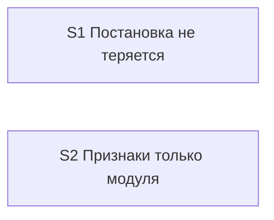
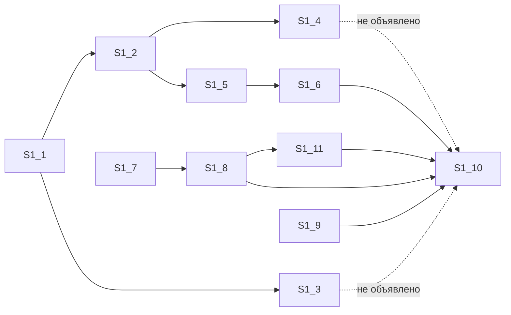

# Quality Control — handoff-empty-explore (повторный, полный)

Дата: 2026-10-23. Режим: срезы (`# Срез S1`, `# Срез S2`). Объём: S1, S2 — полностью с нуля; опоры на `reports/quality-control-2026-10-23.md` нет (прежний текст приёмки первого среза), повторно использованных проверок нет.

Источники: `tasks.md`, `design.md`, `proposal.md`, `specs/kit-protocol-coherence/spec.md`, `specs/split-form-layout-modes/spec.md`; правила `.cursor/rules/vertical-slices.mdc` (раздел «QUALITY CONTROLLER — SLICE COHERENCE», User Task Contract, формат приёмки), `.cursor/rules/task-readability.mdc`.

Вне оценки (по постановке): выполнимость приёмки прямо сейчас, тестовые данные. Приёмка заявки — сообщения в чате на правилах набора, без прогона в базе; это не пробел данных.

## Verdict

`OK`

Блокирующих и предупреждающих находок нет. Три пожелания (SUGGESTION): назвать по имени неизменённые сценарии в задачах сверки, дописать две пропущенные зависимости у задачи сверки первого среза, выровнять нумерацию S1.10 / S1.11.

## Slice Summary

| Slice | Scenario | Tasks | Acceptance | Dependencies | Gate |
|---|---|---|---|---|---|
| S1 «Постановка не теряется» | Создание с именем без блока → короткое подтверждение; после согласия нет пустого разбора; недособранная заявка — тем же именем | S1.1–S1.11 (11 задач, агентские правки и сверки трёх областей двух скиллов) | `S1.accept` (Primary + 6 опциональных; 8/8 сценариев из «Связь со spec» покрыты: 2 через Primary, 6 опционально) | нет | есть |
| S2 «Признаки только модуля» | Вариант «всё в модуле» из решения хода не записывает программную поставку без вопроса | S2.1–S2.4 (4 задачи: правило режима формы, ссылка из цикла форм, сверка) | `S2.accept` (Primary + 2 опциональных; 3/3) | нет | есть |

## Scenario Coverage

### `specs/kit-protocol-coherence/spec.md` — Requirement «Создание заявки читает один источник»

| Scenario | Covered by | Status |
|---|---|---|
| Создание с именем без блока | S1 Primary (первая половина) + S1.1 | OK |
| Подтверждение снимает остановку | S1 Primary (вторая половина «после согласия нет приглашения…») + S1.2, S1.5 | OK |
| В остановке одна команда | S1.accept опционально + S1.6 | OK |
| Недособранная заявка продолжается тем же именем | S1.accept опционально + S1.4, S1.7 | OK |
| Пустой разбор ждёт описание | S1.accept опционально + S1.9 | OK |
| Команда создания только рядом с блоком | S1.accept опционально + S1.11 | OK |
| Готовый блок без повторного подтверждения | S1.accept опционально + S1.1 (путь с блоком не переписывать), S1.3 | OK |
| Баг в открытой заявке | S1.accept опционально + S1.7, S1.8 | OK |
| Поле архитектора | S1.10 (сверка с требованием целиком; явная оговорка «поле архитектора не переписывается»), S1.2 (поле архитектора источник не заполняет) | OK, по имени не назван — SUGGESTION |
| Порядок артефактов | S1.10 (оговорка «порядок артефактов не переписывается») | OK как защита от регресса, по имени не назван — SUGGESTION |
| Нарезка до задач | S1.10 (оговорка «нарезка до задач не переписывается») | OK как защита от регресса, по имени не назван — SUGGESTION |

### `specs/split-form-layout-modes/spec.md` — Requirement «Module-only form records programmatic delivery without a question»

| Scenario | Covered by | Status |
|---|---|---|
| Собственное решение не доказывает только модуль | S2 Primary + S2.1, S2.2 | OK |
| Module-only records programmatic without question | S2.accept опционально + S2.4 («запись программно без вопроса при доказанном «только модуль» сохраняется») | OK |
| Resume does not overwrite recorded mode | S2.accept опционально + S2.2, S2.3 (запрет перезаписи не трогать) | OK |
| Mixed forms sequential | S2.4 (сверка правила и цикла форм с требованием целиком) | OK, по имени не назван — SUGGESTION |
| Informing line is not a selection question | S2.4 (то же) | OK, по имени не назван — SUGGESTION |

Имена сценариев в опциональных строках обеих приёмок совпадают с заголовками `#### Scenario:` буквально. Сценариев чужого среза в приёмках нет.

## Dependency Graph

Между срезами:



Рёбер нет, циклов нет, ссылок вперёд нет. Оба среза принимаются независимо.

Внутри S1 (объявленные зависимости):



Пунктир — необъявленные рёбра: задача сверки S1.10 проверяет формулировки шагов 1–2 скилла создания, а шаг 2 правит S1.4, сводку подтверждений — S1.3. Ни одна из них не входит в зависимости S1.10 ни прямо, ни через цепочку. В порядке файла обе стоят раньше S1.10, поэтому реального риска при последовательном проходе нет.

Внутри S2: S2.1 → S2.2, S2.1 → S2.3, {S2.2, S2.3} → S2.4. Полно, циклов нет.

## Оценка по критериям

| № | Критерий | S1 | S2 |
|---|---|---|---|
| 1 | Покрытие сценариев | OK (3 неизменённых сценария закрыты сверкой S1.10 без имени — SUGGESTION) | OK (2 неизменённых сценария закрыты сверкой S2.4 без имени — SUGGESTION) |
| 2 | Независимость срезов | OK | OK |
| 3 | Полнота среза | OK: подтверждение (S1.1), источник постановки (S1.2), снятие остановки (S1.5), текст остановки (S1.6) — всё для главной проверки внутри среза | OK: источник признаков в правиле (S2.1), класс «неясно» (S2.2), ссылка из цикла форм (S2.3) |
| 4 | Граф зависимостей срезов | OK («нет» объявлено и соответствует задачам) | OK |
| 5 | Целостность границы среза | OK: ровно одна приёмка, маркер конца есть | OK |
| 5b | Покрытие чеклиста приёмки | OK: главная проверка в описании среза и первой строкой приёмки, тексты совпадают | OK |
| 6 | Риск переделки | Низкий: S1 и S2 правят один файл скилла создания, но разные места (шаги 1–2 и остановка против цикла форм); S1.10 явно исключает цикл форм | Низкий |
| 8 | Наблюдаемость приёмки | OK: главная проверка — видимое в чате поведение (подтверждение до описания, нет приглашения к пустому разбору) | OK: видимый вопрос о поставке формы, программная поставка не записана |
| 8b | Достижимость приёмки внутри среза | OK: всё нужное — в задачах S1, ничего из S2 не требуется | OK |
| 9 | Подготовительный срез с отдельной приёмкой | Нет | Нет |
| 10 | Одна обязательная проверка | OK: одна последовательность «создать → подтверждение → после согласия работа идёт», две половины одного пути | OK |
| 11 | Задачи пользователю посередине среза | Нет: все задачи — правки и сверки текста скиллов агентом; запрещённых формулировок нет | Нет |
| — | Читаемость задач | OK: глагол + файл + что меняется + зачем + ссылка на решение / пункт контракта | OK |

## Alerts

### SUGGESTION — `scenario-unnamed-regression-guard` (S1, S2)

- **Где:** S1.10, S2.4; описания срезов «Связь со spec»; матрица приёмки в `design.md`.
- **Факт:** требования изменены целиком, поэтому в изменения входят и неизменённые сценарии: «Поле архитектора», «Порядок артефактов», «Нарезка до задач» (первое требование), «Mixed forms sequential», «Informing line is not a selection question» (второе требование). Они закрыты задачами сверки (S1.10 — оговорка «не переписываются»; S2.4 — сверка правила и цикла форм с требованием целиком), но ни разу не названы по имени. Подготовительная проверка уже отметила это как не блокер.
- **Нюанс по S1.10:** сверка ограничена шагами 1–2 и остановкой до требований, а «Порядок артефактов» живёт ещё в обзоре маршрута и правиле срезов, которых в объёме заявки нет. Задача их не меняет, значит регресса нет. Но сценарий проверяется только на той части, которую заявка трогает.
- **Рекомендация:** дописать в S1.10 и S2.4 имена этих сценариев как сверяемых без правки, по желанию — в «Связь со spec» и в матрицу приёмки `design.md`.

### SUGGESTION — `undeclared-task-dependency` (S1)

- **Где:** S1.10.
- **Факт:** S1.10 сверяет шаги 1–2 скилла создания, но не зависит от S1.3 (сводка подтверждений) и S1.4 (шаг 2, продолжение каталога).
- **Рекомендация:** «Зависимости: S1.3, S1.4, S1.6, S1.8, S1.9, S1.11».

### SUGGESTION — `task-numbering-order` (S1)

- **Где:** S1.11 стоит в файле перед S1.10; S1.10 зависит от S1.11.
- **Факт:** порядок в файле правильный (сначала S1.11, потом сверка), номера идут не по порядку. При ссылках «после S1.10» в apply возможна путаница.
- **Рекомендация:** поменять номера местами (сверку сделать S1.11, ограничение команды создания — S1.10) и поправить ссылки в зависимостях. Отмеченных задач нет, перенумерация безопасна.

## Recommendations

### Автоматическая правка (структуру заявки не меняет)

```markdown
### Remediation (auto-repair)
- alert: scenario-unnamed-regression-guard
- target: tasks.md, срез S1 (S1.10) и срез S2 (S2.4)
- action: в S1.10 после «порядок артефактов, поле архитектора и нарезка до задач не переписываются» дописать «(Scenario «Поле архитектора», Scenario «Порядок артефактов», Scenario «Нарезка до задач» — сверка без правки)»; в S2.4 дописать «Scenario «Mixed forms sequential», Scenario «Informing line is not a selection question» сверяются без правки». По желанию — те же имена в «Связь со spec» срезов и строки «(сверка S1.10 / S2.4)» в матрице приёмки design.md.
```

```markdown
### Remediation (auto-repair)
- alert: undeclared-task-dependency
- target: tasks.md, срез S1 (S1.10)
- action: заменить «Зависимости: S1.6, S1.8, S1.9, S1.11» на «Зависимости: S1.3, S1.4, S1.6, S1.8, S1.9, S1.11».
```

```markdown
### Remediation (auto-repair)
- alert: task-numbering-order
- target: tasks.md, срез S1
- action: перенумеровать S1.11 → S1.10 и S1.10 → S1.11, сохранив порядок строк; в зависимостях сверки заменить ссылку на ограничение команды создания новым номером.
```

### Нужен выбор заказчика

Нет.

## Reused scope vs new findings

- Reused: нет (повторно использованных проверок нет, прежний контроль за основу не взят).
- New: весь объём S1 и S2; три SUGGESTION выше.
