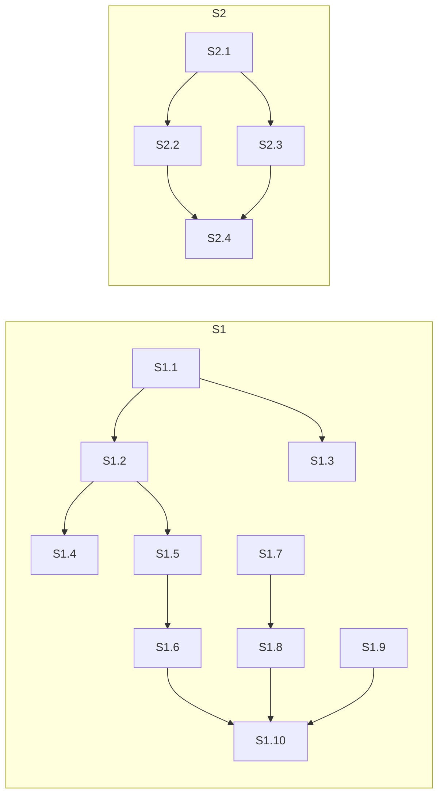

# Quality Control — handoff-empty-explore — 2026-10-23

Режим: slice mode (`# Срез S1`, `# Срез S2`). Delta: cache miss → полный контроль всего плана. Reused checks: нет.

## Verdict

`CRITICAL`

Единственный CRITICAL — `acceptance-simplicity-overload` в S1 (обязательная приёмка склеивает два разных пути). Исправляется автоматически переносом третьей части Primary в опциональный пункт; scope и spec не меняются.

## Slice Summary

| Slice | Scenario | Tasks | Acceptance | Dependencies | Gate |
|---|---|---|---|---|---|
| S1 «Постановка не теряется» | 7 Scenario из `kit-protocol-coherence` (Requirement «Создание заявки читает один источник») | S1.1–S1.10 | `S1.accept` (Primary + 4 опциональных; 7/7 заявленных покрыты через Primary, optional или `S1.<M>`) | нет | есть |
| S2 «Признаки только модуля» | 3 Scenario из `split-form-layout-modes` | S2.1–S2.4 | `S2.accept` (Primary + 2 опциональных; 3/3) | нет | есть |

## Scenario Coverage

| Scenario | Covered by | Status |
|---|---|---|
| Создание с именем без блока | S1 Primary, S1.1 | OK |
| Подтверждение снимает остановку | S1 Primary (часть «после согласия нет приглашения…»), S1.5 | OK |
| В остановке одна команда | S1.accept (optional), S1.6 | OK |
| Недособранная заявка продолжается тем же именем | S1 Primary (третья часть), S1.4, S1.7 | OK (см. алерт 1) |
| Пустой разбор ждёт описание | S1.accept (optional), S1.9 | OK |
| Готовый блок без повторного подтверждения | S1.accept (optional), S1.1 | OK |
| Баг в открытой заявке | S1.accept (optional), S1.7 | OK |
| Поле архитектора | неявно S1.10 (сверка со всем Requirement; «поле архитектора не переписывать») | OK-implicit (см. алерт 4) |
| Порядок артефактов | неявно S1.10 («порядок артефактов не переписывать») | OK-implicit (см. алерт 4) |
| Нарезка до задач | неявно S1.10 (сверка со всем Requirement), по имени не назван | OK-implicit (см. алерт 4) |
| Собственное решение не доказывает только модуль | S2 Primary, S2.1, S2.2 | OK |
| Module-only records programmatic without question | S2.accept (optional), S2.4 | OK |
| Resume does not overwrite recorded mode | S2.accept (optional), S2.3 | OK |
| Mixed forms sequential | неявно S2.4 (сверка со всем Requirement) | OK-implicit (см. алерт 4) |
| Informing line is not a selection question | неявно S2.4 (сверка со всем Requirement) | OK-implicit (см. алерт 4) |

Примечание: три Scenario `kit-protocol-coherence` и два Scenario `split-form-layout-modes` — прежние сценарии MODIFIED Requirement, которые этой заявкой не меняются. Покрыты задачами сверки S1.10 / S2.4, но по имени не названы.

## Dependency Graph

Циклов нет. Forward-зависимостей между срезами нет; S1 и S2 объявлены независимыми, что соответствует задачам. Необъявленная связь: S1 (S1.1–S1.6, S1.10) и S2 (S2.3, S2.4) правят один файл `.cursor/skills/openspec-new-change/SKILL.md` в разных шагах (шаг 1/2 и цикл форм) — функциональной зависимости нет, только риск конфликта правки (алерт 3).

## Criteria walk-through

| # | Критерий | S1 | S2 |
|---|---|---|---|
| 1 | Scenario Coverage | OK (3 Scenario неявно) | OK (2 Scenario неявно) |
| 2 | Slice Independence | OK | OK |
| 3 | Slice Completeness | OK — оба файла (`openspec-new-change`, `openspec-explore`) в задачах | OK — правило режима формы + ссылка из скилла |
| 4 | Dependency Graph | OK | OK |
| 5 | Slice Gate Integrity | OK — один `S1.accept`, маркер есть | OK — один `S2.accept`, маркер есть |
| 5b | Acceptance Checklist Coverage | OK — Primary в metadata и первым пунктом; foreign Scenario нет | OK |
| 6 | Rework Risk | SUGGESTION (общий файл с S2; расхождение матрицы design) | SUGGESTION (общий файл с S1) |
| 8 | Slice Verticality | OK — Primary наблюдаем в чате (подтверждение, отсутствие приглашения, следующий шаг) | OK — Primary наблюдаем (вопрос задан, поставка не записана) |
| 8b | Self-Achievable Acceptance | OK — все слои Primary в задачах S1 | OK |
| 9 | Foundation slice with gate | N/A — нет foundation-среза | N/A |
| 10 | Acceptance Simplicity | **CRITICAL** (алерт 1) | OK — один journey |
| 11 | User Task Contract | OK — DENY-подстрок нет; «Сверить» = агентская статическая сверка правил | OK |
| 7 | Task Readability | OK | OK |

## Alerts

### 1. `acceptance-simplicity-overload` — CRITICAL — S1 / `S1.accept`

**Evidence:** обязательный Primary (`tasks.md`, metadata S1 и первый пункт `S1.accept`) содержит два разных пользовательских пути с разными стартовыми состояниями:
- путь A — «Создать заявку с именем без блока постановки → до записи описания видно короткое подтверждение; после согласия нет приглашения начать разбор без задачи»;
- путь B — «если описание уже есть, а требований нет, следующий шаг продолжает ту же заявку» — другой старт (уже существующий недособранный каталог), другое действие (повтор создания / финал разбора, S1.4 + S1.7), соответствует отдельному Scenario «Недособранная заявка продолжается тем же именем».

Критерий 10 запрещает больше одного обязательного black-box journey в приёмке. Путь B к тому же требует подготовленного недособранного каталога, т.е. отдельной постановки сцены.

**Recommendation:** оставить Primary S1 на пути A; путь B перенести в опциональный пункт `Scenario «Недособранная заявка продолжается тем же именем» (опционально)`. Покрытие Scenario сохраняется (S1.4, S1.7 + optional bullet).

### Remediation (auto-repair)
- alert: `acceptance-simplicity-overload`
- target: `openspec/changes/handoff-empty-explore/tasks.md`, срез S1 (поле `**Primary acceptance:**` и первый пункт `S1.accept`); `design.md` § Slices (строка S1, колонка Primary acceptance) и § «Primary acceptance» (пункт S1)
- action: в обоих местах `tasks.md` укоротить Primary до «Создать заявку с именем без блока постановки → до записи описания видно короткое подтверждение; после согласия нет приглашения начать разбор без задачи». В `S1.accept` добавить опциональный пункт: «Scenario «Недособранная заявка продолжается тем же именем» (опционально): у заявки есть описание, а требований нет — следующий шаг продолжает её тем же именем, вторая заявка не создаётся, разработчик и режим формы не переспрашиваются.» В `design.md` синхронно убрать третью часть из Primary S1 и в матрице приёмки пометить этот Scenario как `(optional)`. Slice-gate маркер S1 при необходимости сократить до первой части.

### 2. `design-acceptance-matrix-mismatch` — WARNING — S1 (rework risk, критерий 6)

**Evidence:** `design.md` § «Матрица приёмки» помечает как `Primary` для S1 пять Scenario: «Создание с именем без блока», «Подтверждение снимает остановку», «В остановке одна команда», «Недособранная заявка продолжается тем же именем», «Пустой разбор ждёт описание». В `tasks.md` «В остановке одна команда» и «Пустой разбор ждёт описание» — опциональные пункты `S1.accept`. Матрица design противоречит принятой в tasks модели «один обязательный Primary» и при следующем `/opsx:extend` или архитекторском проходе может вернуть их в обязательные.

**Recommendation:** привести матрицу в `design.md` к tasks: Primary — только «Создание с именем без блока» и «Подтверждение снимает остановку» (одна сквозная проверка), остальные — `(optional)`.

### Remediation (auto-repair)
- alert: `design-acceptance-matrix-mismatch`
- target: `openspec/changes/handoff-empty-explore/design.md`, § «Матрица приёмки», колонка S1
- action: заменить `Primary` на `(optional)` для строк «В остановке одна команда», «Недособранная заявка продолжается тем же именем», «Пустой разбор ждёт описание»; строку «Баг в открытой заявке с требованиями» переименовать буквально в «Баг в открытой заявке» (как заголовок Scenario в spec).

### 3. `shared-file-overlap` — SUGGESTION — S1 ↔ S2 (rework risk, критерий 6)

**Evidence:** S1.1–S1.6, S1.10 и S2.3, S2.4 правят `.cursor/skills/openspec-new-change/SKILL.md` (шаги 1–2 и шаг цикла форм соответственно). Зависимость между срезами не объявлена и функционально не нужна, но S1.10 сверяет весь файл, а S2.4 сверяет цикл форм того же файла.

**Recommendation:** зависимость не добавлять. В S1.10 уточнить, что сверка касается шагов 1–2 и остановки до требований (цикл форм — в S2.4), чтобы при приёмке S1 до S2 не было повторной сверки чужой области.

### 4. `implicit-scenario-coverage` — SUGGESTION — S1.10, S2.4 (критерий 1 / 5b)

**Evidence:** Scenario «Поле архитектора», «Порядок артефактов», «Нарезка до задач» (`kit-protocol-coherence`) и «Mixed forms sequential», «Informing line is not a selection question» (`split-form-layout-modes`) входят в MODIFIED Requirement, но не перечислены в `**Связь со spec:**` срезов и не названы в задачах. Покрыты неявно задачами сверки S1.10 / S2.4 со всем требованием; «Нарезка до задач» в S1.10 не упомянута даже косвенно. Формально `accept-bullets-missing-scenario` не срабатывает (покрытие через `S<N>.<M>` допустимо), но покрытие держится на трактовке «сверка со всем требованием».

**Recommendation:** в S1.10 дописать, что сверка включает неизменные Scenario «Поле архитектора», «Порядок артефактов», «Нарезка до задач»; в S2.4 — «Mixed forms sequential», «Informing line is not a selection question». Добавлять их в `S<N>.accept` не нужно.

## Task Readability

Все задачи `S<N>.<M>` следуют шаблону «глагол + файл + что меняем + зачем + (опорная ссылка)»: глаголы «Добавить», «Записать», «Поправить», «Дописать», «Сузить», «Заменить», «Развести», «Привести», «Сверить», «Поставить»; путь к файлу в каждой; ссылки на Decision / Behavior Contract в скобках. Задачи сверки (S1.9, S1.10, S2.4) имеют предмет и правило исхода («правка только при расхождении», «правится в скилле, не в требовании»). Заголовки `S1.accept` / `S2.accept` — формат «Принять срез S<N> «<имя>» — <бизнес-результат>:», имена Scenario в ёлочках совпадают с заголовками spec буквально. Алертов `task-opaque-title` / `task-too-short` нет.

## Recommendations

**Automatic fix (без решения заказчика):**
1. `acceptance-simplicity-overload` (S1) — укоротить Primary до пути A, путь B — опциональный пункт; синхронизировать `design.md`.
2. `design-acceptance-matrix-mismatch` (S1) — привести матрицу приёмки design к tasks; выровнять имя Scenario «Баг в открытой заявке».
3. `implicit-scenario-coverage` — назвать неизменные Scenario в S1.10 / S2.4.
4. `shared-file-overlap` — уточнить область сверки S1.10.

**Decision required:** нет. Слияние срезов не требуется, scope и spec не меняются.

## Reused scope vs new findings

- Reused: нет (cache miss).
- New findings: алерты 1–4 на полном плане.
