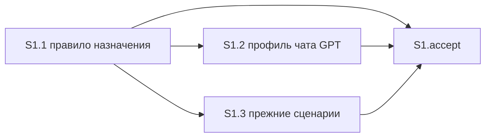

# Quality control — slice-check-opus — 2026-10-19

## Scope

- Mode: slice (`# Срез S1`). Кэш промах, `changed_slices: all`. Оценён весь текущий план, срез S1 и сценарии дельты.
- `reused_checks`: нет. Переиспользованных вердиктов нет.
- `deterministic_results`: один срез, межсрезовых рёбер нет, один `S1.accept`, один mandatory Primary, остальные буллеты помечены «опционально». Сверено чтением `tasks.md`, не взято как готовый вердикт.
- `linked_scenarios`: «Сверка одного среза на модели чата», «Сверка нескольких срезов на Opus 5», «В списке нет Opus 5 для сверки срезов», «Слаг таблицы отсутствует в enum сборки». Восемь имён в S1.3 — свидетельство покрытия прежних сценариев, вердикт по ним вынесен ниже.
- `affected_contract_ids`: нет.
- Новые находки: полный прогон ниже. Алертов нет.
- Ручной чеклист конфигуратора: нет. Механические замечания чекбоксов, пустых буллетов, phase-gate и формы: нет. Предпроверка контракта задач пустая; критерий 11 прогнан по тексту S1.1–S1.3.
- Исполнимость приёмки на информационной базе и тестовые данные не оценивались. Конфигурации 1С нет: это kit. Наблюдаемый результат — текст правила назначения.

Источники: `tasks.md`, `design.md` § Slices, `proposal.md`, `specs/subagent-model-mapping/spec.md` (2 требования, 12 `#### Scenario:`).

`no-slices` не выпускается. `deprecated-phase-gate` не выпускается: маркера фаз нет. `legacy-acceptance-format` неприменим: `S1.T*` нет.

## Verdict

OK

## Slice Summary

| Slice | Scenario | Tasks | Acceptance | Dependencies | Gate |
|---|---|---|---|---|---|
| S1 Проверка нескольких срезов на Opus 5 | В заявке несколько срезов, проверка плана идёт на старшей модели Opus 5, даже если в этот запуск попал один срез | S1.1–S1.3 (3) | S1.accept (1 primary + 3 optional; связь со spec 4/4, весь delta spec 12/12) | нет | `<!-- slice-gate -->` есть, один |

Объём — 4 чекбокса (3 рабочие + приёмка). Для этого размера по умолчанию один срез. Второй срез не нужен: строка роли, раздел старшинства, самосверка, цепочка вызова и фраза профиля чата читаются вместе и дают один видимый текст назначения. `design.md` ## Slices совпадает: один срез, файлы `.cursor/rules/model-selection.mdc` и `.cursor/rules/model-gpt56.mdc`, зависимости нет.

Метаданные среза и `**Primary (обязательно):**` совпадают с `design.md` § Slices.

## Criteria

| # | Criterion | Result |
|---|---|---|
| 1 | Scenario coverage | PASS — 12/12. Четыре сценария связи закрыты Primary и/или optional и S1.1. Восемь прежних сценариев закрыты статической сверкой S1.3 по тексту правила. Отдельного пользовательского прогона на информационной базе нет. |
| 2 | Slice independence | PASS. Следующих срезов нет. Приёмка S1 не ждёт более поздний срез. Циклов нет. |
| 3 | Slice completeness | PASS. Для Primary нужен текст правила назначения: это S1.1. Фраза профиля, которую называет маркер конца среза, — S1.2. Сохранение восьми прежних сценариев — S1.3. Метаданных, формы и BSL у заявки нет. |
| 4 | Dependency graph | PASS. Между срезами рёбер нет, объявлено «нет». Внутри среза S1.2 и S1.3 зависят от S1.1; эти задачи существуют, циклов нет. |
| 5 | Slice gate integrity | PASS. Ровно один `S1.accept` и один маркер `<!-- slice-gate -->`. |
| 5b | Acceptance checklist | PASS. Есть `**Primary acceptance:**` и один sub-bullet `**Primary (обязательно):**`. Чеклист не пуст. Чужих Scenario нет. Имена трёх optional совпадают с `#### Scenario:` буквально. |
| 6 | Rework risk | PASS. Опоры на непринятый предыдущий срез нет. Сценарий не повторён вторым срезом. S1.1 и S1.3 правят и сверяют один файл в объявленном порядке: пять мест, затем нетронутый текст. |
| 7 | Task readability | PASS. Нет `task-opaque-title`, `task-too-short`, `task-opaque-acceptance`. |
| 8 | Slice verticality | PASS. Единственный mandatory Primary — чтение правила назначения: заявка из нескольких срезов описана старшей моделью семейства Opus, мажор 5, заявка из одного среза — без отдельной модели. Это текст правила, не вызов функции и не просмотр типа. |
| 8b | Self-achievable acceptance | PASS. Соседнего среза нет. Дубля journey нет. Текст Primary собирает S1.1. |
| 9 | Foundation slice with gate | PASS. Потребителя S2 с зависимостью от S1 нет. Accept S1 — видимый текст назначения, не отдельная приёмка заготовки. |
| 10 | Acceptance simplicity | PASS. В `S1.accept` один mandatory journey: открыть правило и прочитать обе ветки одной строки роли. Три остальных буллета помечены «(опционально)». |
| 11 | User task contract | PASS. В S1.1–S1.3 нет поручения человеку на информационную базу, стенд, консоль, отладчик, спайк или вызов API и нет цепочки «после verify / после стенда». Рабочие задачи — правки и сверка текстов kit. |

## Scenario Coverage

| Scenario | Covered by | Status |
|---|---|---|
| Сверка одного среза на модели чата | S1 Primary (ветка «один срез — без отдельной модели»), S1.1 | OK |
| Сверка нескольких срезов на Opus 5 | S1 Primary, S1.accept optional, S1.1 | OK |
| В списке нет Opus 5 для сверки срезов | S1.accept optional, S1.1 | OK |
| Слаг таблицы отсутствует в enum сборки | S1.accept optional, S1.1 | OK |
| Вызов архитектора без ошибки enum | S1.3 | OK |
| Команда на Grok 4 без смены чата | S1.3 | OK |
| Рантайм свободен от мёртвых слагов | S1.3 | OK |
| Ревью кода на модели Gemini из списка | S1.3 | OK |
| В списке нет семейства Gemini | S1.3 | OK |
| Готовность задач на модели чата | S1.3 | OK |
| Готовность при неизвестном перехвате или вызове платформы | S1.3 | OK |
| Сбой единственного вызова готовности задач | S1.3 | OK |

Покрытие «Сверка одного среза на модели чата» — по совпадению пути в Primary и по буквальному имени в критерии S1.1. Отдельной строки с ёлочками в `S1.accept` нет. WHEN/THEN этого Scenario и вторая ветка `**Primary acceptance:**` описывают одно: в заявке один срез → вызов без отдельной модели. Имя стоит в `**Связь со spec:**`. Пропусков нет.

Восемь сценариев S1.3 правка не меняет. Задача велит сверить по тексту, что они по-прежнему читаются из мест вне пяти правок D4. Это статическая проверка агентом, покрытие по правилу 6.

## Dependency Graph

Объявленные рёбра между срезами: нет. Циклов нет. Вперёд (приёмка более раннего среза ждёт более поздний) нет. Необъявленных рёбер между срезами нет.

Внутри среза:

- S1.1: зависимостей нет. Пять мест в `.cursor/rules/model-selection.mdc`.
- S1.2: S1.1. Другой файл, `.cursor/rules/model-gpt56.mdc`: снять фразу про Primary и записать, что правило назначения этот профиль не назначает.
- S1.3: S1.1. Тот же файл, что у S1.1: места вне пяти правок не менять и сверить восемь прежних сценариев по тексту.

## Verticality, self-achievable, simplicity

S1 Primary — один заход: открыть правило назначения и увидеть обе ветки строки роли. Ветка «несколько срезов → старшая модель семейства Opus, мажор 5» и ветка «один срез → без отдельной модели» лежат в одной строке и читаются одним открытием файла. Это один THEN, не два обязательных запуска.

Задача того же среза этот THEN закрывает: S1.1 переписывает строку роли, абзац под таблицей, строку «Контроль нескольких срезов», самосверку и пункт цепочки. S1.2 закрывает фразу профиля, которую называет маркер конца среза; для обязательного Primary она не нужна. S1.3 стережёт текст, который пять правок не должны задеть. Более позднего среза, у которого лежал бы этот результат, нет.

Критерий 9 не срабатывает: второго среза нет, accept описывает текст назначения.

Три optional-буллета — границы той же строки: пустой отбор Opus 5, полный текст сценария нескольких срезов (включая «даже если в этот запуск попал один срез» и отсутствие строки модели в чат), пустой отбор в самосверке. Они не блокируют `[x]`.

## Task readability

| Task | Title | Result |
|---|---|---|
| S1.1 | В `.cursor/rules/model-selection.mdc`: перевести проверку заявки из нескольких срезов на старшую модель семейства Opus, мажор 5, без подстановки другого семейства при пустом отборе (D1, D2, D4) | Файл, изменение и зачем в заголовке. Пять мест расписаны в теле, заголовок читается без `design.md`. Ссылка на решения — в скобках. |
| S1.2 | В `.cursor/rules/model-gpt56.mdc`: снять мёртвую фразу про Primary семейства и записать, что ни одна роль этот профиль не назначает (D3) | Глагол, файл, зачем. |
| S1.3 | В `.cursor/rules/model-selection.mdc` сверить по тексту, что места вне пяти правок по-прежнему закрывают прежние сценарии, и эти места не менять (D4) | Файл, сверка и зачем. Восемь имён сценариев в теле буквальные. |
| S1.accept | Принять срез S1 «Проверка нескольких срезов на Opus 5» — проверка плана заявки из нескольких срезов описана старшей моделью Opus 5, заявка из одного среза идёт на модели чата | Бизнес-результат одной фразой. Имена трёх optional Scenario буквальные. |

Короче 8 слов нет. Голого идентификатора решения вместо файла нет. Legacy `S1.T*` нет.

## User task contract

Строки `S1.1`–`S1.3` не содержат: тестовая ИБ, стенд, консоль, отладчик, спайк, вызов API, «после стенда», «после verify S». Упоминание строки модели в чате в S1.1 — текст, который правило должно содержать, не поручение человеку прогнать вызов. Сверка S1.3 — чтение правила агентом. Приёмка человека — `S1.accept` и поле `**Приёмка:**` (чтение правила назначения и профиля чата).

## Alerts

Нет.

## Recommendations

### Automatic fix

Нет.

### Decision required

Нет. Срез один, Primary достижим его задачами, обязательный заход один.

### Remediation (auto-repair)

Нет.
